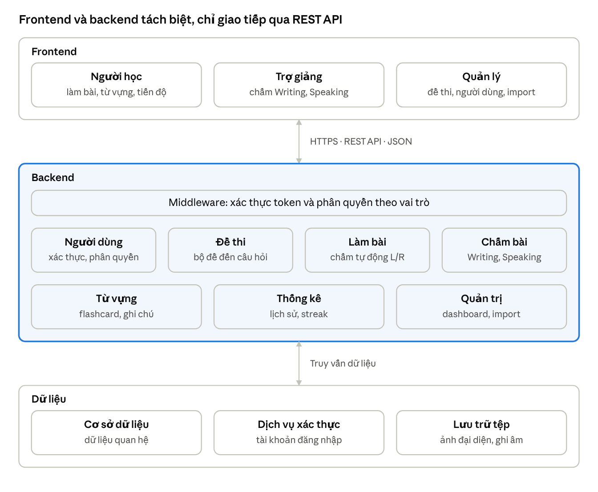

# Kiến trúc hệ thống

> Nguồn: Chương 3 §3.1 (Chương 3 - bản team 10-11 (đã đồng bộ).docx). Giữ nguyên câu chữ báo cáo; sửa ở đây thì cập nhật lại bản Word.

## 3.1. Kiến trúc hệ thống

Hệ thống sử dụng kiến trúc client–server, tách biệt giao diện người dùng với phần xử lý nghiệp vụ. Về mặt logic, hệ thống được tổ chức thành ba tầng: giao diện người dùng (frontend), phần xử lý nghiệp vụ (backend) và cơ sở dữ liệu. Backend được xây dựng theo hướng nguyên khối có phân chia module, trong đó các module nghiệp vụ được tổ chức độc lập tương đối nhưng cùng triển khai trong một ứng dụng backend.

Việc chọn kiến trúc này xuất phát từ ba lý do:

- Đơn giản trong triển khai và vận hành: chỉ có một ứng dụng backend và một cơ sở dữ liệu, phù hợp với phạm vi và thời gian của đồ án.
- Tách biệt frontend và backend giúp hai thành viên phát triển song song, thống nhất với nhau qua hợp đồng API.

- Module hóa theo chức năng hỗ trợ khả năng mở rộng và bảo trì, đồng thời tạo điều kiện tái cấu trúc hoặc tách một số module thành dịch vụ riêng khi có nhu cầu và đáp ứng các điều kiện kỹ thuật cần thiết.

*Hình 3.1. Kiến trúc tổng thể của hệ thống*

**Bảng 3.1. Các tầng của hệ thống**

| Tầng | Thành phần | Trách nhiệm |
|---|---|---|
| Trình bày (client) | Ứng dụng web chạy trên trình duyệt | Hiển thị giao diện cho Khách và ba vai trò Người học, Giáo viên, Quản lý Giao diện làm bài có đồng hồ đếm ngược, ghi âm và phát lại âm thanh, chế độ sáng/tối Gọi REST API |
| Ứng dụng (server) | Máy chủ ứng dụng cung cấp REST API | Xác thực và phân quyền theo vai trò; xử lý nghiệp vụ Chấm tự động Listening/Reading, quản lý hàng đợi chấm Writing/Speaking Nhập dữ liệu hàng loạt và kiểm tra hợp lệ |
| Dữ liệu | Cơ sở dữ liệu quan hệ, dịch vụ xác thực, kho lưu trữ tệp | Lưu dữ liệu quan hệ (người dùng, đề thi, bài làm, từ vựng) Quản lý tài khoản đăng nhập Lưu tệp ảnh đại diện và bản ghi âm |

Dịch vụ xác thực hỗ trợ quản lý thông tin đăng nhập và phiên truy cập. Backend kiểm tra thông tin xác thực và thực hiện phân quyền trước khi xử lý các yêu cầu nghiệp vụ.
