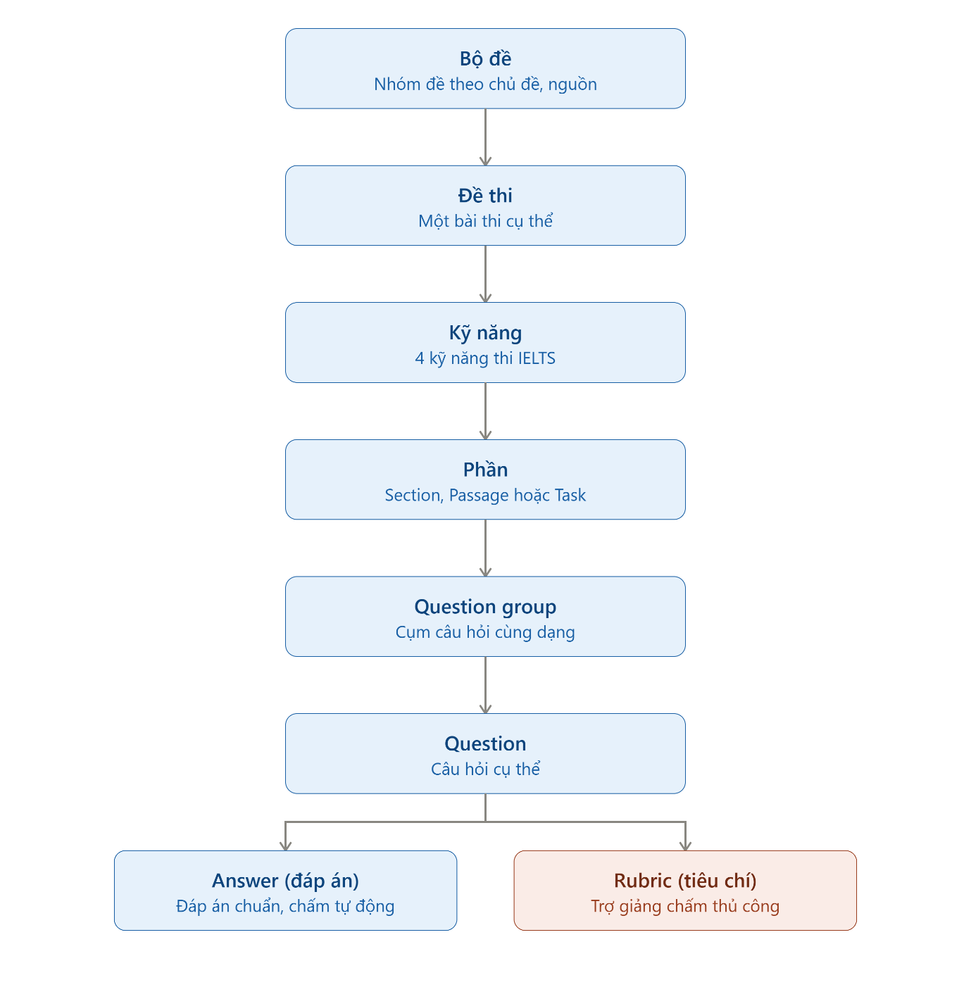

# Hệ thống đề xuất

> Nguồn: Chương 1 §1.2.3 (Chương 1 - Phân tích yêu cầu nghiệp vụ (sửa 20-10 lần 2).docx). Giữ nguyên câu chữ báo cáo; sửa ở đây thì cập nhật lại bản Word.

## 1.2.3. Hệ thống đề xuất

Từ những hạn chế nêu trên, nhóm đề xuất xây dựng một nền tảng học tập và ôn luyện IELTS có ba nhóm người sử dụng: **Người học, Giáo viên và Quản lý (cùng Khách là người truy cập chưa đăng nhập).**

Kiến trúc nghiệp vụ trung tâm của hệ thống được tổ chức như sau:

**Bộ đề → Đề thi → Kỹ năng → Phần → Cụm câu hỏi → Câu hỏi → Đáp án/Tiêu chí**

Trong đó:

- **Bộ đề** là tập hợp nhiều đề thi có cùng nguồn, chủ đề hoặc mục đích sử dụng.
- **Đề thi** là một bài thi cụ thể, có thể gồm một hoặc nhiều kỹ năng.
- **Kỹ năng** gồm Listening, Reading, Writing và Speaking.
- **Phần** là đơn vị nội dung của kỹ năng: Section (Listening) / Passage (Reading) / Task (Writing) / Part (Speaking)
- **Question Group** đại diện cho một cụm câu hỏi cùng dạng và cùng phần chỉ dẫn.
- **Question** là câu hỏi cụ thể.
- **Answer** (đáp án chuẩn): dùng cho Listening/Reading, phục vụ chấm tự động.
- **Rubric** (tiêu chí + thang điểm): dùng cho Writing/Speaking, phục vụ Giáo viên chấm tay.

Điểm khác biệt chính của hệ thống đề xuất là:

- Người dùng có thể làm từng kỹ năng độc lập, không bắt buộc hoàn thành toàn bộ đề.
- Listening và Reading được chấm tự động bằng đáp án mẫu.
- Writing và Speaking được chuyển sang quy trình Giáo viên chấm bài khi Người học chủ động gửi yêu cầu.
- Người học có thể luyện trực tiếp theo dạng câu hỏi.
- Cấu trúc dữ liệu cho phép mở rộng thêm tài liệu, bài tập, bài viết mẫu, dàn ý, từ vựng và mạch ý tưởng.
- Hệ thống bài kiểm tra được quản lý và tạo bởi Quản lý
- Theo dõi tiến trình học tập thông qua lịch sử làm bài và thống kê trực quan.
- Giao diện thân thiện, hỗ trợ tùy biến (chế độ sáng/tối) để tăng trải nghiệm sử dụng lâu dài.

Nhờ đó, hệ thống đề xuất hướng đến việc trở thành một điểm chạm duy nhất (one-stop platform) cho hành trình tự học IELTS, thay vì người dùng phải phân mảnh việc học trên nhiều công cụ khác nhau như hiện trạng phổ biến.
