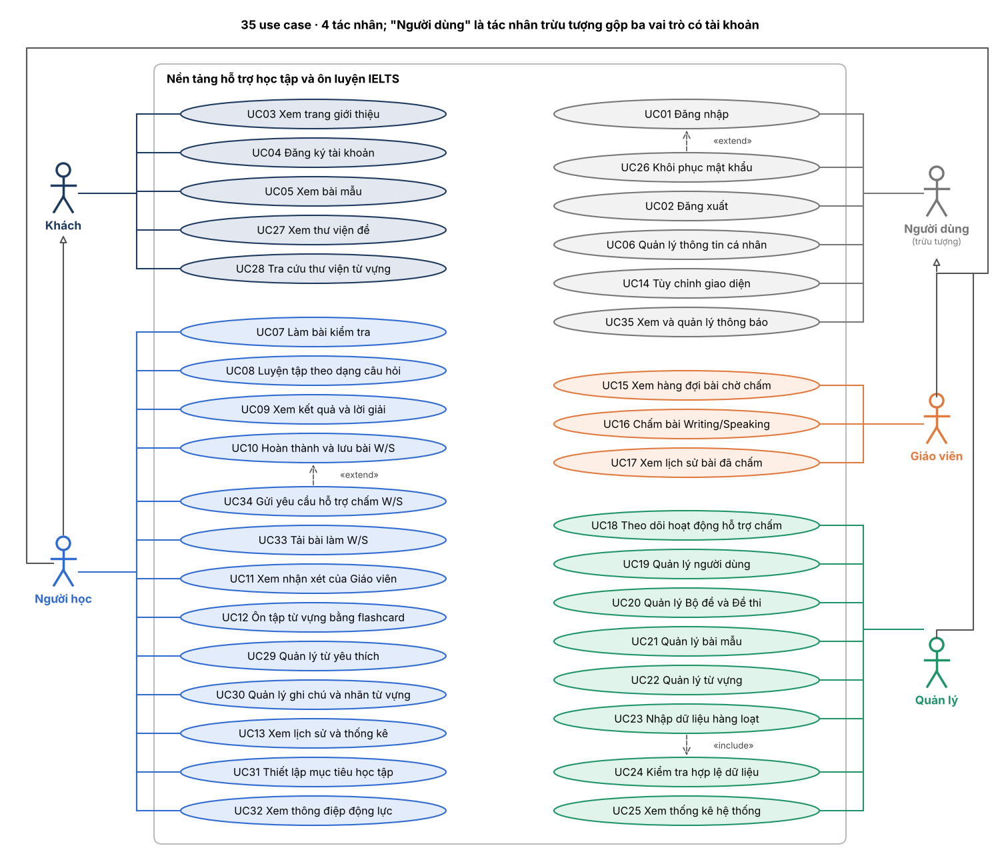

# Use case

> Nguồn: Chương 3 §3.6.1, §3.6.2 (Chương 3 - bản team 10-11 (đã đồng bộ).docx). Giữ nguyên câu chữ báo cáo; sửa ở đây thì cập nhật lại bản Word.

Mỗi use case có một tệp riêng `UCxx-ten.md` trong thư mục này, gồm bảng đặc tả, sơ đồ hoạt động và sơ đồ tuần tự.

## 3.6.1. Sơ đồ use case tổng quan

Hệ thống có bốn tác nhân: ba vai trò đã nêu ở Chương 1 và Khách chưa đăng nhập, cùng 35 use case ở mức tổng quan. Mỗi nhóm use case sẽ được đặc tả chi tiết ở các mục tiếp theo.

**Bảng 3.4. Các tác nhân của hệ thống**

| Tác nhân | Mô tả | Nhóm chức năng chính |
|---|---|---|
| Khách (Guest) | Người truy cập chưa đăng nhập; muốn làm bài phải đăng ký và đăng nhập | Xem Landing Page, đăng ký tài khoản, xem kho bài mẫu Không được làm đề hay nộp bài Xem được thư viện đề, bộ từ vựng hiện có |
| Người học (User) | Học sinh, sinh viên, người đi làm tự ôn luyện IELTS, đã có tài khoản; kế thừa các chức năng của Khách | Làm bài và luyện tập, xem kết quả, nộp bài Writing/Speaking, học từ vựng, xem lịch sử và tiến độ |
| Giáo viên (Assistant) | Người chấm bài Writing/Speaking, tài khoản do Quản lý cấp | Chấm bài theo hàng đợi, xem lịch sử chấm |
| Quản lý (Admin) | Người quản trị nội dung và người dùng của hệ thống | Quản lý tài khoản, Bộ đề, Đề thi, bài mẫu và từ vựng; nhập dữ liệu hàng loạt; xem thống kê toàn hệ thống. Giám sát hỗ trợ chấm và quản lý năng lực tiếp nhận. |

*Hình 3.2. Sơ đồ use case tổng quan của hệ thống*

**Bảng 3.5. Danh sách use case tổng quan**

| Mã | Use case | Tác nhân | Mô tả ngắn |
|---|---|---|---|
| [UC01](UC01-dang-nhap.md) | Đăng nhập | Người học, Giáo viên, Quản lý | Xác thực tài khoản và chuyển đến khu vực làm việc theo vai trò |
| [UC02](UC02-dang-xuat.md) | Đăng xuất | Người học, Giáo viên, Quản lý | Kết thúc phiên đăng nhập hiện tại, xóa thông tin phiên lưu tại trình duyệt và chuyển về trang công khai |
| [UC03](UC03-xem-trang-gioi-thieu.md) | Xem trang giới thiệu | Khách | Xem tổng quan nền tảng, các kỹ năng luyện thi và lời kêu gọi đăng ký/đăng nhập |
| [UC04](UC04-dang-ky-tai-khoan.md) | Đăng ký tài khoản | Khách | Tạo tài khoản mới từ Landing Page để trở thành Người học |
| [UC05](UC05-xem-bai-mau.md) | Xem bài mẫu | Khách, Người học | Tra cứu kho bài mẫu Writing và Speaking mà không cần đăng nhập |
| [UC06](UC06-quan-ly-thong-tin-ca-nhan.md) | Quản lý thông tin cá nhân | Người học, Giáo viên, Quản lý | Xem và cập nhật thông tin cá nhân, tên hiển thị, ảnh đại diện và mật khẩu của chính mình |
| [UC07](UC07-lam-bai-kiem-tra.md) | Làm bài kiểm tra | Người học | Chọn đề từ thư viện và làm theo từng kỹ năng hoặc toàn bộ đề; nộp bài để lưu lịch sử, nhận kết quả tự động (LR) hoặc hoàn thành và lưu Writing/Speaking, sau đó có thể chủ động gửi yêu cầu hỗ trợ chấm |
| [UC08](UC08-luyen-tap-theo-dang-cau-hoi.md) | Luyện tập theo dạng câu hỏi | Người học | Làm riêng từng Question Group (Listening/Reading) hoặc từng Task/Part (Writing/Speaking) để khắc phục điểm yếu cụ thể |
| [UC09](UC09-xem-ket-qua-va-loi-giai.md) | Xem kết quả và lời giải | Người học | Xem số câu đúng, tổng số câu, tỷ lệ chính xác và lời giải của bài Listening/Reading; xem band quy đổi đối với bài thi đầy đủ, đủ điều kiện |
| [UC10](UC10-hoan-thanh-va-luu-bai-writing-speaking.md) | Hoàn thành và lưu bài Writing/Speaking | Người học | Lưu bài viết hoặc bản ghi âm đã hoàn thành trong 14 ngày; cho phép xem lại, tải xuống và lựa chọn gửi yêu cầu hỗ trợ chấm |
| [UC11](UC11-xem-nhan-xet-cua-giao-vien.md) | Xem nhận xét của Giáo viên | Người học | Xem điểm và nhận xét đã công bố; tiếp tục xem kết quả sau khi nội dung bài hết hạn |
| [UC12](UC12-on-tap-tu-vung-bang-flashcard.md) | Ôn tập từ vựng bằng flashcard | Người học | Xem từ theo chủ đề, học qua flashcard, lưu kết quả phiên ôn |
| [UC13](UC13-xem-lich-su-va-thong-ke.md) | Xem lịch sử và thống kê | Người học | Xem lịch sử bài làm, trạng thái yêu cầu chấm, thời hạn nội dung, kết quả học tập và các lượt hỗ trợ còn hiệu lực. Kết quả theo kỹ năng, theo dõi streak và Daily Motivation |
| [UC14](UC14-tuy-chinh-giao-dien.md) | Tùy chỉnh giao diện | Người học, Giáo viên, Quản lý | Chuyển chế độ sáng/tối |
| [UC15](UC15-xem-hang-doi-bai-cho-cham.md) | Xem hàng đợi bài chờ chấm | Giáo viên | Xem và lọc danh sách bài Writing/Speaking đang chờ chấm được hệ thống phân công cho bản thân |
| [UC16](UC16-cham-bai-writing-speaking.md) | Chấm bài Writing/Speaking | Giáo viên | Chấm bài được phân công, công bố điểm và nhận xét; hệ thống cập nhật trạng thái bài, khối lượng công việc để tiếp tục phân công và thời hạn lưu nội dung sau chấm |
| [UC17](UC17-xem-lich-su-bai-da-cham.md) | Xem lịch sử bài đã chấm | Giáo viên | Xem lại các bài đã chấm, theo dõi khối lượng công việc. chỉ xem lại nội dung bài khi còn thời hạn và còn quyền truy cập |
| [UC18](UC18-theo-doi-hoat-dong-ho-tro-cham-bai.md) | Theo dõi hoạt động hỗ trợ chấm bài | Quản lý | Giám sát hàng đợi (bài đang phân công, đang chấm), tải công việc của Giáo viên, thời gian chờ, trạng thái ngừng nhận bài, yêu cầu bị hủy và việc hoàn bonus. |
| [UC19](UC19-quan-ly-nguoi-dung.md) | Quản lý người dùng | Quản lý | Xem, tạo, sửa, khóa/mở và xóa tài khoản theo ràng buộc; quản lý quyền chấm, giới hạn nhận bài và xử lý các yêu cầu còn tồn khi Giáo viên ngừng phụ trách |
| [UC20](UC20-quan-ly-bo-de-va-de-thi.md) | Quản lý Bộ đề và Đề thi | Quản lý | Tạo và quản lý Bộ đề, Đề thi theo cấu trúc phân cấp của hệ thống |
| [UC21](UC21-quan-ly-bai-mau.md) | Quản lý bài mẫu | Quản lý | Tạo, xem danh sách, chỉnh sửa, xóa hoặc ẩn bài mẫu; phân loại theo kỹ năng (Writing, Speaking), chủ đề và liên kết với đề hoặc phần thi khi cần |
| [UC22](UC22-quan-ly-tu-vung.md) | Quản lý từ vựng | Quản lý | Tạo, xem danh sách, chỉnh sửa, xóa hoặc ẩn từ vựng; quản lý chủ đề và các thông tin như phiên âm, nghĩa, loại từ, ví dụ, độ khó |
| [UC23](UC23-nhap-du-lieu-hang-loat.md) | Nhập dữ liệu hàng loạt | Quản lý | Đẩy đề thi, bài mẫu và từ vựng lên hệ thống bằng tệp xlsx theo mẫu chuẩn, kèm tệp audio/hình ảnh |
| [UC24](UC24-kiem-tra-hop-le-du-lieu.md) | Kiểm tra hợp lệ dữ liệu | Quản lý | Kiểm tra cấu trúc và quy tắc nghiệp vụ của dữ liệu nhập trước khi lưu; được [UC23](UC23-nhap-du-lieu-hang-loat.md) bao hàm |
| [UC25](UC25-xem-thong-ke-he-thong.md) | Xem thống kê hệ thống | Quản lý | Xem số người dùng, bài hoàn thành, yêu cầu tiếp nhận, phân công, đã chấm, yêu cầu hủy theo nguyên nhân và bonus đã hoàn |
| [UC26](UC26-khoi-phuc-mat-khau.md) | Khôi phục mật khẩu | Người có tài khoản chưa đăng nhập | Yêu cầu liên kết khôi phục qua email và đặt mật khẩu mới sau khi xác minh hợp lệ |
| [UC27](UC27-xem-thu-vien-de.md) | Xem thư viện đề | Khách, Người học | Xem danh sách và thông tin đề; tìm kiếm, lọc theo kỹ năng, Academic/General Training và xem trước nội dung được công khai |
| [UC28](UC28-tra-cuu-thu-vien-tu-vung.md) | Tra cứu thư viện từ vựng | Khách, Người học | Tìm kiếm, lọc từ theo chủ đề và xem phiên âm, nghĩa, loại từ, ví dụ minh họa |
| [UC29](UC29-quan-ly-tu-yeu-thich.md) | Quản lý từ yêu thích | Người học | Thêm, bỏ yêu thích và xem danh sách từ đã lưu; chọn danh sách từ yêu thích để ôn bằng flashcard |
| [UC30](UC30-quan-ly-ghi-chu-va-nhan-tu-vung.md) | Quản lý ghi chú và nhãn từ vựng | Người học | Tạo, xem, sửa, xóa ghi chú và nhãn cá nhân; gắn hoặc bỏ nhãn cho từ vựng |
| [UC31](UC31-thiet-lap-muc-tieu-hoc-tap.md) | Thiết lập mục tiêu học tập | Người học | Thiết lập và cập nhật band mục tiêu tổng thể, mục tiêu theo kỹ năng và số phiên học mỗi ngày |
| [UC32](UC32-xem-thong-diep-dong-luc-hang-ngay.md) | Xem thông điệp động lực hằng ngày | Người học | Xem thông điệp Daily Motivation được hệ thống cung cấp theo ngày để hỗ trợ duy trì động lực học tập |
| [UC33](UC33-tai-bai-lam-writing-speaking.md) | Tải bài làm Writing/Speaking | Người học | Tải bài Writing dưới dạng tệp .docx hoặc tải bản ghi âm Speaking về máy để tự ôn tập và tự chia sẻ bên ngoài hệ thống |
| [UC34](UC34-gui-yeu-cau-ho-tro-cham-writing-speaking.md) | Gửi yêu cầu hỗ trợ chấm Writing/Speaking | Người học | Chủ động gửi bài đã hoàn thành và chưa hết hạn; hệ thống kiểm tra và sử dụng lượt, tiếp nhận vào hàng đợi, phân công hoặc hủy và hoàn bonus khi quá hạn chờ |
| [UC35](UC35-xem-va-quan-ly-thong-bao.md) | Xem và quản lý thông báo | Người học, Giáo viên, Quản lý | Xem danh sách và chi tiết thông báo, đánh dấu đã đọc, truy cập bài làm hoặc chức năng liên quan trong phạm vi được cấp quyền |

## 3.6.2. Đặc tả chi tiết các use case

**Quy ước chung**

- **Main flow:** luồng xử lý chính khi use case thực hiện thành công.
- **Alternative Flow:** luồng thay thế hợp lệ, chẳng hạn người dùng lựa chọn cách thực hiện khác hoặc hủy thao tác.
- **Exception:** trường hợp lỗi hoặc vi phạm điều kiện khiến thao tác không thể hoàn thành bình thường.
- Các chức năng yêu cầu đăng nhập phải kiểm tra phiên truy cập và quyền tại backend. Nếu phiên không hợp lệ, hệ thống yêu cầu đăng nhập lại; nếu không đủ quyền, hệ thống từ chối thao tác.
- Bài mẫu được phép xem công khai. Các hoạt động làm bài, lưu dữ liệu học tập và xem tiến độ yêu cầu đăng nhập.
- Writing/Speaking trong phạm vi MVP được chấm bởi Giáo viên; không sử dụng AI để chấm điểm.

**Quy định chung**

- Các chức năng yêu cầu đăng nhập phải kiểm tra phiên, trạng thái tài khoản và quyền truy cập tại backend.
- Quyền truy cập bài làm phải được kiểm tra theo quyền sở hữu hoặc quan hệ phân công, không chỉ theo vai trò.
- Tuần được tính từ 00:00 thứ Hai đến trước 00:00 thứ Hai kế tiếp, theo múi giờ Việt Nam.
- Thời hạn 14 ngày và 72 giờ được tính từ thời điểm nghiệp vụ tương ứng do backend ghi nhận.
- Nội dung Writing/Speaking hết hạn không được mở hoặc tải xuống. Việc xử lý hết hạn và xóa nội dung là tác vụ tự động, không phải use case xem nội dung riêng.
- Các thao tác đọc, xem kết quả, tải bài và thống kê không tự thay đổi thời hạn lưu nội dung.
