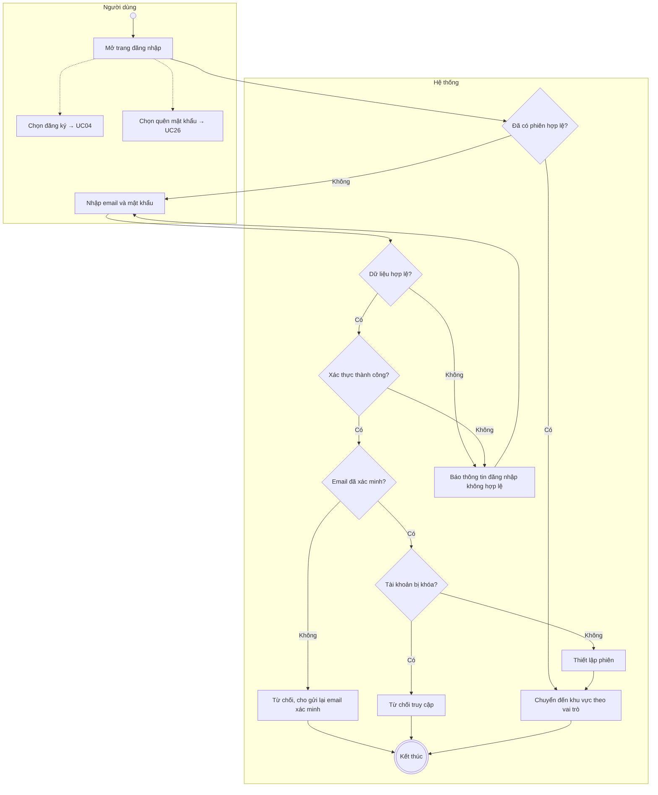
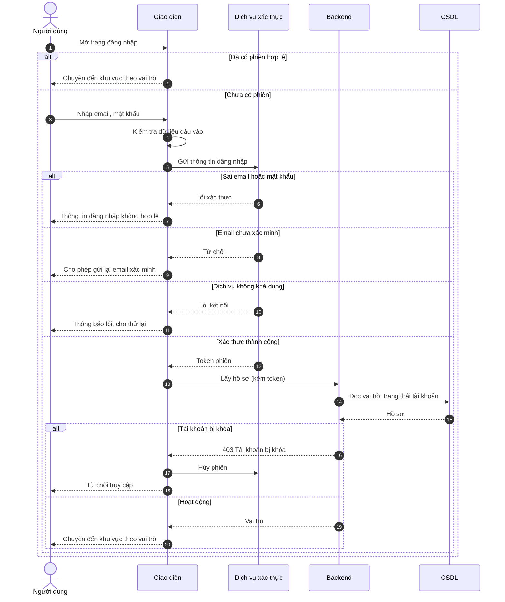

# UC01 – Đăng nhập

> Nguồn: Chương 3 §3.6.2 (Chương 3 - bản team 10-11 (đã đồng bộ).docx). [← Danh sách use case](README.md)

| Mục | Nội dung |
|---|---|
| Mã use case | UC01 |
| Tên use case | Đăng nhập |
| Mô tả | Cho phép người dùng xác thực tài khoản và truy cập chức năng phù hợp với vai trò. |
| Actors | Người học, Giáo viên, Quản lý. |
| Pre-Conditions | Người dùng đã có tài khoản và truy cập chức năng đăng nhập. |
| Post-Conditions | **Thành công:** phiên đăng nhập được thiết lập; người dùng được chuyển đến khu vực phù hợp với vai trò. **Không thành công:** không tạo phiên truy cập vào chức năng được bảo vệ. |

## Main flow

1. Người dùng mở trang đăng nhập.
2. Nhập email và mật khẩu.
3. Hệ thống kiểm tra dữ liệu đầu vào.
4. Hệ thống xác thực thông tin đăng nhập.
5. Kiểm tra trạng thái tài khoản và vai trò.
6. Thiết lập phiên và chuyển đến trang tương ứng.

## Alternative Flow

- A1. Người dùng đã có phiên hợp lệ: hệ thống chuyển đến khu vực tương ứng mà không yêu cầu nhập lại thông tin.
- A2. Người dùng chưa có tài khoản: chọn đăng ký và chuyển sang [UC04](UC04-dang-ky-tai-khoan.md).
- A3. Người dùng chọn quên mật khẩu: chuyển sang [UC26](UC26-khoi-phuc-mat-khau.md).
- A4. Người dùng chọn đăng nhập bằng Google: hệ thống chuyển sang dịch vụ xác thực của Google; sau khi xác thực thành công, hệ thống kiểm tra hồ sơ và trạng thái tài khoản rồi chuyển đến khu vực tương ứng. Tài khoản Google mới được tạo với vai trò Người học.

## Exception

- E1. Email hoặc mật khẩu không đúng: thông báo thông tin đăng nhập không hợp lệ.
- E2. Tài khoản bị khóa: từ chối truy cập.
- E3. Dịch vụ xác thực không khả dụng: thông báo lỗi và cho phép thử lại.
- E4. Email chưa được xác minh: từ chối đăng nhập và cho phép gửi lại email xác minh.
- E5. Đăng nhập Google bị hủy hoặc thất bại: quay lại trang đăng nhập và thông báo lỗi.

## Business Rules

- BR1. Không ghi mật khẩu vào nhật ký hệ thống.
- BR2. Vai trò được xác định từ dữ liệu do hệ thống quản lý, không lấy từ giá trị tự khai báo phía client.
- BR3. Tài khoản bị khóa không được truy cập chức năng được bảo vệ.
- BR4. Tài khoản đăng nhập bằng Google được xem là đã xác minh email.

## Sơ đồ

*Hình 3.3. Sơ đồ hoạt động của UC01 – Đăng nhập*

*Hình 3.4. Sơ đồ tuần tự của UC01 – Đăng nhập*
