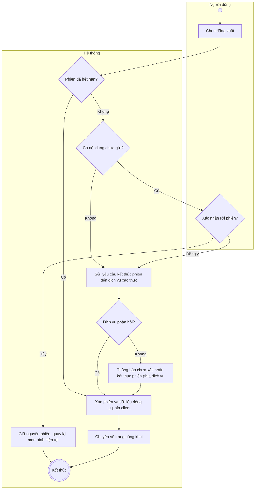
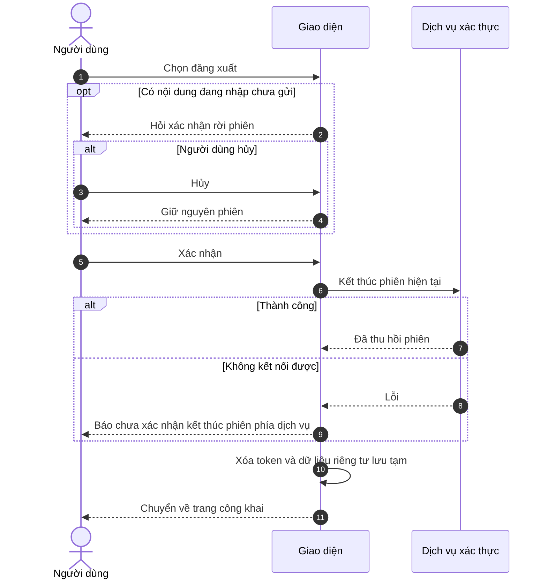

# UC02 – Đăng xuất

> Nguồn: Chương 3 §3.6.2 (Chương 3 - bản team 10-11 (đã đồng bộ).docx). [← Danh sách use case](README.md)

| Mục | Nội dung |
|---|---|
| Mã use case | UC02 |
| Tên use case | Đăng xuất |
| Mô tả | Cho phép người dùng kết thúc phiên đăng nhập hiện tại và rời khỏi khu vực được bảo vệ. |
| Actors | Người học, Giáo viên, Quản lý. |
| Pre-Conditions | Người dùng đang có phiên đăng nhập hoặc trạng thái đăng nhập còn lưu trên trình duyệt hiện tại. |
| Post-Conditions | **Thành công:** thông tin phiên phía client được xóa, yêu cầu kết thúc phiên được dịch vụ xác thực xử lý và người dùng được chuyển về trang công khai. **Thất bại một phần:** trạng thái đăng nhập cục bộ được xóa nhưng việc thu hồi phiên phía dịch vụ chưa được xác nhận. |

## Main flow

1. Người dùng chọn đăng xuất.
2. Hệ thống kiểm tra nội dung đang nhập chưa gửi, nếu có.
3. Người dùng xác nhận rời khỏi phiên khi cần.
4. Hệ thống gửi yêu cầu kết thúc phiên hiện tại đến dịch vụ xác thực.
5. Xóa thông tin phiên và dữ liệu riêng tư được lưu tạm phía client.
6. Chuyển về trang công khai.

## Alternative Flow

- A1. Có nội dung chưa gửi và người dùng chọn hủy: giữ nguyên phiên, quay lại màn hình hiện tại.
- A2. Phiên đã hết hạn: xóa trạng thái cục bộ còn lại và chuyển về trang công khai.

## Exception

- E1. Không kết nối được dịch vụ xác thực: vẫn xóa phiên cục bộ và thông báo chưa xác nhận kết thúc phiên phía dịch vụ.
- E2. Không xóa được một phần dữ liệu lưu trữ trình duyệt: thông báo và hướng dẫn người dùng thử lại hoặc xóa dữ liệu trang web.

## Business Rules

- BR1. Đăng xuất mặc định chỉ áp dụng cho phiên hiện tại, không mặc định đăng xuất mọi thiết bị.
- BR2. Không được chỉ chuyển trang mà giữ nguyên thông tin đăng nhập và dữ liệu riêng tư trong trạng thái ứng dụng.
- BR3. Đăng xuất không xóa tài khoản, lịch sử học tập hoặc bài đã lưu.
- BR4. Với access token có thời hạn, không khẳng định token bị vô hiệu tức thời nếu cơ chế xác thực không hỗ trợ thu hồi; backend phải tuân thủ cơ chế kiểm tra phiên và thời hạn token đã chọn.

## Sơ đồ

*Hình 3.5. Sơ đồ hoạt động của UC02 – Đăng xuất*

*Hình 3.6. Sơ đồ tuần tự của UC02 – Đăng xuất*
