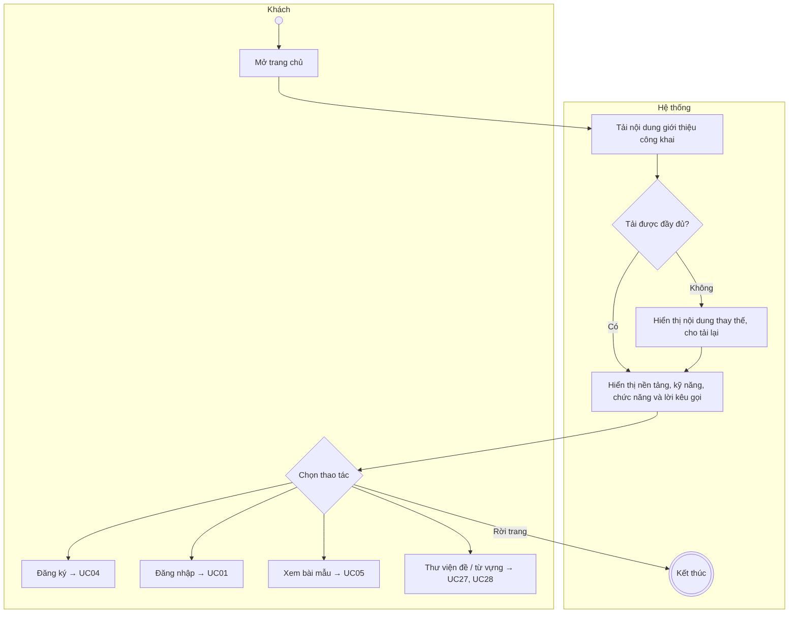
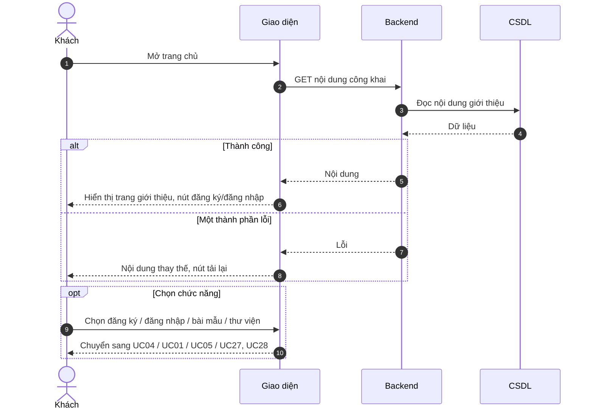

# UC03 – Xem trang giới thiệu

> Nguồn: Chương 3 §3.6.2 (Chương 3 - bản team 10-11 (đã đồng bộ).docx). [← Danh sách use case](README.md)

| Mục | Nội dung |
|---|---|
| Mã use case | UC03 |
| Tên use case | Xem trang giới thiệu |
| Mô tả | Cung cấp thông tin tổng quan về nền tảng, kỹ năng luyện thi và các chức năng học tập. |
| Actors | Khách; Người học, Giáo viên và Quản lý cũng có thể truy cập trang công khai. |
| Pre-Conditions | Người truy cập mở địa chỉ website bằng trình duyệt được hỗ trợ. |
| Post-Conditions | Trang giới thiệu được hiển thị; không phát sinh thay đổi dữ liệu học tập. |

## Main flow

1. Người truy cập mở trang chủ.
2. Hệ thống tải nội dung giới thiệu đã công khai.
3. Hiển thị thông tin nền tảng, các kỹ năng và chức năng chính.
4. Hiển thị liên kết đăng ký, đăng nhập hoặc truy cập khu vực học tập.

## Alternative Flow

- A1. Chọn đăng ký: chuyển sang [UC04](UC04-dang-ky-tai-khoan.md).
- A2. Chọn đăng nhập: chuyển sang [UC01](UC01-dang-nhap.md).
- A3. Chọn xem bài mẫu: chuyển sang [UC05](UC05-xem-bai-mau.md).
- A4. Chọn thư viện đề hoặc từ vựng: chuyển sang [UC27](UC27-xem-thu-vien-de.md) hoặc [UC28](UC28-tra-cuu-thu-vien-tu-vung.md).
- A5. Người dùng đã đăng nhập: có thể chuyển trực tiếp đến khu vực theo vai trò.

## Exception

- E1. Không tải được một thành phần nội dung: hiển thị thông báo hoặc nội dung thay thế, cho phép tải lại.

## Business Rules

- BR1. Trang giới thiệu không yêu cầu đăng nhập.
- BR2. Chỉ hiển thị thông tin công khai, không đưa dữ liệu cá nhân hoặc nội dung quản trị lên trang.

## Sơ đồ

*Hình 3.7. Sơ đồ hoạt động của UC03 – Xem trang giới thiệu*

*Hình 3.8. Sơ đồ tuần tự của UC03 – Xem trang giới thiệu*
