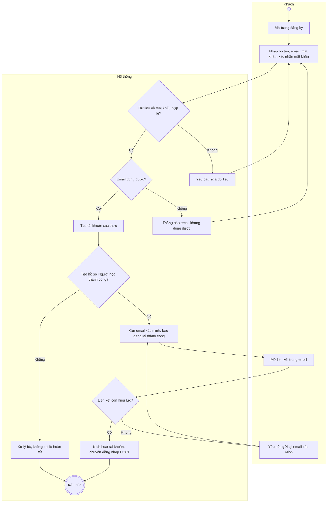
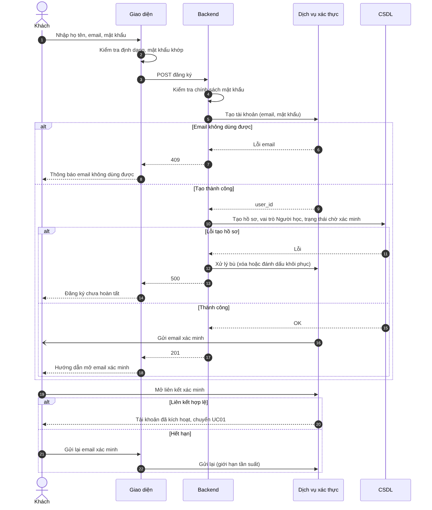

# UC04 – Đăng ký tài khoản

> Nguồn: Chương 3 §3.6.2 (Chương 3 - bản team 10-11 (đã đồng bộ).docx). [← Danh sách use case](README.md)

| Mục | Nội dung |
|---|---|
| Mã use case | UC04 |
| Tên use case | Đăng ký tài khoản |
| Mô tả | Cho phép Khách tạo tài khoản Người học. |
| Actors | Khách. |
| Pre-Conditions | Khách chưa đăng nhập; chức năng đăng ký đang được cung cấp. |
| Post-Conditions | **Thành công:** tài khoản Người học được tạo; tài khoản ở trạng thái chờ xác minh email cho đến khi Khách mở liên kết xác minh. **Không thành công:** không tạo tài khoản có thể sử dụng với dữ liệu không hợp lệ. |

## Main flow

1. Khách mở trang đăng ký.
2. Nhập họ tên, email, mật khẩu và xác nhận mật khẩu.
3. Hệ thống kiểm tra dữ liệu và chính sách mật khẩu.
4. Kiểm tra khả năng sử dụng email đăng ký.
5. Tạo tài khoản xác thực và hồ sơ với vai trò Người học.
6. Thông báo đăng ký thành công và hướng dẫn bước tiếp theo (mở email để xác minh tài khoản).

## Alternative Flow

- A1. Hệ thống gửi email xác minh; Khách mở liên kết để kích hoạt tài khoản rồi đăng nhập theo [UC01](UC01-dang-nhap.md).
- A2. Khách đã có tài khoản: chuyển sang [UC01](UC01-dang-nhap.md).
- A3. Khách chưa nhận được email hoặc liên kết hết hạn: yêu cầu gửi lại email xác minh trong giới hạn tần suất.
- A4. Khách chọn đăng ký bằng Google: tài khoản Người học được tạo sau khi xác thực Google thành công, không cần bước xác minh email.

## Exception

- E1. Dữ liệu không hợp lệ hoặc mật khẩu xác nhận không khớp: yêu cầu sửa.
- E2. Email không thể sử dụng để đăng ký: thông báo phù hợp.
- E3. Không tạo được hồ sơ sau khi tạo tài khoản xác thực: thực hiện xử lý bù hoặc đánh dấu để khôi phục, không coi đăng ký đã hoàn tất.

## Business Rules

- BR1. Đăng ký công khai chỉ tạo vai trò Người học.
- BR2. Email tài khoản phải duy nhất theo quy tắc chuẩn hóa của dịch vụ xác thực.
- BR3. Mật khẩu được quản lý bằng cơ chế băm an toàn, không lưu dạng văn bản thuần.
- BR4. Tài khoản Người học đang hoạt động được áp dụng chính sách lượt hỗ trợ chấm quy định tại [UC34](UC34-gui-yeu-cau-ho-tro-cham-writing-speaking.md).
- BR5. Xác minh email là bắt buộc trước lần đăng nhập đầu tiên, trừ tài khoản đăng ký bằng Google.

## Sơ đồ

*Hình 3.9. Sơ đồ hoạt động của UC04 – Đăng ký tài khoản*

*Hình 3.10. Sơ đồ tuần tự của UC04 – Đăng ký tài khoản*
