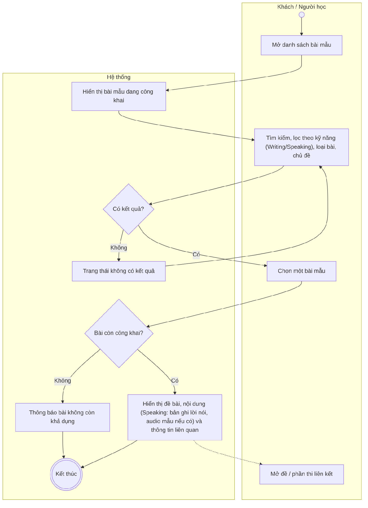
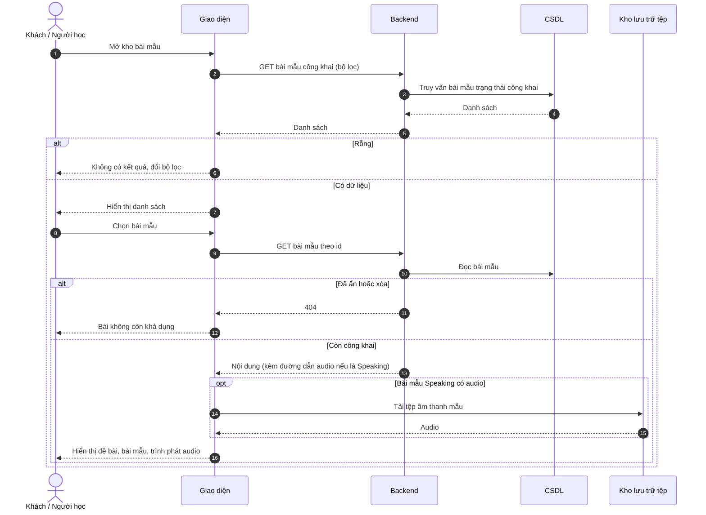

# UC05 – Xem bài mẫu

> Nguồn: Chương 3 §3.6.2 (Chương 3 - bản team 10-11 (đã đồng bộ).docx). [← Danh sách use case](README.md)

| Mục | Nội dung |
|---|---|
| Mã use case | UC05 |
| Tên use case | Xem bài mẫu |
| Mô tả | Cho phép tra cứu và đọc nội dung bài mẫu phục vụ học tập. |
| Actors | Khách; Người học cũng có thể truy cập nội dung công khai. |
| Pre-Conditions | Người truy cập mở khu vực bài mẫu. |
| Post-Conditions | Danh sách hoặc nội dung bài mẫu được hiển thị; không thay đổi nội dung gốc. |

## Main flow

1. Người truy cập mở danh sách bài mẫu.
2. Hệ thống hiển thị các bài mẫu đang công khai.
3. Người truy cập tìm kiếm hoặc lọc theo kỹ năng (Writing, Speaking), loại bài và chủ đề.
4. Chọn một bài mẫu.
5. Hệ thống hiển thị nội dung và thông tin liên quan; với bài mẫu Speaking, hiển thị bản ghi lời nói và trình phát tệp âm thanh mẫu nếu có.

## Alternative Flow

- A1. Không có bài phù hợp bộ lọc: hiển thị trạng thái không có kết quả và cho phép thay đổi điều kiện tìm kiếm.
- A2. Bài mẫu có liên kết với đề hoặc phần thi: người truy cập có thể mở nội dung liên quan theo quyền được phép.

## Exception

- E1. Bài mẫu đã bị ẩn hoặc xóa: thông báo không còn khả dụng.
- E2. Không tải được nội dung: cho phép thử lại.

## Business Rules

- BR1. Khách và Người học chỉ được xem bài mẫu đang công khai.
- BR2. Xem bài mẫu không cấp quyền chỉnh sửa nội dung.
- BR3. Truy cập nội dung liên kết vẫn phải tuân thủ quyền của chức năng đích.
- BR4. Bài mẫu gồm hai kỹ năng Writing và Speaking; bài mẫu Speaking trình bày dưới dạng bản ghi lời nói, có thể kèm tệp âm thanh mẫu.

## Sơ đồ

*Hình 3.11. Sơ đồ hoạt động của UC05 – Xem bài mẫu*

*Hình 3.12. Sơ đồ tuần tự của UC05 – Xem bài mẫu*
