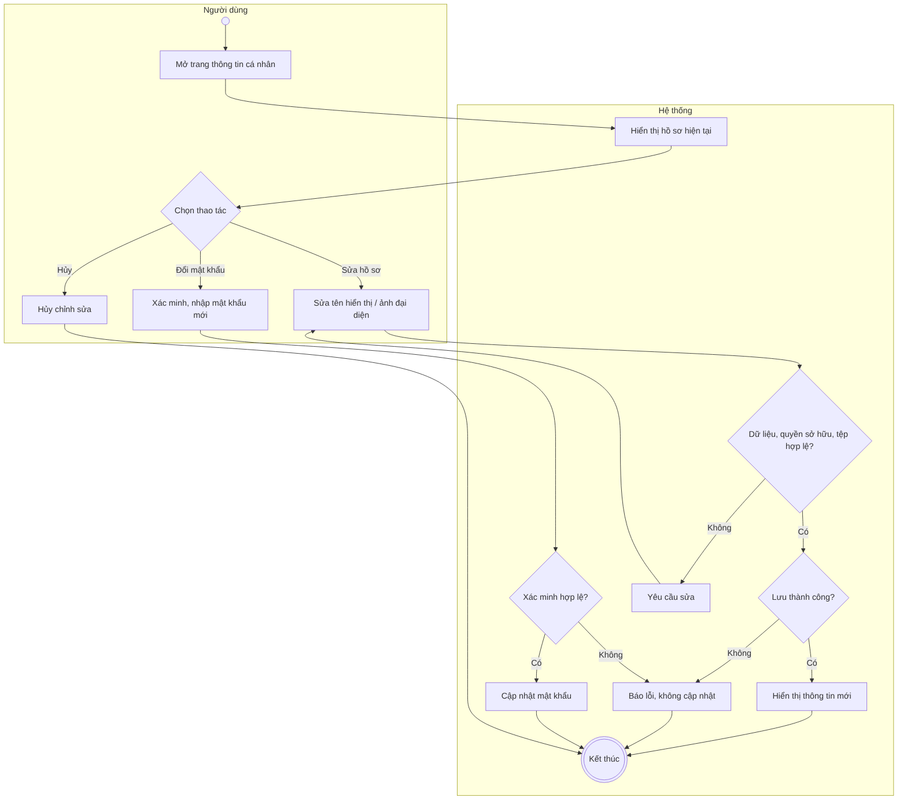
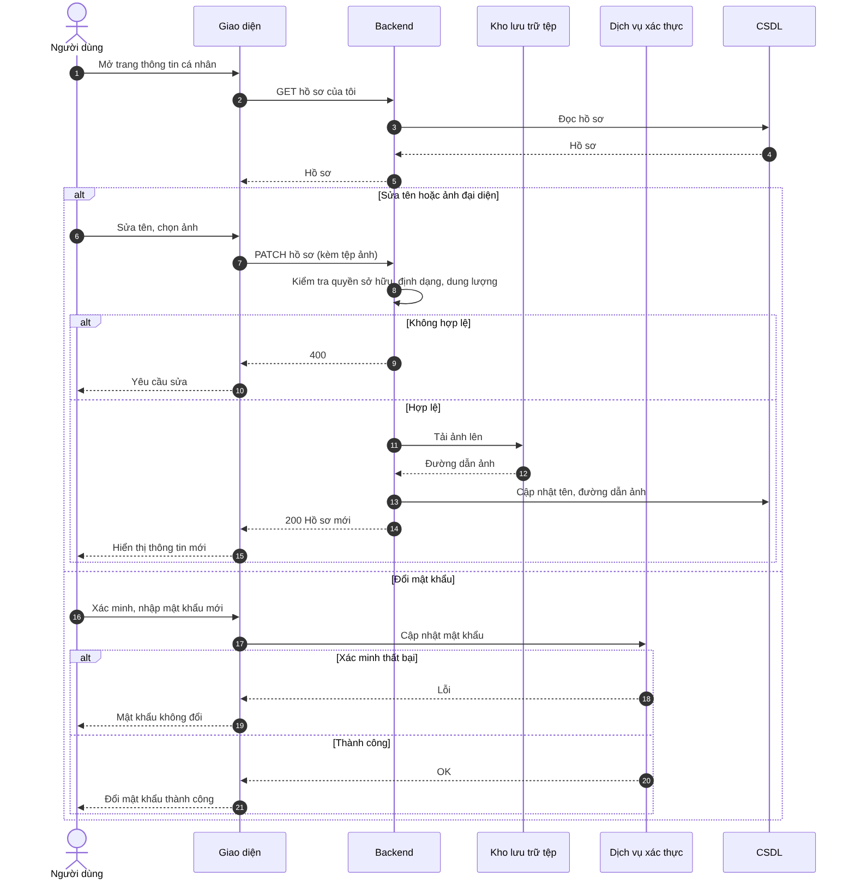

# UC06 – Quản lý thông tin cá nhân

> Nguồn: Chương 3 §3.6.2 (Chương 3 - bản team 10-11 (đã đồng bộ).docx). [← Danh sách use case](README.md)

| Mục | Nội dung |
|---|---|
| Mã use case | UC06 |
| Tên use case | Quản lý thông tin cá nhân |
| Mô tả | Cho phép người dùng xem và cập nhật tên hiển thị, ảnh đại diện và mật khẩu của mình. |
| Actors | Người học, Giáo viên, Quản lý. |
| Pre-Conditions | Người dùng đã đăng nhập và tài khoản đang hoạt động. |
| Post-Conditions | **Thành công:** thông tin được cập nhật. **Không thành công:** thông tin tương ứng giữ nguyên. |

## Main flow

1. Người dùng mở trang thông tin cá nhân.
2. Hệ thống hiển thị hồ sơ hiện tại.
3. Người dùng chỉnh sửa tên hiển thị hoặc ảnh đại diện.
4. Gửi yêu cầu lưu.
5. Hệ thống kiểm tra dữ liệu, quyền sở hữu và tệp đính kèm.
6. Lưu thay đổi và hiển thị thông tin mới.

## Alternative Flow

- A1. Đổi mật khẩu: người dùng thực hiện bước xác minh theo chính sách xác thực, nhập và xác nhận mật khẩu mới; hệ thống cập nhật khi hợp lệ.
- A2. Hủy chỉnh sửa: không lưu thay đổi.

## Exception

- E1. Tên hoặc tệp ảnh không hợp lệ: yêu cầu chỉnh sửa.
- E2. Xác minh đổi mật khẩu thất bại: không thay đổi mật khẩu.
- E3. Tải ảnh hoặc lưu dữ liệu thất bại: thông báo lỗi, không báo cập nhật thành công.

## Business Rules

- BR1. Người dùng chỉ được cập nhật hồ sơ của mình qua chức năng này.
- BR2. Không được tự thay đổi vai trò, trạng thái tài khoản, quyền chấm hoặc lượt hỗ trợ.
- BR3. Tệp ảnh phải đáp ứng định dạng và dung lượng được cấu hình.
- BR4. Mục tiêu học tập của Người học được quản lý tại [UC31](UC31-thiet-lap-muc-tieu-hoc-tap.md).

## Sơ đồ

*Hình 3.13. Sơ đồ hoạt động của UC06 – Quản lý thông tin cá nhân*

*Hình 3.14. Sơ đồ tuần tự của UC06 – Quản lý thông tin cá nhân*
