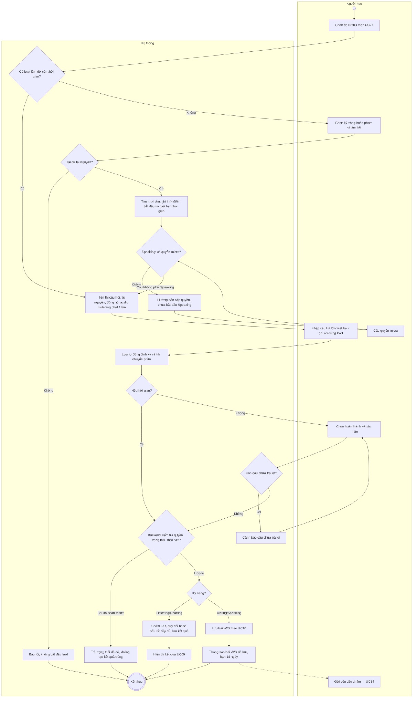
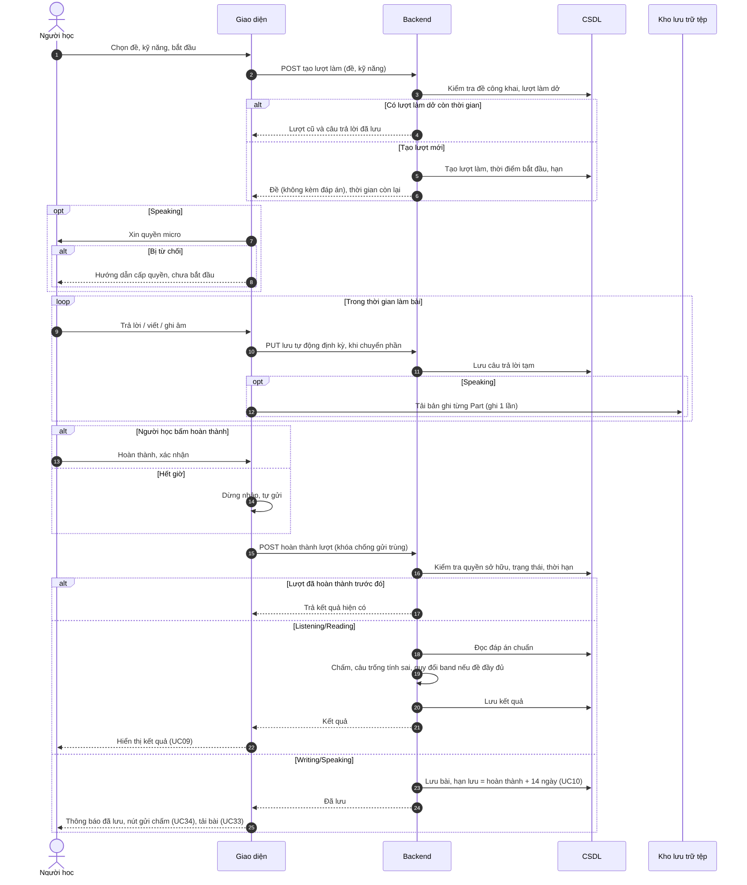

# UC07 – Làm bài kiểm tra

> Nguồn: Chương 3 §3.6.2 (Chương 3 - bản team 10-11 (đã đồng bộ).docx). [← Danh sách use case](README.md)

| Mục | Nội dung |
|---|---|
| Mã use case | UC07 |
| Tên use case | Làm bài kiểm tra |
| Mô tả | Cho phép Người học thực hiện bài kiểm tra theo một kỹ năng hoặc nhiều kỹ năng trong cùng đề thi. |
| Actors | Người học. |
| Pre-Conditions | Người học đã đăng nhập; đề được chọn đang được phép làm và có nội dung hợp lệ. |
| Post-Conditions | **Thành công:** bài làm được lưu; Listening/Reading có kết quả chấm tự động; Writing/Speaking được hoàn thành và lưu theo [UC10](UC10-hoan-thanh-va-luu-bai-writing-speaking.md). **Không thành công:** không ghi nhận hoàn thành khi dữ liệu chưa được lưu. |

## Main flow

1. Người học chọn đề từ [UC27](UC27-xem-thu-vien-de.md) và bắt đầu làm bài.
2. Chọn kỹ năng hoặc phạm vi làm bài.
3. Hệ thống tạo lượt làm bài, ghi nhận thời điểm bắt đầu và giới hạn thời gian.
4. Hiển thị câu hỏi, tài nguyên và đồng hồ đếm ngược.
5. Người học nhập câu trả lời.
6. Chọn hoàn thành và xác nhận.
7. Backend kiểm tra quyền sở hữu, trạng thái, thời hạn và dữ liệu bài làm.
8. Chấm và lưu Listening/Reading; xử lý Writing/Speaking theo [UC10](UC10-hoan-thanh-va-luu-bai-writing-speaking.md).
9. Hiển thị kết quả tự động hoặc thông báo bài Writing/Speaking đã được lưu.

## Alternative Flow

- A1. Người học hoàn thành khi chưa trả lời hết: hệ thống cảnh báo và cho phép xác nhận theo điều kiện của từng loại bài.
- A2. Hết thời gian: giao diện dừng nhập và gửi yêu cầu hoàn thành; backend áp dụng quy tắc thời hạn đã cấu hình.
- A3. Người học chỉ hoàn thành một kỹ năng: ghi nhận kỹ năng đó, không bắt buộc hoàn thành các kỹ năng còn lại.
- A4. Sau khi lưu Writing/Speaking, Người học có thể chọn gửi yêu cầu hỗ trợ tại [UC34](UC34-gui-yeu-cau-ho-tro-cham-writing-speaking.md).

## Exception

- E1. Không tải được tài nguyên bắt buộc: thông báo lỗi, không bắt đầu lượt làm chưa đủ điều kiện.
- E2. Mất kết nối khi gửi: giữ câu trả lời còn trên giao diện để thử lại và tra cứu trạng thái lưu.
- E3. Bài đã hoàn thành: trả trạng thái hiện có, không tạo kết quả trùng.
- E4. Trình duyệt không cấp quyền micro hoặc không hỗ trợ ghi âm khi làm Speaking: hướng dẫn cấp quyền, không bắt đầu phần Speaking cho đến khi ghi âm được.

## Business Rules

- BR1. Backend xác định tính hợp lệ của thời gian và trạng thái lượt làm bài.
- BR2. Không gửi đáp án chuẩn cho client trước thời điểm được phép xem lời giải.
- BR3. Câu bỏ trống của Listening/Reading được tính là không đúng.
- BR4. Chỉ bài đầy đủ theo cấu trúc quy định và có cấu hình quy đổi hợp lệ mới được quy đổi band.
- BR5. Hoàn thành Writing/Speaking không tự tạo yêu cầu chấm hoặc sử dụng lượt hỗ trợ.
- BR6. Trong bài thi đầy đủ, audio Listening của mỗi phần chỉ phát một lần, không tua hoặc phát lại, mô phỏng điều kiện thi thật.
- BR7. Câu trả lời được lưu tự động lên máy chủ định kỳ và khi chuyển phần; nếu Người học rời trang hoặc mất kết nối, có thể mở lại lượt làm dở để làm tiếp trong thời gian còn lại. Hết thời gian, hệ thống hoàn thành lượt làm với phần đã lưu.
- BR8. Trong bài thi đầy đủ, mỗi Part Speaking chỉ được ghi âm một lần, không ghi lại.

## Sơ đồ

*Hình 3.15. Sơ đồ hoạt động của UC07 – Làm bài kiểm tra*

*Hình 3.16. Sơ đồ tuần tự của UC07 – Làm bài kiểm tra*
