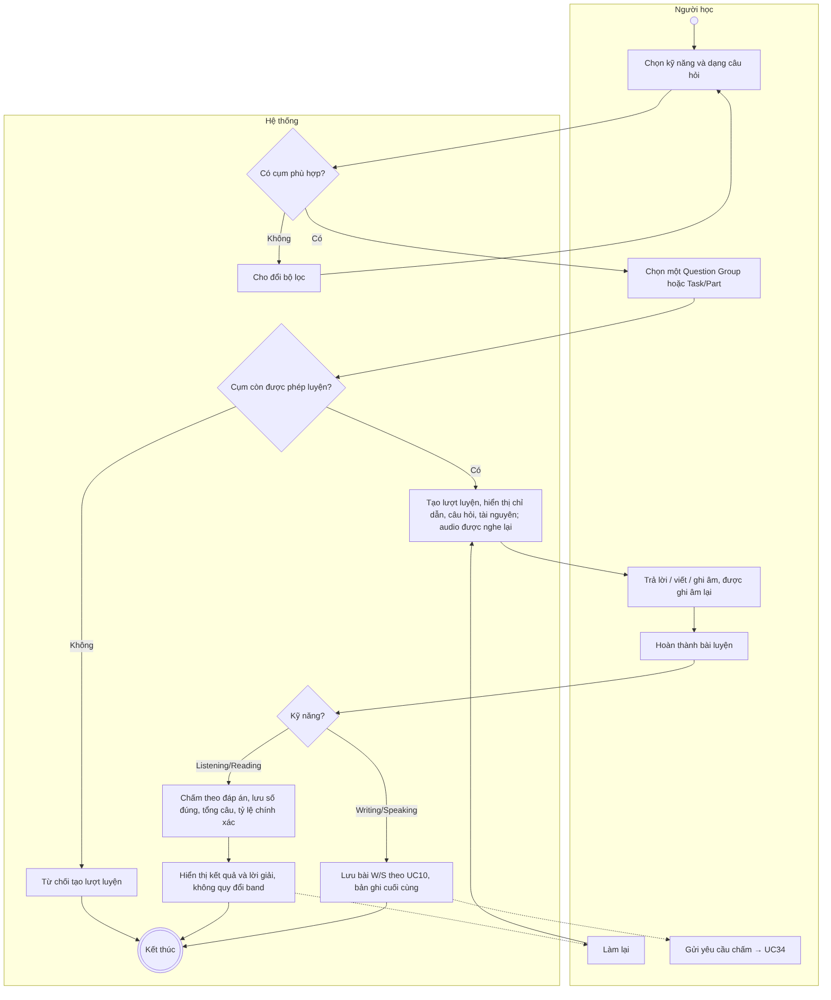
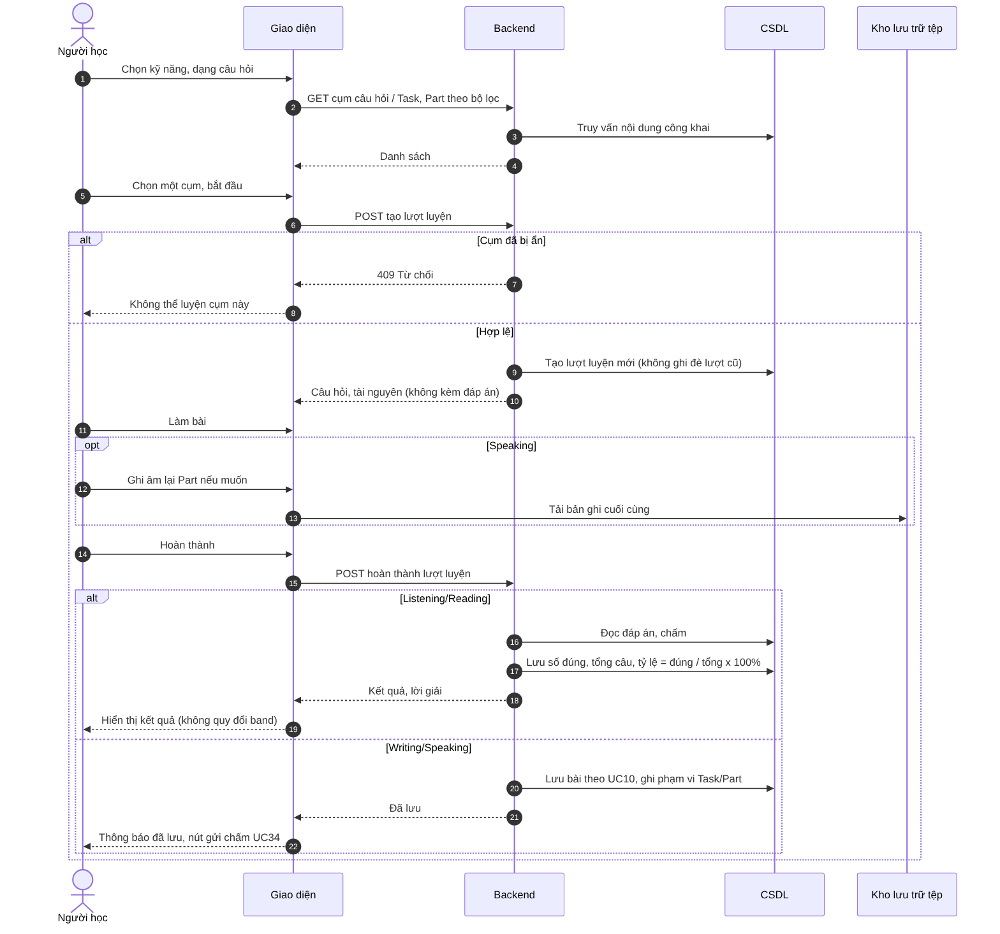

# UC08 – Luyện tập theo dạng câu hỏi

> Nguồn: Chương 3 §3.6.2 (Chương 3 - bản team 10-11 (đã đồng bộ).docx). [← Danh sách use case](README.md)

| Mục | Nội dung |
|---|---|
| Mã use case | UC08 |
| Tên use case | Luyện tập theo dạng câu hỏi |
| Mô tả | Cho phép Người học luyện riêng một Question Group (Listening/Reading) hoặc một Task/Part (Writing/Speaking) để tập trung vào dạng bài cụ thể. |
| Actors | Người học. |
| Pre-Conditions | Người học đã đăng nhập; có Question Group hoặc Task/Part được phép luyện và đầy đủ tài nguyên cần thiết. |
| Post-Conditions | Bài luyện được lưu và phân loại là luyện theo cụm câu hỏi; kết quả được ghi nhận theo phương thức đánh giá tương ứng. |

## Main flow

1. Người học chọn kỹ năng và dạng câu hỏi.
2. Hệ thống hiển thị các Question Group (Listening/Reading) hoặc Task/Part (Writing/Speaking) phù hợp.
3. Người học chọn một cụm và bắt đầu luyện.
4. Hệ thống hiển thị chỉ dẫn, câu hỏi và tài nguyên liên quan.
5. Người học trả lời và hoàn thành bài.
6. Với bài chấm theo đáp án, hệ thống kiểm tra, chấm và lưu kết quả.
7. Hiển thị số câu đúng, tổng số câu, tỷ lệ chính xác và lời giải.

## Alternative Flow

- A1. Không có cụm phù hợp: cho phép đổi bộ lọc.
- A2. Người học làm lại: tạo lượt luyện mới, không ghi đè kết quả cũ.
- A3. Với bài Writing/Speaking, chuyển sang [UC10](UC10-hoan-thanh-va-luu-bai-writing-speaking.md) để lưu; Người học có thể gửi yêu cầu hỗ trợ riêng qua [UC34](UC34-gui-yeu-cau-ho-tro-cham-writing-speaking.md) nếu bài đủ điều kiện.

## Exception

- E1. Cụm câu hỏi bị ẩn trước khi bắt đầu: từ chối tạo lượt luyện.
- E2. Không tải được tài nguyên hoặc không lưu được bài: thông báo lỗi và cho phép thử lại.

## Business Rules

- BR1. Bài luyện không được mặc định quy đổi thành band IELTS.
- BR2. Với bài chấm theo đáp án, tỷ lệ chính xác bằng số câu đúng chia tổng số câu của bài luyện, nhân 100%.
- BR3. Tổng số câu bao gồm cả câu chưa trả lời.
- BR4. Bài luyện được thống kê riêng với bài thi đầy đủ.
- BR5. Yêu cầu hỗ trợ Writing/Speaking sử dụng cùng chính sách lượt tại [UC34](UC34-gui-yeu-cau-ho-tro-cham-writing-speaking.md).
- BR6. Trong bài luyện, audio Listening được phép phát lại và tua.
- BR7. Bài luyện Writing/Speaking theo Task/Part được lưu theo [UC10](UC10-hoan-thanh-va-luu-bai-writing-speaking.md); kết quả chấm ghi rõ là đánh giá cho Task/Part đó, không phải band toàn kỹ năng.
- BR8. Khi luyện Speaking, Người học được ghi âm lại một Part trước khi hoàn thành; chỉ bản ghi cuối cùng được lưu.

## Sơ đồ

*Hình 3.17. Sơ đồ hoạt động của UC08 – Luyện tập theo dạng câu hỏi*

*Hình 3.18. Sơ đồ tuần tự của UC08 – Luyện tập theo dạng câu hỏi*
