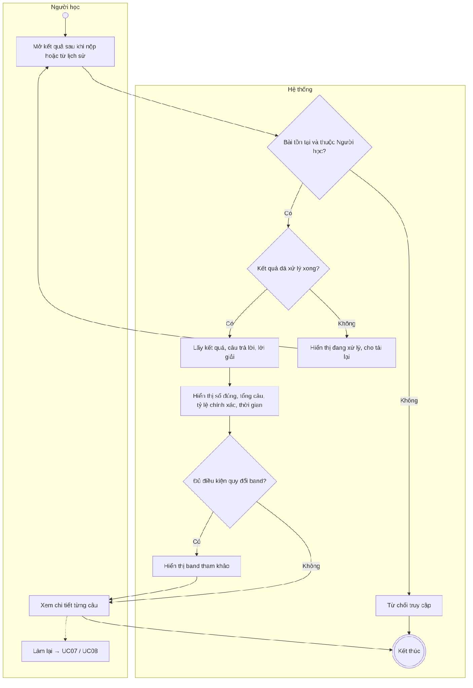
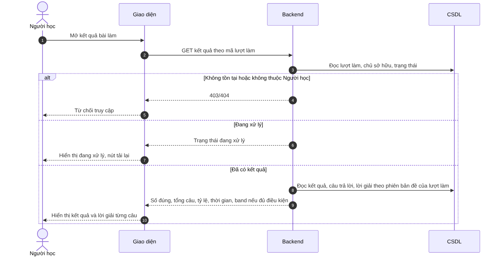

# UC09 – Xem kết quả và lời giải

> Nguồn: Chương 3 §3.6.2 (Chương 3 - bản team 10-11 (đã đồng bộ).docx). [← Danh sách use case](README.md)

| Mục | Nội dung |
|---|---|
| Mã use case | UC09 |
| Tên use case | Xem kết quả và lời giải |
| Mô tả | Cho phép Người học xem kết quả chấm tự động và lời giải của bài Listening/Reading đã nộp. |
| Actors | Người học. |
| Pre-Conditions | Người học đã đăng nhập; bài làm thuộc về Người học và đã được nộp. |
| Post-Conditions | Kết quả, câu trả lời và lời giải được hiển thị khi đã xử lý xong; không làm thay đổi bài đã nộp. |

## Main flow

1. Người học mở kết quả sau khi nộp bài hoặc từ lịch sử.
2. Backend kiểm tra quyền sở hữu và trạng thái bài.
3. Hệ thống lấy kết quả, câu trả lời và lời giải tương ứng.
4. Hiển thị số câu đúng, tổng số câu, tỷ lệ chính xác và thời gian làm bài.
5. Hiển thị band nếu bài đủ điều kiện quy đổi.
6. Người học xem chi tiết từng câu.

## Alternative Flow

- A1. Bài không đủ điều kiện quy đổi band: chỉ hiển thị các chỉ số phù hợp.
- A2. Người học chọn làm lại: chuyển sang [UC07](UC07-lam-bai-kiem-tra.md) hoặc [UC08](UC08-luyen-tap-theo-dang-cau-hoi.md) với lượt làm mới.
- A3. Kết quả đang được xử lý: hiển thị trạng thái xử lý và cho phép tải lại.

## Exception

- E1. Bài không tồn tại hoặc không thuộc Người học: từ chối truy cập.
- E2. Không tải được dữ liệu: cho phép thử lại.

## Business Rules

- BR1. Không tính lại kết quả lịch sử theo đáp án mới khi chỉ thực hiện thao tác xem.
- BR2. Kết quả phải gắn với nội dung và quy tắc chấm áp dụng cho lượt làm đó.
- BR3. Band quy đổi có tính chất tham khảo phục vụ luyện tập.

## Sơ đồ

*Hình 3.19. Sơ đồ hoạt động của UC09 – Xem kết quả và lời giải*

*Hình 3.20. Sơ đồ tuần tự của UC09 – Xem kết quả và lời giải*
