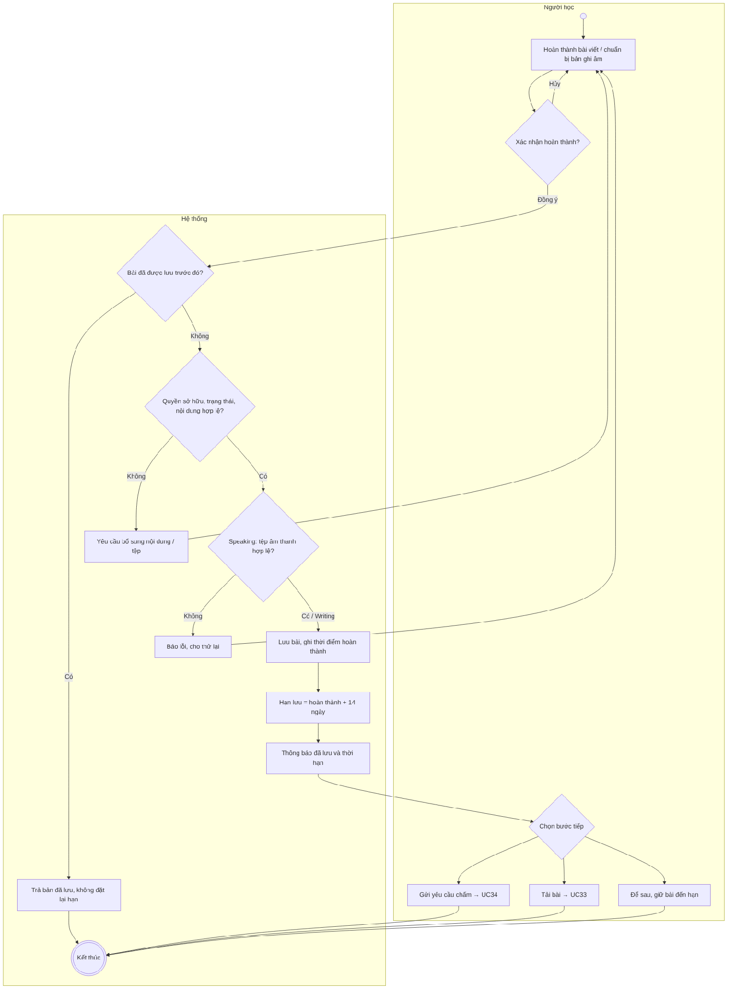
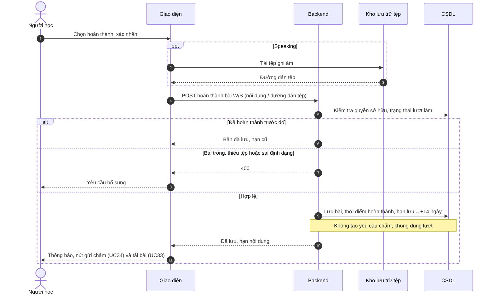

# UC10 – Hoàn thành và lưu bài Writing/Speaking

> Nguồn: Chương 3 §3.6.2 (Chương 3 - bản team 10-11 (đã đồng bộ).docx). [← Danh sách use case](README.md)

| Mục | Nội dung |
|---|---|
| Mã use case | UC10 |
| Tên use case | Hoàn thành và lưu bài Writing/Speaking |
| Mô tả | Lưu bài viết hoặc bản ghi âm đã hoàn thành để Người học xem lại, tải xuống hoặc chủ động gửi yêu cầu hỗ trợ chấm. |
| Actors | Người học. |
| Pre-Conditions | Người học đã đăng nhập; có lượt làm Writing/Speaking chưa hoàn thành và nội dung cần lưu. |
| Post-Conditions | **Thành công:** bài chuyển sang đã hoàn thành; nội dung được lưu với thời hạn ban đầu 14 ngày. **Không thành công:** không ghi nhận hoàn thành khi nội dung bắt buộc chưa được lưu. |

## Main flow

1. Người học hoàn thành bài viết hoặc chuẩn bị bản ghi âm.
2. Chọn hoàn thành và xác nhận.
3. Backend kiểm tra quyền sở hữu, trạng thái và nội dung.
4. Với Speaking, hoàn tất lưu tệp âm thanh hợp lệ.
5. Lưu bài và ghi nhận thời điểm hoàn thành.
6. Xác định hạn lưu ban đầu bằng thời điểm hoàn thành cộng 14 ngày.
7. Hiển thị thông báo đã lưu và thời hạn nội dung.
8. Cung cấp lựa chọn gửi yêu cầu chấm hoặc tải bài.

## Alternative Flow

- A1. Người học gửi yêu cầu chấm ngay: chuyển sang [UC34](UC34-gui-yeu-cau-ho-tro-cham-writing-speaking.md).
- A2. Người học chưa gửi chấm: bài được giữ đến hạn để gửi sau nếu còn nội dung hợp lệ.
- A3. Người học tải bài: chuyển sang [UC33](UC33-tai-bai-lam-writing-speaking.md).
- A4. Người học hủy xác nhận: quay lại bài làm.

## Exception

- E1. Bài viết trống hoặc thiếu tệp âm thanh bắt buộc: yêu cầu bổ sung.
- E2. Tệp sai định dạng, vượt dung lượng hoặc tải lên thất bại: không hoàn tất lưu.
- E3. Gửi lại yêu cầu hoàn thành: trả bản ghi đã lưu, không tạo bài trùng hoặc đặt lại thời hạn.
- E4. Lưu dữ liệu thất bại: thông báo và cho phép thử lại.

## Business Rules

- BR1. Lưu bài không sử dụng lượt hỗ trợ và không tự phân công Giáo viên.
- BR2. Nội dung đã hoàn thành không được sửa trực tiếp; làm lại phải tạo lượt làm mới.
- BR3. Bài chưa có kết quả và không có yêu cầu đang hoạt động áp dụng hạn lưu ban đầu 14 ngày và được hệ thống tự động xóa.
- BR4. Nội dung có yêu cầu đang hoạt động được giữ lại; sau khi có kết quả, thời hạn nội dung là 14 ngày từ lúc công bố.
- BR5. Sau khi yêu cầu bị hủy, áp dụng lại hạn lưu ban đầu; nếu đã quá hạn thì nội dung hết hiệu lực.
- BR6. Bài chưa được chấm khi nội dung bị xóa chỉ giữ lịch sử tối thiểu, không tạo điểm giả định.

## Sơ đồ

*Hình 3.21. Sơ đồ hoạt động của UC10 – Hoàn thành và lưu bài Writing/Speaking*

*Hình 3.22. Sơ đồ tuần tự của UC10 – Hoàn thành và lưu bài Writing/Speaking*
