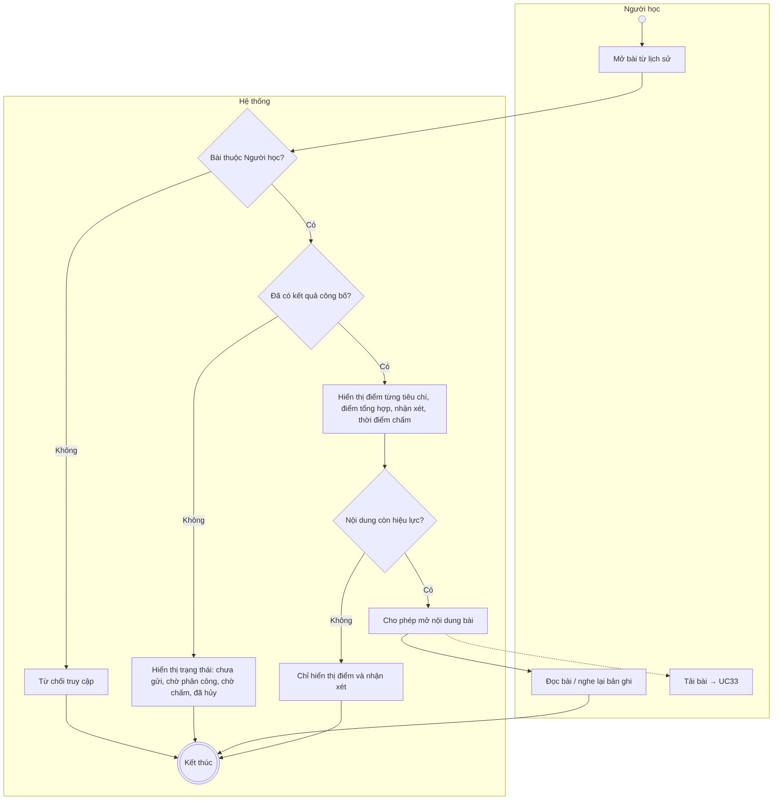
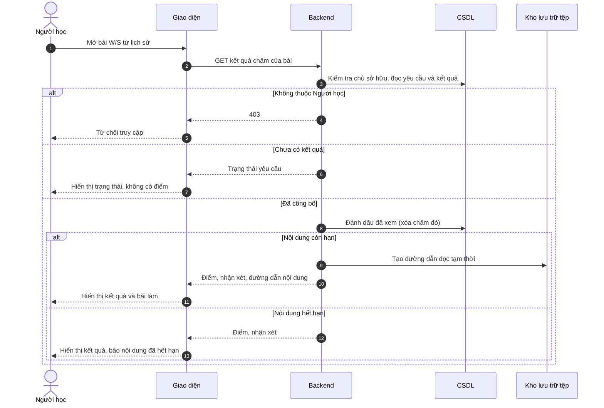

# UC11 – Xem nhận xét của Giáo viên

> Nguồn: Chương 3 §3.6.2 (Chương 3 - bản team 10-11 (đã đồng bộ).docx). [← Danh sách use case](README.md)

| Mục | Nội dung |
|---|---|
| Mã use case | UC11 |
| Tên use case | Xem nhận xét của Giáo viên |
| Mô tả | Cho phép Người học xem điểm và phản hồi đã được công bố đối với bài Writing/Speaking. |
| Actors | Người học. |
| Pre-Conditions | Người học đã đăng nhập; bài làm thuộc về Người học. |
| Post-Conditions | Kết quả đã công bố hoặc trạng thái xử lý được hiển thị; không thay đổi điểm và nhận xét. |

## Main flow

1. Người học mở bài đã có kết quả từ lịch sử.
2. Backend kiểm tra quyền sở hữu.
3. Hệ thống lấy điểm từng tiêu chí, điểm tổng hợp, nhận xét và thời điểm chấm.
4. Hiển thị kết quả.
5. Nếu nội dung còn hiệu lực, cho phép đọc bài viết hoặc phát lại bản ghi âm.

## Alternative Flow

- A1. Chưa có kết quả: hiển thị trạng thái thực tế như chưa gửi yêu cầu, chờ phân công, chờ chấm hoặc đã hủy; không hiển thị điểm.
- A2. Nội dung đã hết hạn: chỉ hiển thị điểm, nhận xét và thông tin kết quả còn được lưu.
- A3. Nội dung còn hiệu lực và Người học chọn tải: chuyển sang [UC33](UC33-tai-bai-lam-writing-speaking.md).

## Exception

- E1. Bài không tồn tại hoặc không thuộc Người học: từ chối truy cập.
- E2. Nội dung còn hạn nhưng không tải được: thông báo lỗi; vẫn hiển thị điểm và nhận xét nếu khả dụng.

## Business Rules

- BR1. Chỉ hiển thị kết quả đã được Giáo viên gửi chính thức.
- BR2. Điểm của một Task hoặc Part phải được ghi rõ phạm vi, không mặc định là band toàn kỹ năng.
- BR3. Người học không được chỉnh sửa điểm hoặc nhận xét.
- BR4. Xem kết quả không gia hạn nội dung.
- BR5. Nội dung đã hết hạn không được mở lại hoặc khôi phục qua chức năng này.

## Sơ đồ

*Hình 3.23. Sơ đồ hoạt động của UC11 – Xem nhận xét của Giáo viên*

*Hình 3.24. Sơ đồ tuần tự của UC11 – Xem nhận xét của Giáo viên*
