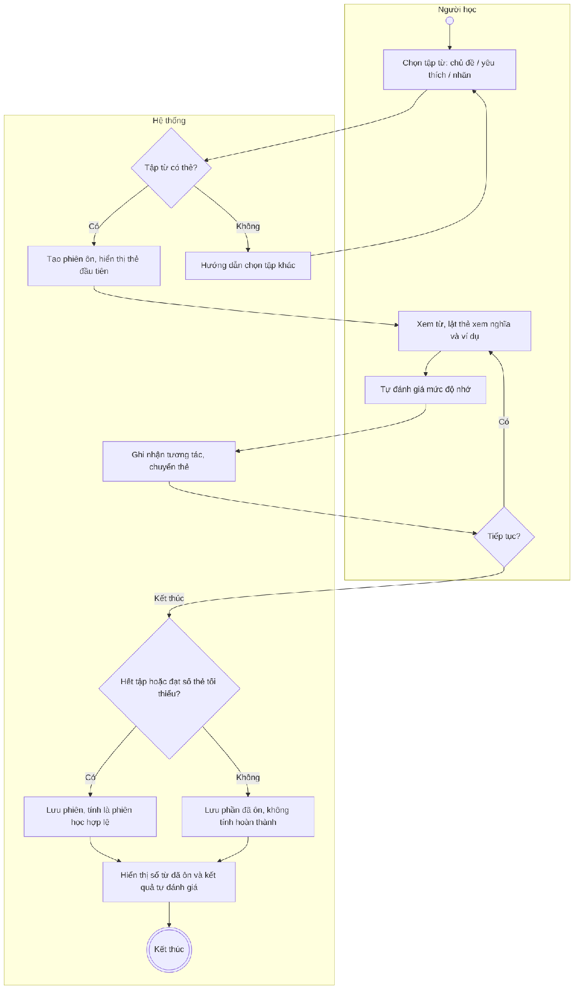
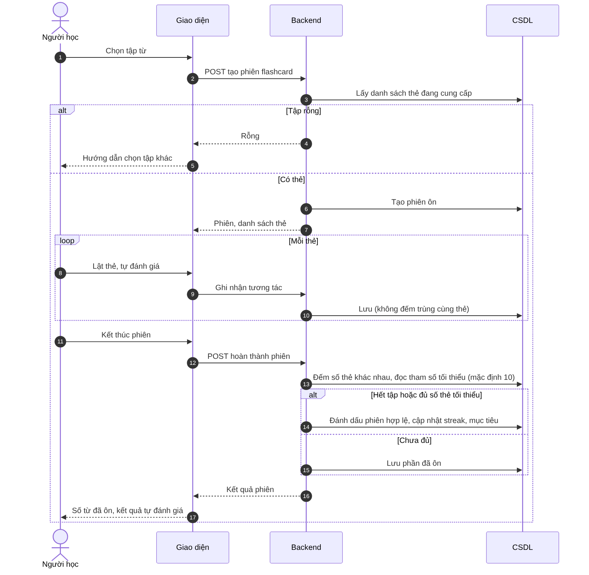

# UC12 – Ôn tập từ vựng bằng flashcard

> Nguồn: Chương 3 §3.6.2 (Chương 3 - bản team 10-11 (đã đồng bộ).docx). [← Danh sách use case](README.md)

| Mục | Nội dung |
|---|---|
| Mã use case | UC12 |
| Tên use case | Ôn tập từ vựng bằng flashcard |
| Mô tả | Cho phép Người học ôn từ vựng bằng flashcard và lưu kết quả phiên ôn. |
| Actors | Người học. |
| Pre-Conditions | Người học đã đăng nhập; tập từ được chọn có nội dung được phép sử dụng. |
| Post-Conditions | Kết quả phiên ôn được lưu; phiên đáp ứng điều kiện hoàn thành được sử dụng để cập nhật tiến độ học tập. |

## Main flow

1. Người học chọn tập từ theo chủ đề, danh sách yêu thích hoặc nhãn.
2. Hệ thống tạo phiên ôn và hiển thị thẻ đầu tiên.
3. Người học xem từ, lật thẻ để xem nghĩa và ví dụ.
4. Tự đánh giá mức độ ghi nhớ theo lựa chọn trên giao diện.
5. Hệ thống ghi nhận tương tác và chuyển thẻ.
6. Người học hoàn thành phiên.
7. Hệ thống lưu và hiển thị số từ đã ôn, kết quả tự đánh giá.

## Alternative Flow

- A1. Tập từ rỗng: hướng dẫn chọn tập khác.
- A2. Kết thúc sớm: ghi nhận phần đã thực hiện; chỉ tính hoàn thành nếu đáp ứng điều kiện của hệ thống.
- A3. Ôn lại: tạo phiên mới.

## Exception

- E1. Không tải được tập thẻ: thông báo và cho phép thử lại.
- E2. Không lưu được kết quả: thông báo lỗi, không báo đã cập nhật tiến độ thành công.

## Business Rules

- BR1. Kết quả ôn thuộc riêng từng Người học.
- BR2. Tương tác lặp với cùng thẻ không được tính thành nhiều từ khác nhau đã ôn.
- BR3. Tự đánh giá không được xem là kết quả kiểm chứng mức độ thành thạo.
- BR4. Chỉ phiên đủ điều kiện hoàn thành mới đóng góp vào mục tiêu số phiên và streak. Phiên flashcard đủ điều kiện khi Người học ôn hết tập thẻ đã chọn hoặc đạt số thẻ khác nhau tối thiểu; số thẻ tối thiểu là tham số cấu hình của hệ thống (mặc định 10).
- BR5. Tra cứu, yêu thích, ghi chú và nhãn được quản lý riêng tại [UC28](UC28-tra-cuu-thu-vien-tu-vung.md)–[UC30](UC30-quan-ly-ghi-chu-va-nhan-tu-vung.md).

## Sơ đồ

*Hình 3.25. Sơ đồ hoạt động của UC12 – Ôn tập từ vựng bằng flashcard*

*Hình 3.26. Sơ đồ tuần tự của UC12 – Ôn tập từ vựng bằng flashcard*
