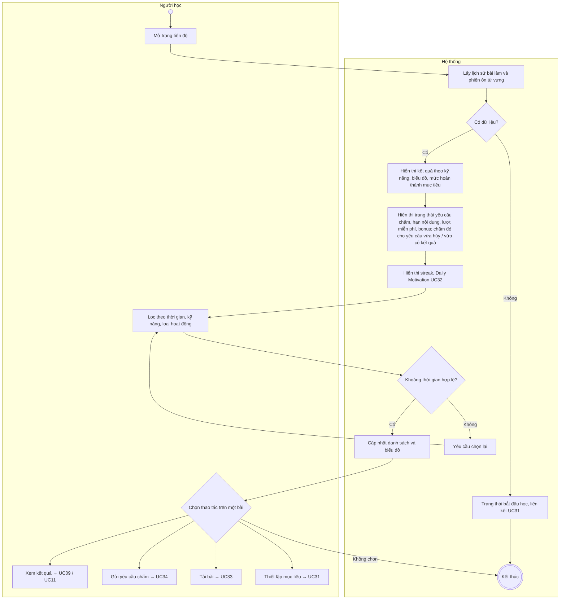
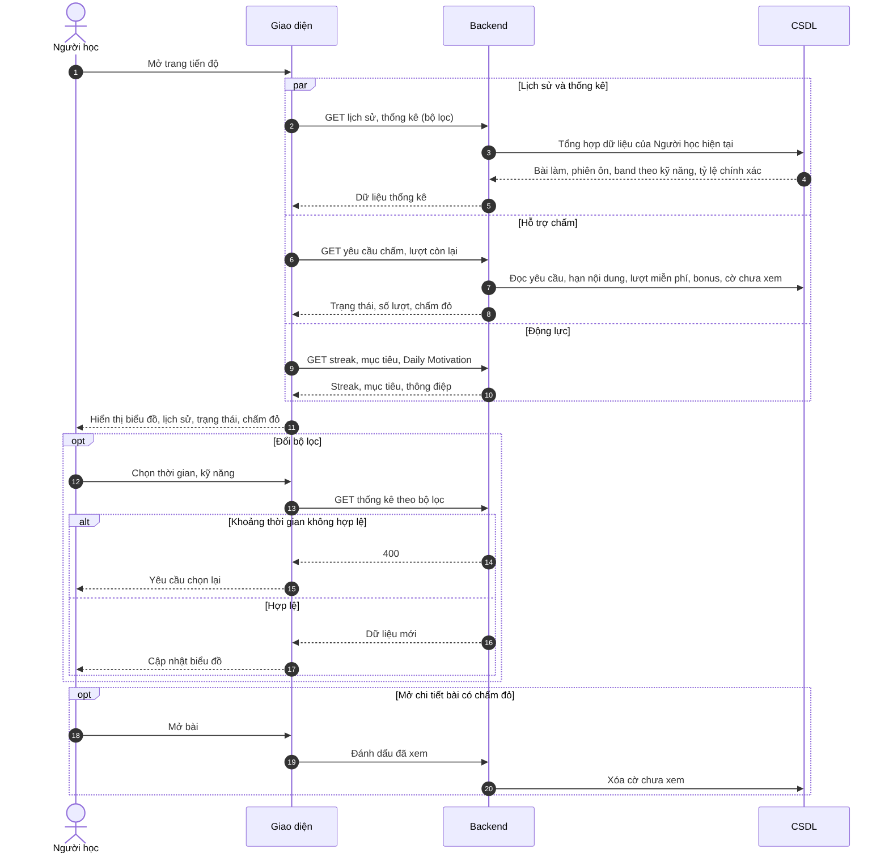

# UC13 – Xem lịch sử và thống kê

> Nguồn: Chương 3 §3.6.2 (Chương 3 - bản team 10-11 (đã đồng bộ).docx). [← Danh sách use case](README.md)

| Mục | Nội dung |
|---|---|
| Mã use case | UC13 |
| Tên use case | Xem lịch sử và thống kê |
| Mô tả | Cho phép Người học theo dõi lịch sử học tập, kết quả, mục tiêu, trạng thái hỗ trợ chấm và các lượt còn hiệu lực. |
| Actors | Người học. |
| Pre-Conditions | Người học đã đăng nhập. |
| Post-Conditions | Lịch sử và chỉ số thống kê cá nhân được hiển thị theo bộ lọc; không thay đổi dữ liệu học tập. |

## Main flow

1. Người học mở trang tiến độ.
2. Hệ thống lấy lịch sử bài làm và phiên ôn từ vựng.
3. Hiển thị kết quả theo kỹ năng, biểu đồ và mức độ hoàn thành mục tiêu.
4. Hiển thị trạng thái yêu cầu chấm, hạn nội dung còn hiệu lực, lượt miễn phí và bonus còn lại. Yêu cầu vừa bị hủy hoặc vừa có kết quả được đánh dấu chưa xem (chấm đỏ).
5. Hiển thị streak; thông điệp Daily Motivation được cung cấp theo [UC32](UC32-xem-thong-diep-dong-luc-hang-ngay.md).
6. Người học lọc theo thời gian, kỹ năng hoặc loại hoạt động.
7. Hệ thống cập nhật danh sách và biểu đồ.

## Alternative Flow

- A1. Chưa có dữ liệu: hiển thị trạng thái bắt đầu học, không tạo điểm trung bình giả định.
- A2. Chọn xem kết quả: chuyển sang [UC09](UC09-xem-ket-qua-va-loi-giai.md) hoặc [UC11](UC11-xem-nhan-xet-cua-giao-vien.md).
- A3. Chọn gửi yêu cầu cho bài Writing/Speaking còn hiệu lực: chuyển sang [UC34](UC34-gui-yeu-cau-ho-tro-cham-writing-speaking.md).
- A4. Chọn tải bài còn hiệu lực: chuyển sang [UC33](UC33-tai-bai-lam-writing-speaking.md).
- A5. Chưa thiết lập mục tiêu: cung cấp liên kết đến [UC31](UC31-thiet-lap-muc-tieu-hoc-tap.md).

## Exception

- E1. Khoảng thời gian không hợp lệ: yêu cầu chọn lại.
- E2. Không tổng hợp được dữ liệu: thông báo phần chưa khả dụng, không trình bày dữ liệu thiếu như thống kê đầy đủ.

## Business Rules

- BR1. Chỉ tổng hợp dữ liệu thuộc Người học hiện tại.
- BR2. Không tính trung bình chung giữa band điểm, tỷ lệ chính xác và kết quả tự đánh giá flashcard.
- BR3. Band được thống kê riêng theo kỹ năng; bài luyện không đầy đủ được tách khỏi bài thi đầy đủ.
- BR4. Bài chưa được chấm không tính vào điểm trung bình.
- BR5. Streak dựa trên hoạt động học hợp lệ và múi giờ thống nhất; chỉ mở trang không được tính.
- BR6. Nội dung hết hạn không được mở; lịch sử tối thiểu và kết quả đã có vẫn được giữ.
- BR7. Số bài hoàn thành và số yêu cầu chấm là hai chỉ số riêng.
- BR8. Thông báo trong MVP gồm trạng thái, dấu hiệu chưa xem trên trang này và danh sách thông báo trong hệ thống tại [UC35](UC35-xem-va-quan-ly-thong-bao.md); hệ thống không gửi email hoặc thông báo đẩy. Dấu hiệu được xóa khi Người học mở chi tiết.
- BR9. Phiên học hợp lệ là: hoàn thành một lượt làm bài ([UC07](UC07-lam-bai-kiem-tra.md)), hoàn thành một bài luyện ([UC08](UC08-luyen-tap-theo-dang-cau-hoi.md)) hoặc một phiên flashcard đủ điều kiện theo số thẻ tối thiểu đã cấu hình ([UC12](UC12-on-tap-tu-vung-bang-flashcard.md)). Streak tăng khi trong ngày có ít nhất một phiên học hợp lệ.

## Sơ đồ

*Hình 3.27. Sơ đồ hoạt động của UC13 – Xem lịch sử và thống kê*

*Hình 3.28. Sơ đồ tuần tự của UC13 – Xem lịch sử và thống kê*
