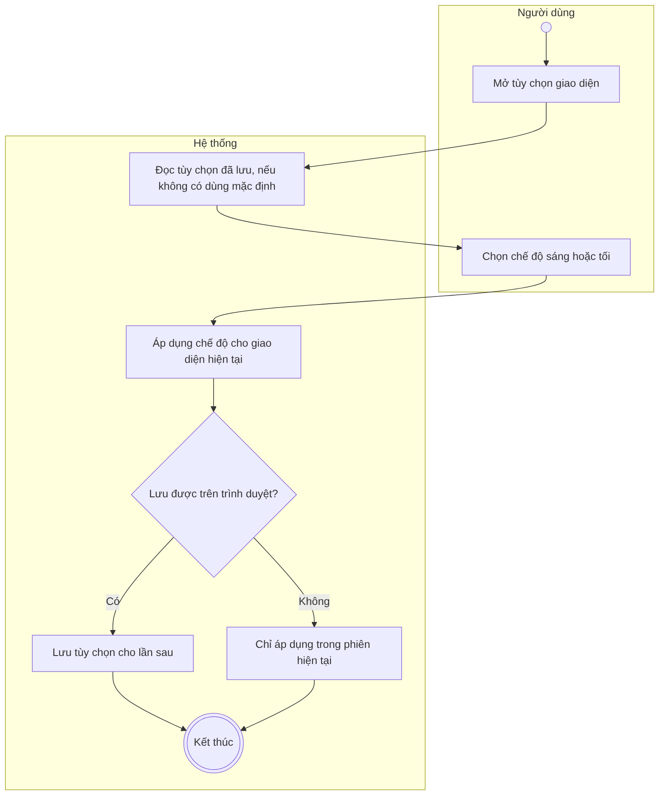
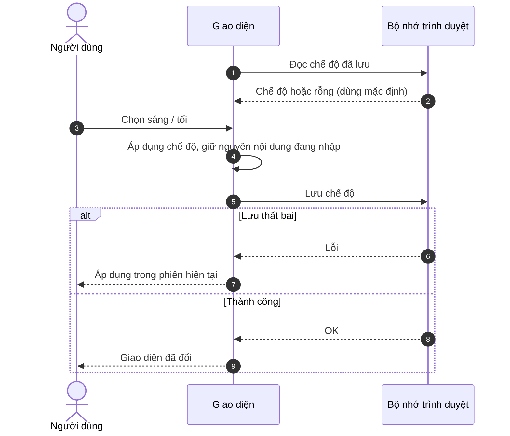

# UC14 – Tùy chỉnh giao diện

> Nguồn: Chương 3 §3.6.2 (Chương 3 - bản team 10-11 (đã đồng bộ).docx). [← Danh sách use case](README.md)

| Mục | Nội dung |
|---|---|
| Mã use case | UC14 |
| Tên use case | Tùy chỉnh giao diện |
| Mô tả | Cho phép người dùng chuyển giữa chế độ sáng và tối. |
| Actors | Người học, Giáo viên, Quản lý. |
| Pre-Conditions | Người dùng đã đăng nhập và đang sử dụng giao diện hệ thống. |
| Post-Conditions | Chế độ được chọn được áp dụng; tùy chọn được lưu trên trình duyệt nếu cơ chế lưu trữ khả dụng. |

## Main flow

1. Người dùng mở tùy chọn giao diện.
2. Chọn chế độ sáng hoặc tối.
3. Hệ thống áp dụng chế độ cho giao diện hiện tại.
4. Lưu tùy chọn để sử dụng cho các lần truy cập tiếp theo trên cùng trình duyệt.

## Alternative Flow

- A1. Chưa có tùy chọn được lưu: hệ thống sử dụng chế độ mặc định.
- A2. Người học đổi lại chế độ: hệ thống cập nhật tùy chọn mới.

## Exception

- E1. Không thể lưu tùy chọn trên trình duyệt: vẫn áp dụng chế độ trong phiên hiện tại, nhưng không bảo đảm ghi nhớ cho lần truy cập sau.

## Business Rules

- BR1. Thay đổi giao diện không làm mất câu trả lời hoặc nội dung đang nhập.
- BR2. Hai chế độ phải giữ nguyên chức năng và bảo đảm nội dung dễ đọc.
- BR3. Tùy chọn lưu cục bộ không mặc định đồng bộ giữa các thiết bị.

## Sơ đồ

*Hình 3.29. Sơ đồ hoạt động của UC14 – Tùy chỉnh giao diện*

*Hình 3.30. Sơ đồ tuần tự của UC14 – Tùy chỉnh giao diện*
