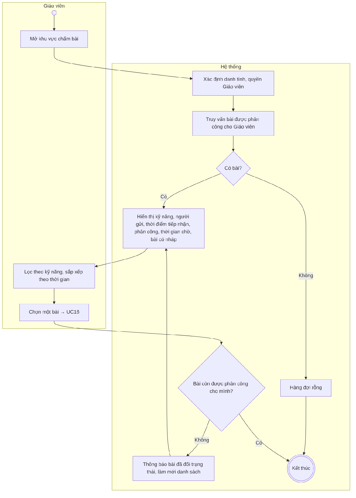
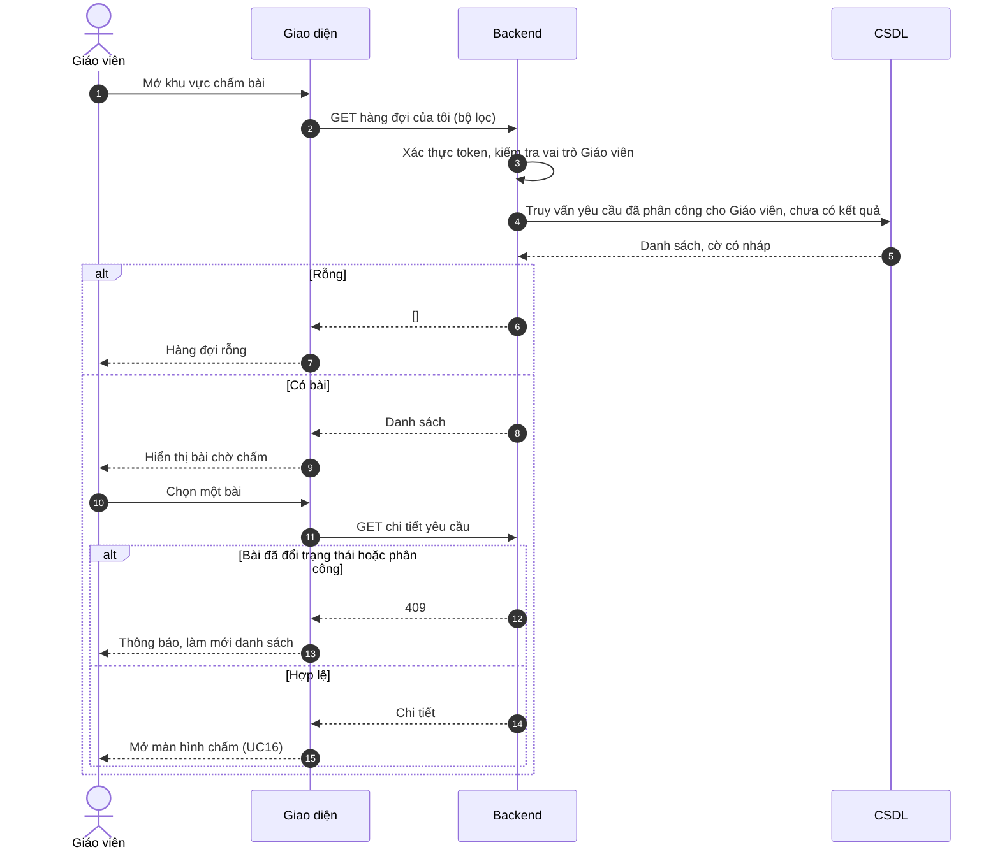

# UC15 – Xem hàng đợi bài chờ chấm

> Nguồn: Chương 3 §3.6.2 (Chương 3 - bản team 10-11 (đã đồng bộ).docx). [← Danh sách use case](README.md)

| Mục | Nội dung |
|---|---|
| Mã use case | UC15 |
| Tên use case | Xem hàng đợi bài chờ chấm |
| Mô tả | Cho phép Giáo viên xem các bài Writing/Speaking đang chờ chấm được phân công cho mình. |
| Actors | Giáo viên. |
| Pre-Conditions | Giáo viên đã đăng nhập và tài khoản đang hoạt động. |
| Post-Conditions | Danh sách bài trong phạm vi phân công được hiển thị. |

## Main flow

1. Giáo viên mở khu vực chấm bài.
2. Backend xác định danh tính và quyền của Giáo viên.
3. Truy vấn các bài chờ chấm được phân công cho Giáo viên.
4. Hiển thị kỹ năng, người gửi, thời điểm tiếp nhận, phân công và thời gian chờ chấm và bài nào đã có bản nháp chấm.
5. Giáo viên chọn một bài để chuyển sang [UC16](UC16-cham-bai-writing-speaking.md).

## Alternative Flow

- A1. Lọc theo kỹ năng hoặc sắp xếp theo thời gian.
- A2. Không có bài: hiển thị hàng đợi rỗng.

## Exception

- E1. Bài đã thay đổi trạng thái hoặc phân công khi mở: thông báo và cập nhật danh sách.
- E2. Không tải được danh sách: cho phép thử lại.

## Business Rules

- BR1. Giáo viên không được xem toàn bộ bài chờ chấm của hệ thống.
- BR2. Bài chưa có người phụ trách không xuất hiện trong hàng đợi cá nhân.
- BR3. Backend phải kiểm tra quan hệ phân công.
- BR4. Giáo viên nhận bài thông qua phân công tự động; không có thao tác tự nhận hoặc từ chối trong phạm vi hiện tại.
- BR5. Nội dung bài đang được xử lý được giữ lại theo chính sách lưu trữ.

## Sơ đồ

*Hình 3.31. Sơ đồ hoạt động của UC15 – Xem hàng đợi bài chờ chấm*

*Hình 3.32. Sơ đồ tuần tự của UC15 – Xem hàng đợi bài chờ chấm*
