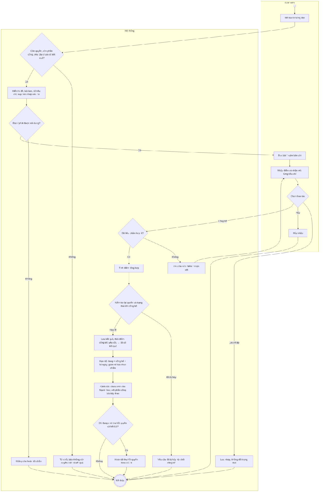
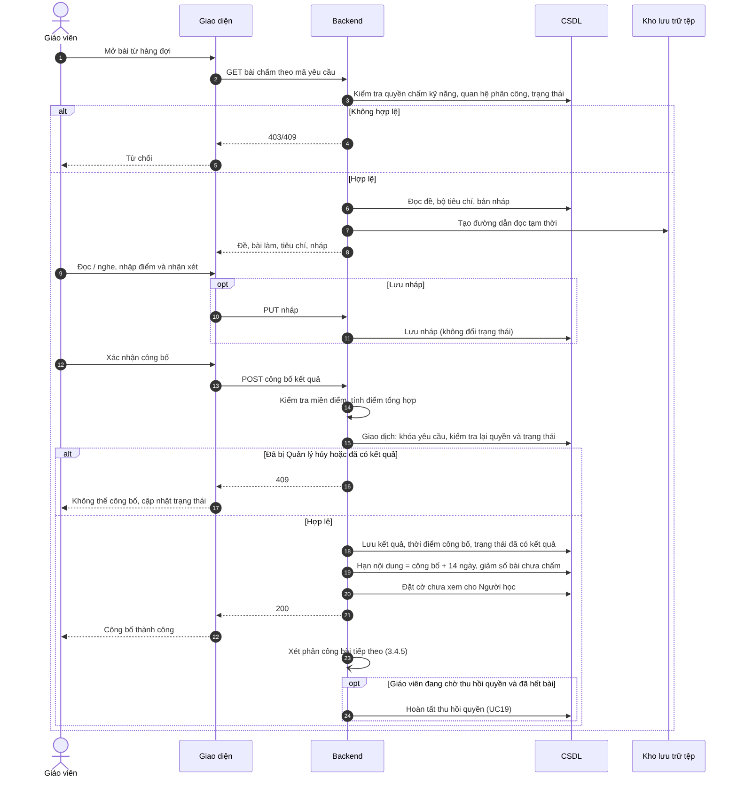

# UC16 – Chấm bài Writing/Speaking

> Nguồn: Chương 3 §3.6.2 (Chương 3 - bản team 10-11 (đã đồng bộ).docx). [← Danh sách use case](README.md)

| Mục | Nội dung |
|---|---|
| Mã use case | UC16 |
| Tên use case | Chấm bài Writing/Speaking |
| Mô tả | Cho phép Giáo viên đánh giá bài được phân công theo tiêu chí IELTS và công bố điểm, nhận xét cho Người học. |
| Actors | Giáo viên. |
| Pre-Conditions | Giáo viên đã đăng nhập, tài khoản còn hoạt động và có quyền chấm kỹ năng tương ứng; yêu cầu chưa có kết quả, chưa bị hủy và đang được phân công cho Giáo viên. |
| Post-Conditions | **Thành công:** điểm, nhận xét, người chấm và thời điểm công bố được lưu; yêu cầu chuyển sang đã có kết quả; nội dung được giữ thêm 14 ngày từ lúc công bố. **Không thành công:** không công bố kết quả chưa hợp lệ; không thay đổi trạng thái hoàn thành chấm. |

## Main flow

1. Giáo viên mở bài từ hàng đợi cá nhân.
2. Backend kiểm tra quyền chấm, quan hệ phân công và trạng thái yêu cầu.
3. Hệ thống hiển thị đề bài, nội dung bài làm và bộ tiêu chí tương ứng.
4. Giáo viên đọc bài viết hoặc nghe bản ghi âm.
5. Nhập điểm và nhận xét theo từng tiêu chí.
6. Hệ thống kiểm tra dữ liệu và tính điểm tổng hợp.
7. Giáo viên xác nhận công bố kết quả.
8. Backend kiểm tra lại quyền và trạng thái, lưu kết quả cùng thời điểm công bố.
9. Cập nhật trạng thái yêu cầu, hạn lưu nội dung và khối lượng bài chưa chấm.
10. Hệ thống cung cấp kết quả cho Người học và kiểm tra khả năng phân công bài tiếp theo.

## Alternative Flow

- A1. Giáo viên chỉnh sửa điểm hoặc nhận xét trước khi xác nhận.
- A2. Giáo viên hủy thao tác nhập: không công bố kết quả; nội dung chưa gửi không được coi là đã lưu.
- A4. Giáo viên lưu nháp: điểm và nhận xét đang nhập được lưu ở trạng thái nháp, chưa công bố và Người học không xem được; Giáo viên mở lại bài từ hàng đợi để tiếp tục.
- A3. Giáo viên đang ngừng nhận bài mới để chuẩn bị thu hồi quyền: vẫn được hoàn thành các bài đã giao. Sau bài cuối cùng thuộc phạm vi cần hoàn tất, hệ thống hoàn tất việc thu hồi quyền theo [UC19](UC19-quan-ly-nguoi-dung.md).

## Exception

- E1. Thiếu điểm, nhận xét bắt buộc hoặc điểm ngoài miền hợp lệ: yêu cầu sửa.
- E2. Không đọc được bài hoặc phát được âm thanh: không hoàn tất chấm khi chưa đủ nội dung đánh giá.
- E3. Bài đã có kết quả hoặc Giáo viên không còn quyền xử lý: từ chối cập nhật.
- E4. Lưu thất bại: không chuyển trạng thái sang đã có kết quả.
- E5. Yêu cầu đã bị Quản lý hủy trong lúc Giáo viên đang chấm: từ chối công bố và cập nhật trạng thái trên giao diện.

## Business Rules

- BR1. Chỉ Giáo viên được phân công và còn quyền chấm mới được công bố kết quả.
- BR2. Ngừng nhận bài mới không đồng nghĩa mất quyền chấm các bài đang phụ trách.
- BR3. Bộ tiêu chí, trọng số và quy tắc làm tròn phải phù hợp với kỹ năng, Task hoặc Part; điểm tổng hợp được tính tại backend. Bộ tiêu chí và quy tắc này là dữ liệu khởi tạo cố định (mục 3.3).
- BR4. Kết quả, trạng thái và thời hạn nội dung phải được cập nhật nhất quán.
- BR5. Không cho sửa kết quả đã công bố trong phạm vi use case này.
- BR6. Sau 14 ngày từ lúc công bố, hệ thống tự xóa nội dung; điểm, nhận xét và lịch sử tối thiểu được giữ lại.
- BR7. Hoàn thành chấm không hoàn lại lượt hỗ trợ đã sử dụng.
- BR8. Công bố kết quả và hủy yêu cầu phải loại trừ lẫn nhau; không cho phép một yêu cầu vừa hoàn thành chấm vừa được hủy và hoàn bonus.
- BR9. Giáo viên không tự từ chối hoặc hủy yêu cầu; việc hủy do không thể hoàn thành được Quản lý xử lý tại [UC19](UC19-quan-ly-nguoi-dung.md).
- BR10. Bản nháp chỉ Giáo viên đang được phân công xem được; nếu yêu cầu bị hủy, bản nháp không được công bố. Lưu nháp không thay đổi trạng thái yêu cầu hay khối lượng bài chưa chấm.

## Sơ đồ

*Hình 3.33. Sơ đồ hoạt động của UC16 – Chấm bài Writing/Speaking*

*Hình 3.34. Sơ đồ tuần tự của UC16 – Chấm bài Writing/Speaking*
