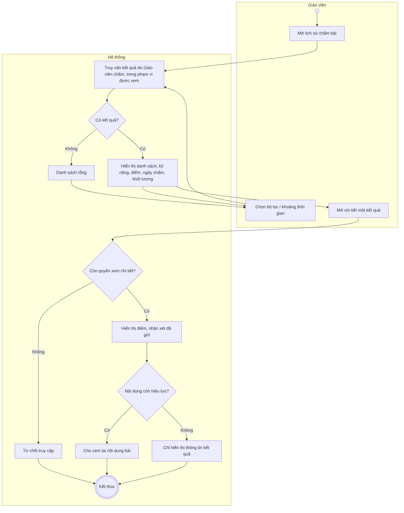
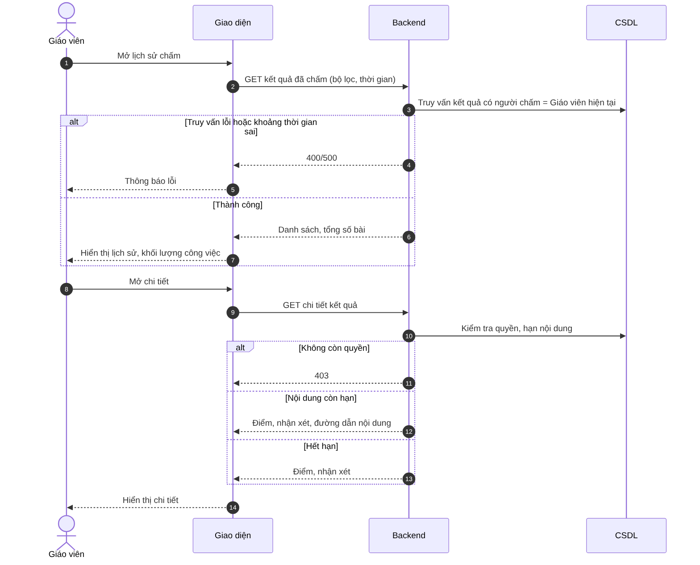

# UC17 – Xem lịch sử bài đã chấm

> Nguồn: Chương 3 §3.6.2 (Chương 3 - bản team 10-11 (đã đồng bộ).docx). [← Danh sách use case](README.md)

| Mục | Nội dung |
|---|---|
| Mã use case | UC17 |
| Tên use case | Xem lịch sử bài đã chấm |
| Mô tả | Cho phép Giáo viên xem lại kết quả do mình thực hiện và theo dõi khối lượng công việc. |
| Actors | Giáo viên. |
| Pre-Conditions | Giáo viên đã đăng nhập và có quyền truy cập khu vực chấm bài. |
| Post-Conditions | Lịch sử và số lượng bài đã chấm trong phạm vi được phép được hiển thị. |

## Main flow

1. Giáo viên mở lịch sử chấm bài.
2. Hệ thống truy vấn kết quả do Giáo viên thực hiện trong phạm vi còn được phép xem.
3. Hiển thị danh sách, kỹ năng, điểm và ngày chấm.
4. Giáo viên chọn bộ lọc hoặc mở chi tiết kết quả.
5. Hệ thống hiển thị điểm và nhận xét đã gửi.
6. Nếu nội dung còn hiệu lực và Giáo viên còn quyền, cho phép xem lại nội dung bài.

## Alternative Flow

- A1. Không có kết quả phù hợp: hiển thị danh sách rỗng.
- A2. Giáo viên chọn khoảng thời gian khác để xem khối lượng công việc.
- A3. Nội dung đã hết hạn: chỉ hiển thị thông tin kết quả còn lưu, không cho mở nội dung.

## Exception

- E1. Không còn quyền xem chi tiết kết quả: từ chối truy cập.
- E2. Khoảng thời gian không hợp lệ hoặc truy vấn thất bại: thông báo lỗi.

## Business Rules

- BR1. Không hiển thị lịch sử của Giáo viên khác.
- BR2. Việc từng chấm một bài không cấp quyền xem toàn bộ lịch sử học tập của Người học.
- BR3. Chức năng này chỉ xem, không sửa kết quả đã công bố.
- BR4. Xem lịch sử không gia hạn nội dung và không khôi phục nội dung đã xóa.

## Sơ đồ

*Hình 3.35. Sơ đồ hoạt động của UC17 – Xem lịch sử bài đã chấm*

*Hình 3.36. Sơ đồ tuần tự của UC17 – Xem lịch sử bài đã chấm*
