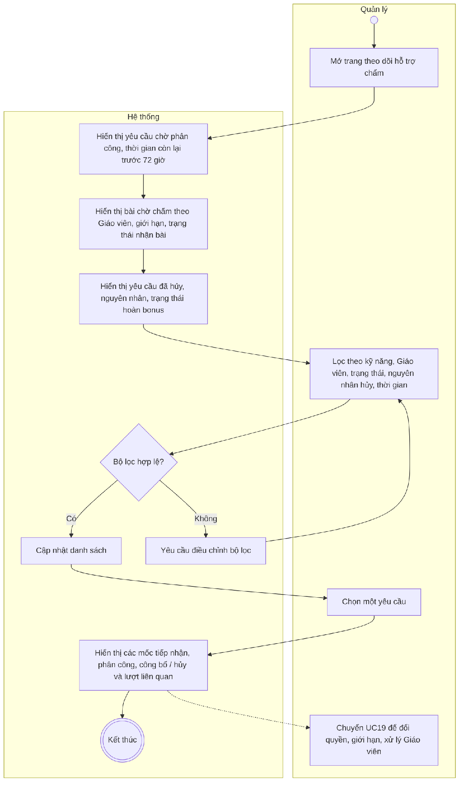
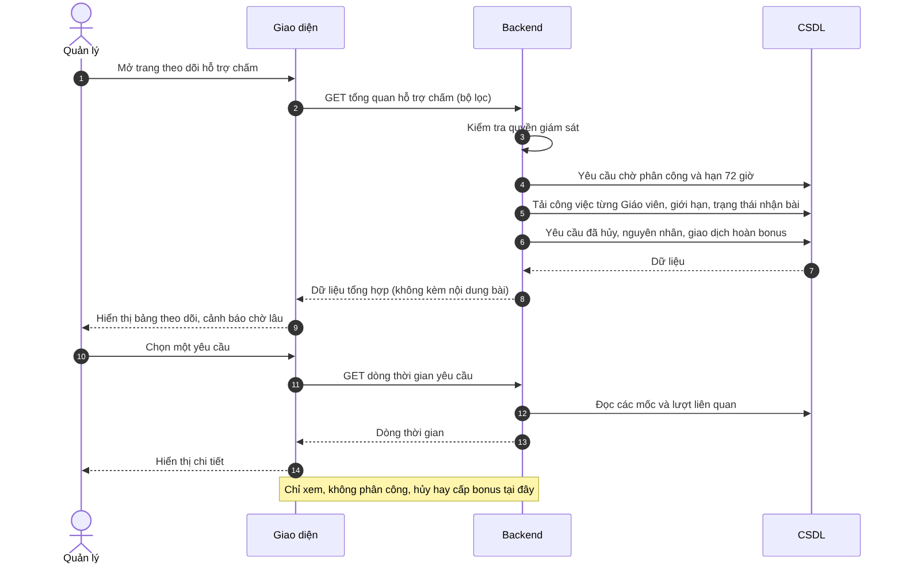

# UC18 – Theo dõi hoạt động hỗ trợ chấm bài

> Nguồn: Chương 3 §3.6.2 (Chương 3 - bản team 10-11 (đã đồng bộ).docx). [← Danh sách use case](README.md)

| Mục | Nội dung |
|---|---|
| Mã use case | UC18 |
| Tên use case | Theo dõi hoạt động hỗ trợ chấm bài |
| Mô tả | Cho phép Quản lý giám sát hàng đợi, tải công việc của Giáo viên, thời gian chờ, yêu cầu bị hủy và việc hoàn lượt hỗ trợ. |
| Actors | Quản lý. |
| Pre-Conditions | Quản lý đã đăng nhập và có quyền giám sát hoạt động hỗ trợ chấm. |
| Post-Conditions | Thông tin vận hành được hiển thị; thao tác xem không thay đổi phân công, lượt hỗ trợ hoặc kết quả chấm. |

## Main flow

1. Quản lý mở trang theo dõi hỗ trợ chấm.
2. Hệ thống hiển thị yêu cầu chờ phân công và thời gian còn lại trước hạn 72 giờ.
3. Hiển thị bài chờ chấm theo từng Giáo viên, số bài chưa chấm, giới hạn nhận bài và trạng thái tiếp nhận bài mới.
4. Hiển thị yêu cầu đã hủy, nguyên nhân và trạng thái hoàn bonus.
5. Quản lý lọc theo kỹ năng, Giáo viên, trạng thái, nguyên nhân hủy hoặc thời gian.
6. Chọn một yêu cầu để xem các mốc tiếp nhận, phân công, công bố hoặc hủy và thông tin lượt liên quan.

## Alternative Flow

- A1. Xem bài chờ lâu theo ngưỡng cảnh báo.
- A2. Xem các Giáo viên đang ngừng nhận bài mới và số bài còn phải hoàn tất trước khi thu hồi quyền.
- A3. Xem yêu cầu bị hủy do quá hạn phân công hoặc do Giáo viên không thể hoàn thành.
- A4. Chuyển sang [UC19](UC19-quan-ly-nguoi-dung.md) để thay đổi quyền, giới hạn tiếp nhận hoặc xử lý ngừng hoạt động của Giáo viên.
- A5. Không có dữ liệu phù hợp: hiển thị danh sách rỗng.

## Exception

- E1. Bộ lọc không hợp lệ: yêu cầu điều chỉnh.
- E2. Không tải được dữ liệu: thông báo và cho phép thử lại.
- E3. Dữ liệu thay đổi trong lúc xem: cập nhật trạng thái mới nhất khi tải lại.
- E4. Giao dịch hoàn bonus đang gặp lỗi: hiển thị trạng thái chưa hoàn tất để Quản lý nhận biết, không trình bày như đã hoàn thành.

## Business Rules

- BR1. Phân biệt thời gian chờ phân công và thời gian chờ chấm.
- BR2. Yêu cầu chưa được phân công khi hết hạn 72 giờ được hủy và hoàn bonus theo [UC34](UC34-gui-yeu-cau-ho-tro-cham-writing-speaking.md).
- BR3. Bài đã phân công không tự động được hoàn lượt chỉ vì thời gian chấm vượt 72 giờ.
- BR4. Phân biệt hai nguyên nhân hủy: quá hạn chưa phân công và Giáo viên không thể hoàn thành.
- BR5. UC18 chỉ giám sát; không trực tiếp hủy yêu cầu, phân công thủ công, sửa điểm hoặc cấp bonus thủ công.
- BR6. Quyền giám sát không mặc định cấp quyền đọc toàn bộ nội dung bài riêng tư.
- BR7. Không có chức năng xem hoặc khôi phục nội dung đã hết hạn.

## Sơ đồ

*Hình 3.37. Sơ đồ hoạt động của UC18 – Theo dõi hoạt động hỗ trợ chấm bài*

*Hình 3.38. Sơ đồ tuần tự của UC18 – Theo dõi hoạt động hỗ trợ chấm bài*
