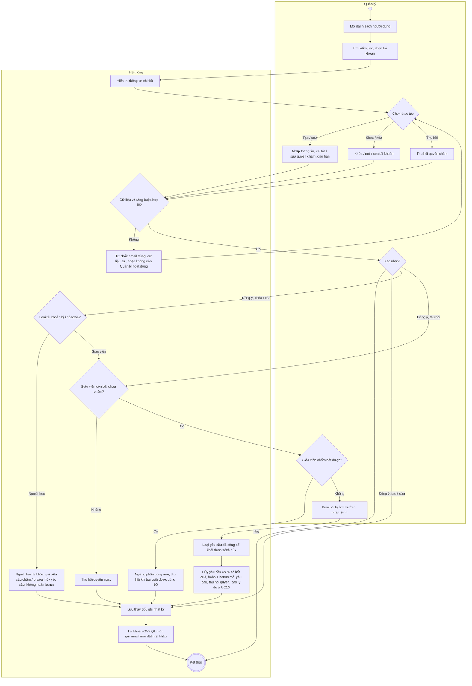
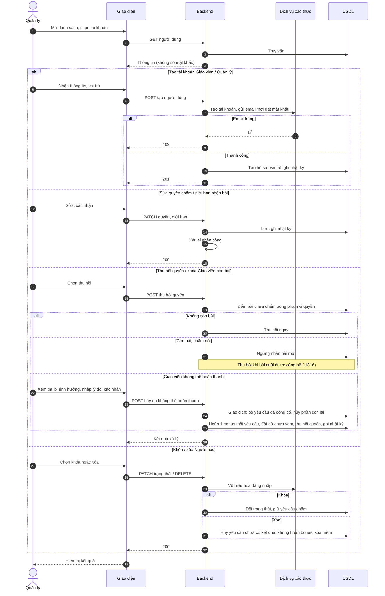

# UC19 – Quản lý người dùng

> Nguồn: Chương 3 §3.6.2 (Chương 3 - bản team 10-11 (đã đồng bộ).docx). [← Danh sách use case](README.md)

| Mục | Nội dung |
|---|---|
| Mã use case | UC19 |
| Tên use case | Quản lý người dùng |
| Mô tả | Cho phép Quản lý xem, tạo, sửa, khóa/mở và xóa tài khoản theo ràng buộc; quản lý quyền chấm, giới hạn nhận bài và xử lý các bài còn tồn khi Giáo viên ngừng phụ trách. |
| Actors | Quản lý. |
| Pre-Conditions | Quản lý đã đăng nhập và có quyền quản trị tài khoản. |
| Post-Conditions | **Thành công:** thông tin, trạng thái hoặc quyền được cập nhật; thao tác được ghi nhật ký. **Chờ hoàn tất công việc:** Giáo viên ngừng nhận bài mới nhưng giữ quyền chấm bài đang phụ trách. **Không thể hoàn thành:** các yêu cầu chưa hoàn tất bị hủy, được ghi nhận hoàn bonus và quyền tương ứng bị thu hồi. **Không thành công:** không thông báo hoàn tất những thay đổi chưa được xử lý đầy đủ. |

## Main flow

1. Quản lý mở danh sách người dùng.
2. Tìm kiếm, lọc và chọn tài khoản.
3. Hệ thống hiển thị thông tin chi tiết được phép quản lý.
4. Quản lý chỉnh sửa thông tin hoặc quyền.
5. Hệ thống kiểm tra dữ liệu và các ràng buộc.
6. Quản lý xác nhận.
7. Hệ thống lưu thay đổi và ghi nhật ký.

## Alternative Flow

- A1. Tạo tài khoản theo vai trò được phép. Với tài khoản Giáo viên hoặc Quản lý mới, hệ thống gửi email mời đặt mật khẩu (cùng cơ chế [UC26](UC26-khoi-phuc-mat-khau.md)), không giao mật khẩu tạm.
- A2. Khóa hoặc mở tài khoản; với Giáo viên còn bài chưa chấm, áp dụng A6 hoặc A7 trước khi hoàn tất thao tác ngừng hoạt động.
- A3. Xóa tài khoản theo chính sách dữ liệu; xử lý các nghĩa vụ chấm còn tồn trước khi hoàn tất.
- A4. Thiết lập quyền chấm Writing/Speaking và giới hạn bài chưa chấm.
- A5. Hủy thao tác: không lưu thay đổi.
- A6. Thu hồi quyền theo quy trình thông thường: hệ thống ngừng phân công mới trong phạm vi quyền cần thu hồi. Nếu còn bài, Giáo viên tiếp tục chấm; khi hoàn tất toàn bộ, hệ thống thu hồi quyền. Nếu không còn bài, thu hồi ngay.
- A7. Giáo viên không thể hoàn thành: Quản lý chọn các quyền cần ngừng, xem danh sách bài bị ảnh hưởng, nhập lý do và xác nhận. Hệ thống kiểm tra lại trạng thái, hủy các yêu cầu chưa hoàn tất, ghi nhận hoàn một bonus cho mỗi yêu cầu, thu hồi quyền và thông báo cho Người học.

## Exception

- E1. Email trùng hoặc dữ liệu không hợp lệ: từ chối lưu.
- E2. Thao tác khiến hệ thống không còn Quản lý hoạt động: từ chối.
- E3. Không đồng bộ được với dịch vụ xác thực: ghi nhận lỗi và xử lý khôi phục, không thông báo thành công toàn bộ.
- E4. Tài khoản có dữ liệu tham chiếu không cho phép xóa vật lý: từ chối xóa vật lý hoặc áp dụng chính sách xóa mềm.
- E5. Một yêu cầu đã được công bố kết quả trước khi xác nhận hủy có hiệu lực: loại yêu cầu đó khỏi danh sách hủy, không hoàn bonus cho yêu cầu đó.
- E6. Xử lý hủy hoặc hoàn bonus thất bại: ghi nhận để thử lại, không tạo lượt hoàn trùng và không để yêu cầu đã hủy tiếp tục được chấm.

## Business Rules

- BR1. Không hiển thị mật khẩu hiện tại của người dùng.
- BR2. Tài khoản bị khóa phải bị từ chối truy cập chức năng được bảo vệ.
- BR3. Không xóa lịch sử học tập hoặc kết quả chấm chỉ vì khóa tài khoản.
- BR4. Theo quy trình thông thường, Giáo viên phải hoàn thành các bài thuộc phạm vi quyền cần thu hồi trước khi mất quyền; trong thời gian này không nhận thêm bài mới.
- BR5. Nếu không thể hoàn thành, Quản lý phải xác nhận hủy và cung cấp lý do; hệ thống không chuyển các bài đó sang phân công lại.
- BR6. Mỗi yêu cầu bị hủy được hoàn một bonus theo thời hạn quy định tại [UC34](UC34-gui-yeu-cau-ho-tro-cham-writing-speaking.md); kết quả đã công bố không bị hủy.
- BR7. Khi khóa, xóa tài khoản hoặc thay đổi vai trò khiến Giáo viên mất toàn bộ khả năng chấm, phải xử lý tất cả bài chưa hoàn thành bị ảnh hưởng.
- BR8. Giảm giới hạn xuống thấp hơn số bài đang phụ trách chỉ ngăn nhận thêm, không tự hủy các phân công hiện có.
- BR9. Thu hồi một quyền theo kỹ năng chỉ tác động đến các bài thuộc kỹ năng đó, trừ khi tài khoản bị khóa hoặc mất toàn bộ vai trò Giáo viên.
- BR10. Thay đổi quyền, giới hạn, lý do hủy và giao dịch hoàn lượt phải được ghi nhật ký.
- BR11. Không cấp quyền theo dõi toàn bộ tiến độ học viên cho Giáo viên qua chức năng này.
- BR12. Khóa tài khoản Người học không hủy yêu cầu hỗ trợ đang hoạt động; xóa tài khoản Người học hủy các yêu cầu chưa có kết quả và không hoàn bonus (mục 3.4.8).

## Sơ đồ

*Hình 3.39. Sơ đồ hoạt động của UC19 – Quản lý người dùng*

*Hình 3.40. Sơ đồ tuần tự của UC19 – Quản lý người dùng*
