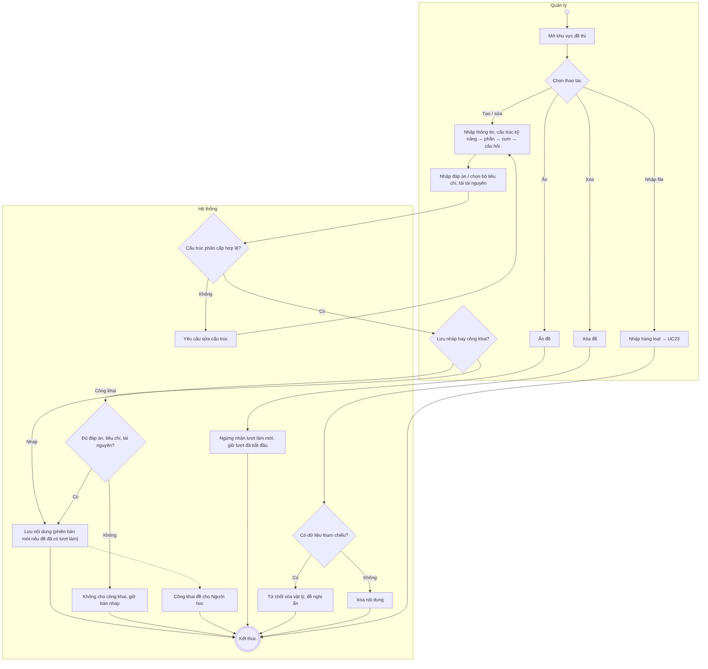
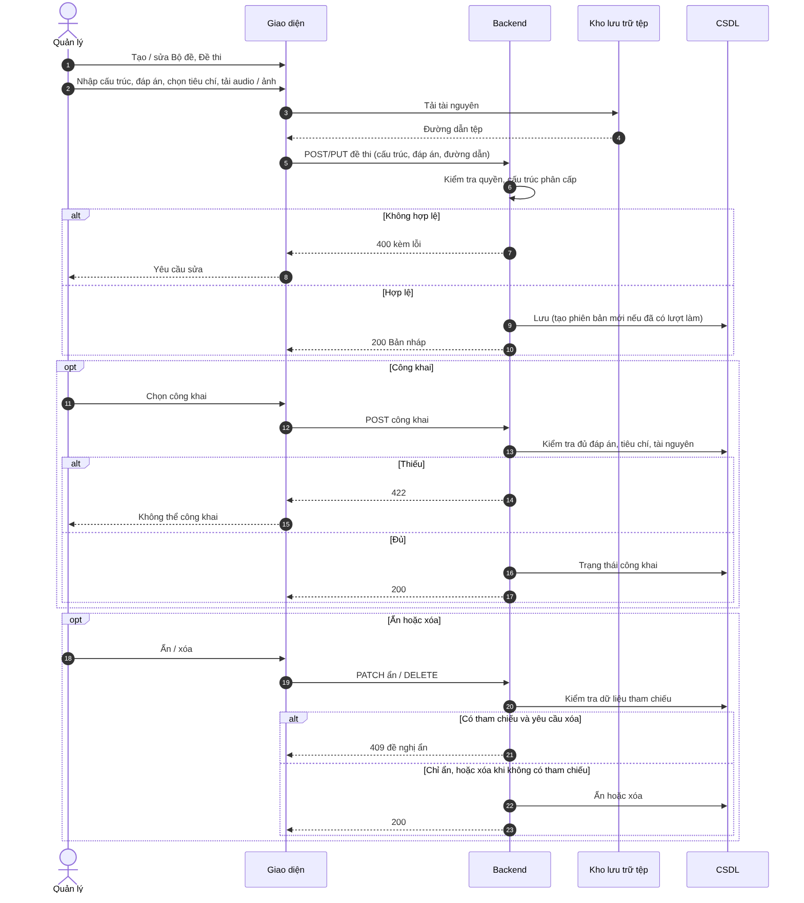

# UC20 – Quản lý Bộ đề và Đề thi

> Nguồn: Chương 3 §3.6.2 (Chương 3 - bản team 10-11 (đã đồng bộ).docx). [← Danh sách use case](README.md)

| Mục | Nội dung |
|---|---|
| Mã use case | UC20 |
| Tên use case | Quản lý Bộ đề và Đề thi |
| Mô tả | Cho phép Quản lý tạo, chỉnh sửa, công khai, ẩn hoặc xóa nội dung đề thi theo cấu trúc phân cấp. |
| Actors | Quản lý. |
| Pre-Conditions | Quản lý đã đăng nhập và có quyền quản lý đề thi. |
| Post-Conditions | Nội dung đề thi được lưu hợp lệ; trạng thái cung cấp được cập nhật nếu có thay đổi. |

## Main flow

1. Quản lý mở khu vực đề thi.
2. Chọn tạo mới hoặc chỉnh sửa Bộ đề/Đề thi.
3. Nhập thông tin và cấu trúc kỹ năng, phần, cụm câu hỏi, câu hỏi.
4. Cung cấp đáp án hoặc bộ tiêu chí và tài nguyên liên quan.
5. Hệ thống kiểm tra cấu trúc và dữ liệu.
6. Lưu nội dung.
7. Khi Quản lý chọn công khai, hệ thống kiểm tra điều kiện sử dụng trước khi cho phép Người học truy cập.

## Alternative Flow

- A1. Lưu bản nháp chưa đủ điều kiện công khai.
- A2. Ẩn đề để ngừng nhận lượt làm mới.
- A3. Xóa nội dung chưa có dữ liệu tham chiếu và đáp ứng ràng buộc.
- A4. Nhập hàng loạt qua [UC23](UC23-nhap-du-lieu-hang-loat.md).

## Exception

- E1. Thiếu đáp án, tiêu chí hoặc tài nguyên bắt buộc: không cho công khai.
- E2. Quan hệ phân cấp không hợp lệ: yêu cầu sửa.
- E3. Nội dung có dữ liệu tham chiếu: từ chối xóa vật lý.

## Business Rules

- BR1. Tuân thủ cấu trúc Bộ đề → Đề thi → Kỹ năng → Phần → Question Group → Question.
- BR2. Listening/Reading phải có đáp án phục vụ chấm; Writing/Speaking phải có tiêu chí phù hợp. Bảng quy đổi band và bộ tiêu chí là dữ liệu khởi tạo cố định, không chỉnh sửa trong UC này.
- BR3. Không sửa nội dung hoặc đáp án theo cách làm thay đổi kết quả lịch sử; sử dụng phiên bản hoặc bản chụp nội dung gắn với lượt làm.
- BR4. Việc ẩn đề không được làm mất bài đã lưu hoặc phá vỡ lượt làm đã bắt đầu.
- BR5. Phân loại Academic/General Training và kỹ năng phải phù hợp để phục vụ bộ lọc thư viện.

## Sơ đồ

*Hình 3.41. Sơ đồ hoạt động của UC20 – Quản lý Bộ đề và Đề thi*

*Hình 3.42. Sơ đồ tuần tự của UC20 – Quản lý Bộ đề và Đề thi*
