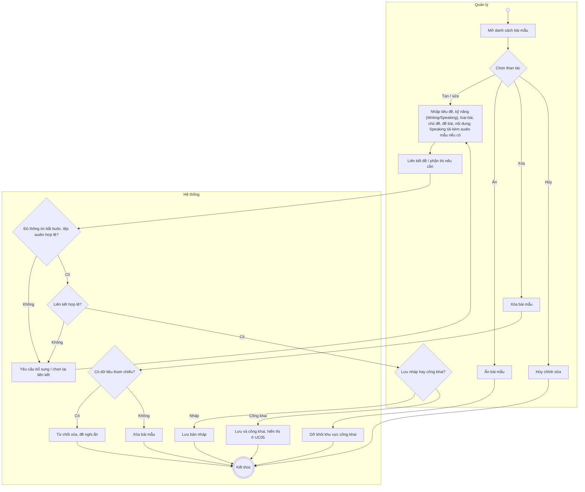
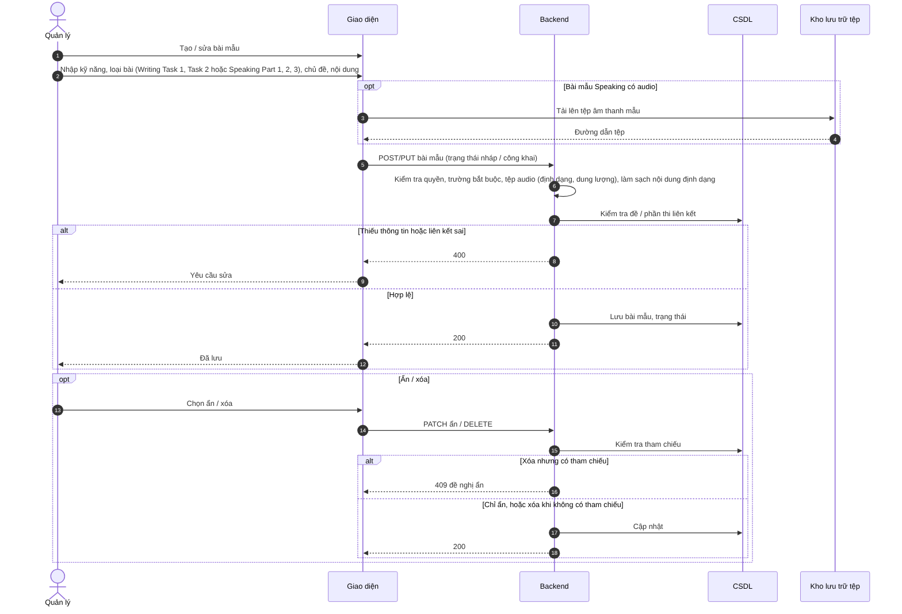

# UC21 – Quản lý bài mẫu

> Nguồn: Chương 3 §3.6.2 (Chương 3 - bản team 10-11 (đã đồng bộ).docx). [← Danh sách use case](README.md)

| Mục | Nội dung |
|---|---|
| Mã use case | UC21 |
| Tên use case | Quản lý bài mẫu |
| Mô tả | Cho phép Quản lý tạo, chỉnh sửa, phân loại và kiểm soát trạng thái cung cấp bài mẫu. |
| Actors | Quản lý. |
| Pre-Conditions | Quản lý đã đăng nhập và có quyền quản lý nội dung học tập. |
| Post-Conditions | Bài mẫu được lưu hoặc thay đổi trạng thái hợp lệ; nội dung công khai được cập nhật tương ứng. |

## Main flow

1. Quản lý mở danh sách bài mẫu.
2. Chọn tạo mới hoặc chỉnh sửa.
3. Nhập tiêu đề, kỹ năng (Writing hoặc Speaking), loại bài, chủ đề, đề bài và nội dung; bài mẫu Speaking nhập bản ghi lời nói và có thể tải kèm tệp âm thanh mẫu.
4. Liên kết với đề hoặc phần thi nếu cần.
5. Hệ thống kiểm tra dữ liệu và liên kết.
6. Quản lý chọn lưu nháp hoặc công khai.
7. Hệ thống lưu và thông báo kết quả.

## Alternative Flow

- A1. Ẩn bài mẫu: bài không còn xuất hiện trong khu vực công khai.
- A2. Xóa bài mẫu chưa có tham chiếu và đủ điều kiện xóa.
- A3. Hủy chỉnh sửa: không lưu thay đổi.

## Exception

- E1. Thiếu thông tin bắt buộc: yêu cầu bổ sung.
- E2. Liên kết đề hoặc phần thi không hợp lệ: yêu cầu chọn lại.
- E3. Bài có dữ liệu tham chiếu: từ chối xóa vật lý và đề nghị ẩn.
- E4. Tệp âm thanh mẫu không đúng định dạng hoặc vượt dung lượng cho phép: từ chối lưu và yêu cầu tải lại.

## Business Rules

- BR1. Chỉ bài mẫu công khai mới được hiển thị trong [UC05](UC05-xem-bai-mau.md).
- BR2. Nội dung có định dạng phải được xử lý an toàn trước khi hiển thị.
- BR3. Quản lý chịu trách nhiệm kiểm tra nguồn và quyền sử dụng nội dung.
- BR4. Thay đổi bài mẫu không được làm mất dữ liệu học tập đang tham chiếu.
- BR5. Trong phạm vi đồ án, bài mẫu dành cho kỹ năng Writing và Speaking. Loại bài Writing: Task 1 Academic, Task 1 General, Task 2; loại bài Speaking: Part 1, Part 2, Part 3.

## Sơ đồ

*Hình 3.43. Sơ đồ hoạt động của UC21 – Quản lý bài mẫu*

*Hình 3.44. Sơ đồ tuần tự của UC21 – Quản lý bài mẫu*
