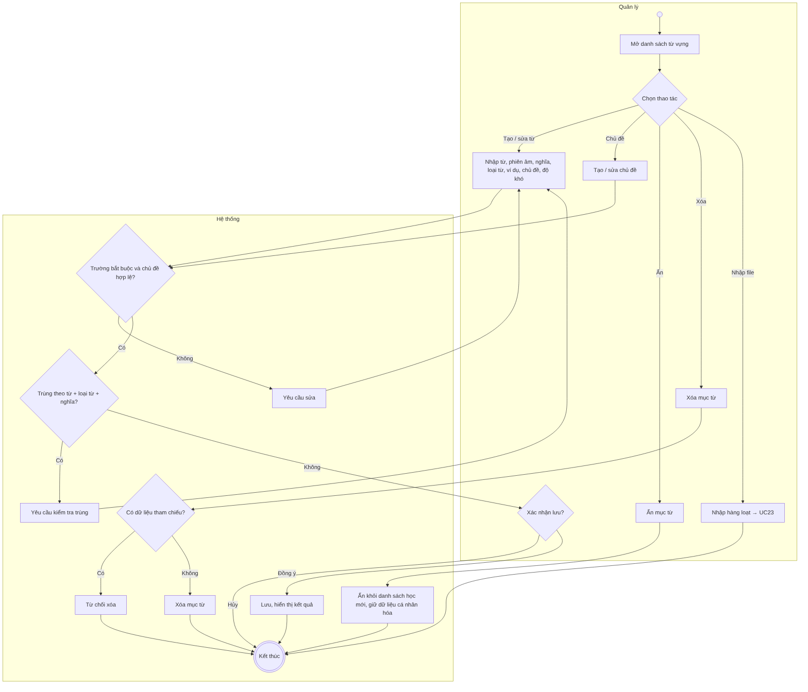
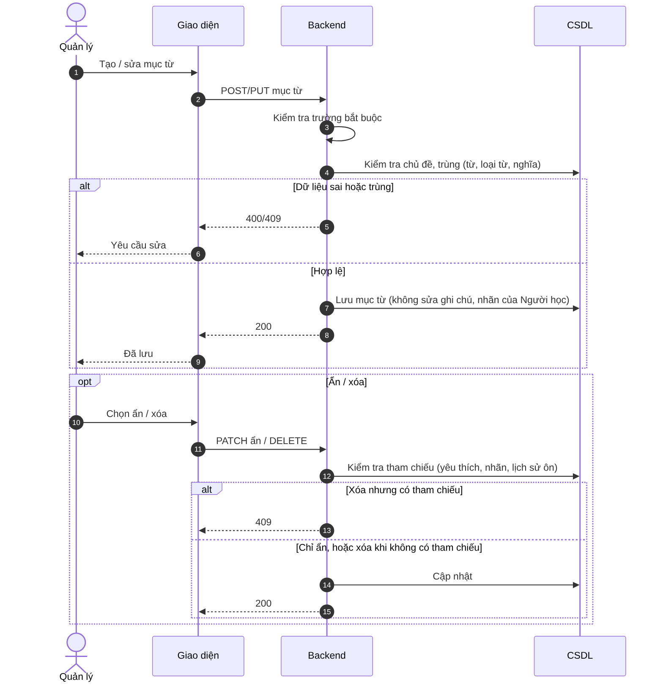

# UC22 – Quản lý từ vựng

> Nguồn: Chương 3 §3.6.2 (Chương 3 - bản team 10-11 (đã đồng bộ).docx). [← Danh sách use case](README.md)

| Mục | Nội dung |
|---|---|
| Mã use case | UC22 |
| Tên use case | Quản lý từ vựng |
| Mô tả | Cho phép Quản lý tạo, chỉnh sửa, phân loại, ẩn hoặc xóa nội dung từ vựng. |
| Actors | Quản lý. |
| Pre-Conditions | Quản lý đã đăng nhập và có quyền quản lý từ vựng. |
| Post-Conditions | Dữ liệu từ vựng hoặc chủ đề được cập nhật; dữ liệu cá nhân hóa liên quan được bảo toàn. |

## Main flow

1. Quản lý mở danh sách từ vựng.
2. Chọn tạo mới hoặc chỉnh sửa một mục từ.
3. Nhập từ, phiên âm, nghĩa, loại từ, ví dụ, chủ đề và độ khó nếu áp dụng.
4. Hệ thống kiểm tra trường bắt buộc và khả năng trùng lặp.
5. Quản lý xác nhận lưu.
6. Hệ thống cập nhật dữ liệu và hiển thị kết quả.

## Alternative Flow

- A1. Tạo hoặc chỉnh sửa chủ đề từ vựng.
- A2. Ẩn một mục từ khỏi danh sách học mới.
- A3. Xóa mục từ chưa có dữ liệu tham chiếu.
- A4. Nhập hàng loạt qua [UC23](UC23-nhap-du-lieu-hang-loat.md).

## Exception

- E1. Dữ liệu không hợp lệ hoặc chủ đề không tồn tại: yêu cầu sửa.
- E2. Bản ghi trùng theo quy tắc hệ thống: yêu cầu kiểm tra lại.
- E3. Từ hoặc chủ đề có dữ liệu tham chiếu: từ chối xóa nếu chưa xử lý quan hệ liên quan.

## Business Rules

- BR1. Không xác định trùng chỉ bằng cách viết của từ, vì một từ có thể có nhiều loại từ hoặc nghĩa.
- BR2. Sửa nội dung gốc không được tự động sửa ghi chú và nhãn cá nhân của Người học.
- BR3. Ưu tiên ẩn thay vì xóa vật lý mục từ đang được sử dụng.
- BR4. Mục từ đã ẩn không xuất hiện trong danh sách học mới; dữ liệu cá nhân hóa đã có không bị xóa.

## Sơ đồ

*Hình 3.45. Sơ đồ hoạt động của UC22 – Quản lý từ vựng*

*Hình 3.46. Sơ đồ tuần tự của UC22 – Quản lý từ vựng*
