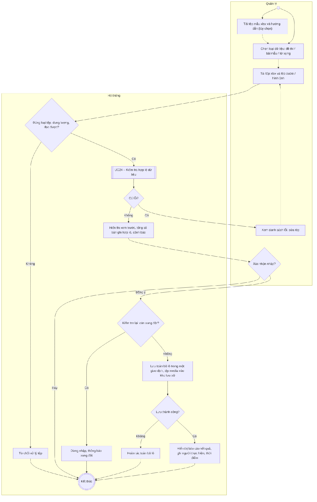
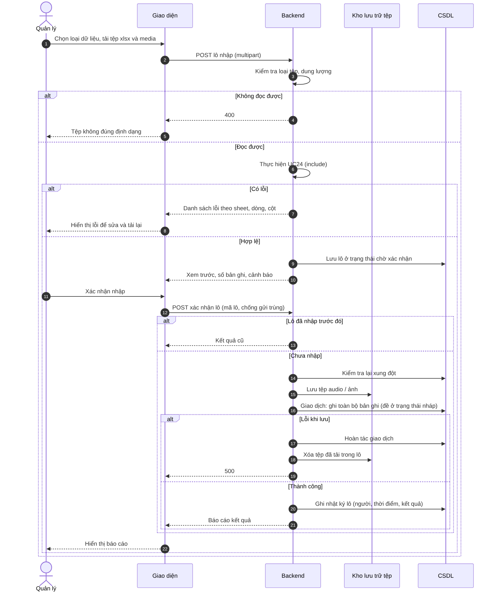

# UC23 – Nhập dữ liệu hàng loạt

> Nguồn: Chương 3 §3.6.2 (Chương 3 - bản team 10-11 (đã đồng bộ).docx). [← Danh sách use case](README.md)

| Mục | Nội dung |
|---|---|
| Mã use case | UC23 |
| Tên use case | Nhập dữ liệu hàng loạt |
| Mô tả | Cho phép Quản lý nhập đề thi, bài mẫu hoặc từ vựng bằng tệp xlsx theo mẫu chuẩn. Mỗi tệp đề thi gồm một kỹ năng của một Đề thi. |
| Actors | Quản lý. |
| Pre-Conditions | Quản lý đã đăng nhập; có tệp dữ liệu xlsx theo mẫu của hệ thống. |
| Post-Conditions | **Thành công:** toàn bộ lô dữ liệu đã xác nhận được lưu và có báo cáo kết quả. **Không thành công:** không tạo lô dữ liệu nghiệp vụ dở dang. |

## Main flow

1. Quản lý chọn loại dữ liệu cần nhập.
2. Tải tệp lên hệ thống. Nếu dữ liệu có tham chiếu audio hoặc hình ảnh, tải kèm các tệp này trong cùng lô.
3. Hệ thống kiểm tra loại tệp và dung lượng.
4. Thực hiện [UC24](UC24-kiem-tra-hop-le-du-lieu.md) – Kiểm tra hợp lệ dữ liệu.
5. Hiển thị bản xem trước và tổng số bản ghi hợp lệ.
6. Quản lý xác nhận nhập.
7. Hệ thống kiểm tra lại điều kiện lưu và ghi dữ liệu trong giao dịch phù hợp.
8. Hiển thị báo cáo kết quả.

## Alternative Flow

- A1. Tải tệp mẫu và hướng dẫn trước khi nhập.
- A2. Có lỗi kiểm tra: hiển thị danh sách lỗi để Quản lý sửa rồi tải lại.
- A3. Quản lý hủy trước khi xác nhận: không nhập dữ liệu.

## Exception

- E1. Tệp không đọc được hoặc không đúng định dạng: từ chối xử lý.
- E2. Xung đột dữ liệu phát sinh sau bước xem trước: dừng nhập và thông báo.
- E3. Lưu thất bại: hoàn tác thay đổi của lô.
- E4. Gửi lại cùng yêu cầu nhập đã hoàn tất: trả kết quả cũ, không nhập trùng.

## Business Rules

- BR1. UC23 luôn bao hàm [UC24](UC24-kiem-tra-hop-le-du-lieu.md).
- BR2. Trong MVP, áp dụng nguyên tắc toàn bộ lô hợp lệ mới được lưu; không tự động bỏ qua dòng lỗi.
- BR3. Không tự động ghi đè dữ liệu trùng nếu chưa có chính sách cập nhật rõ ràng.
- BR4. Nội dung đề thi mới nhập chưa mặc định được công khai.
- BR5. Lô nhập phải có thông tin người thực hiện, thời điểm và kết quả.
- BR6. Tệp audio/hình ảnh không nhúng trong xlsx; hệ thống đối chiếu theo tên tệp ghi trong cột audio_file/image_file và lưu vào kho lưu trữ tệp.

## Sơ đồ

*Hình 3.47. Sơ đồ hoạt động của UC23 – Nhập dữ liệu hàng loạt*

*Hình 3.48. Sơ đồ tuần tự của UC23 – Nhập dữ liệu hàng loạt*
