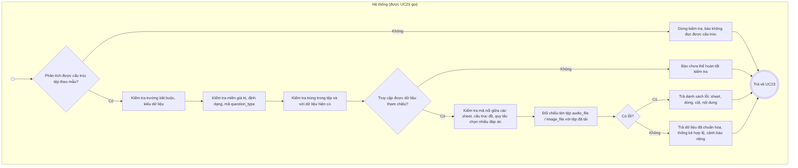
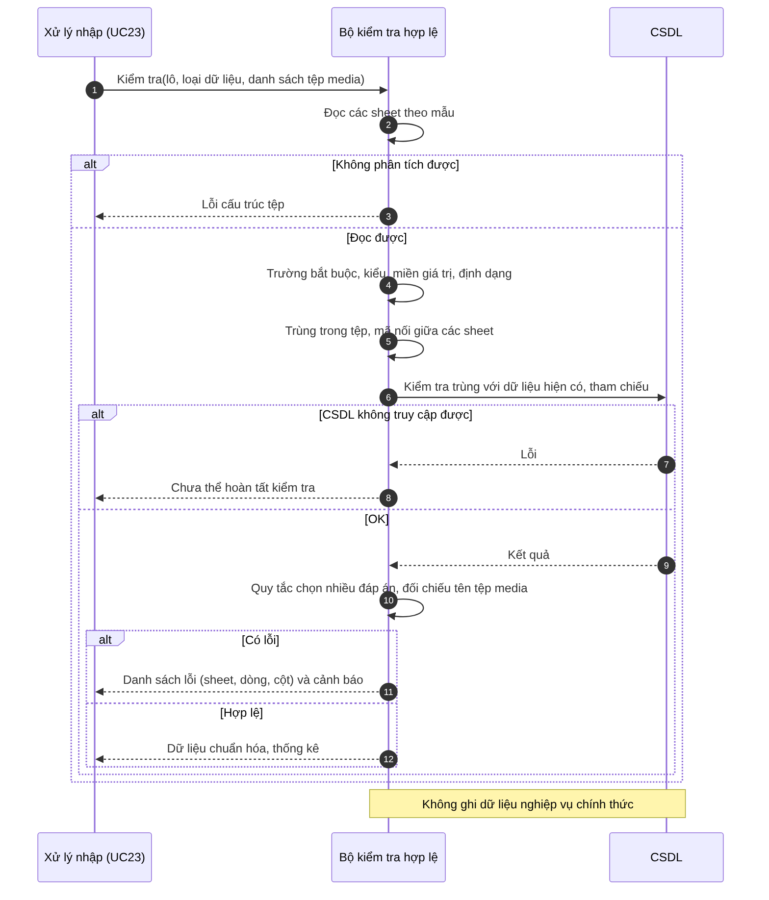

# UC24 – Kiểm tra hợp lệ dữ liệu

> Nguồn: Chương 3 §3.6.2 (Chương 3 - bản team 10-11 (đã đồng bộ).docx). [← Danh sách use case](README.md)

| Mục | Nội dung |
|---|---|
| Mã use case | UC24 |
| Tên use case | Kiểm tra hợp lệ dữ liệu |
| Mô tả | Kiểm tra cấu trúc và quy tắc nghiệp vụ của dữ liệu nhập trước khi lưu. |
| Actors | Quản lý, gián tiếp thông qua [UC23](UC23-nhap-du-lieu-hang-loat.md); không khởi chạy độc lập trong giao diện MVP. |
| Pre-Conditions | [UC23](UC23-nhap-du-lieu-hang-loat.md) đã tiếp nhận tệp có thể đọc được và xác định loại dữ liệu cần nhập. |
| Post-Conditions | Trả kết quả hợp lệ hoặc danh sách lỗi; chưa tạo dữ liệu nghiệp vụ chính thức. |

## Main flow

1. Hệ thống đọc dữ liệu theo mẫu quy định.
2. Kiểm tra trường bắt buộc và kiểu dữ liệu.
3. Kiểm tra miền giá trị và định dạng.
4. Kiểm tra trùng lặp trong tệp và với dữ liệu hiện có.
5. Kiểm tra quan hệ tham chiếu, cấu trúc đề và điều kiện nghiệp vụ; đối chiếu tên tệp audio/hình ảnh được tham chiếu với các tệp đã tải lên.
6. Tổng hợp kết quả và trả về [UC23](UC23-nhap-du-lieu-hang-loat.md).

## Alternative Flow

- A1. Có lỗi dữ liệu: trả danh sách lỗi kèm vị trí dòng, trường và nội dung lỗi.
- A2. Có cảnh báo không ngăn nhập: hiển thị riêng để Quản lý xem xét.
- A3. Không có lỗi: trả dữ liệu đã chuẩn hóa và thống kê hợp lệ.

## Exception

- E1. Không phân tích được cấu trúc tệp: dừng kiểm tra.
- E2. Không truy cập được dữ liệu tham chiếu: báo chưa thể hoàn tất kiểm tra, không kết luận hợp lệ.

## Business Rules

- BR1. Không âm thầm bỏ qua bản ghi sai.
- BR2. Chuẩn hóa dữ liệu không được làm thay đổi ý nghĩa câu hỏi, đáp án hoặc từ vựng.
- BR3. Kết quả kiểm tra trước đó không thay thế ràng buộc cơ sở dữ liệu tại thời điểm lưu.
- BR4. Use case này không công khai nội dung hoặc ghi dữ liệu nghiệp vụ chính thức.
- BR5. Với câu chọn nhiều đáp án, số lựa chọn phải nhiều hơn số đáp án đúng, và số đáp án đúng phải bằng số câu mà câu hỏi đó chiếm.

## Sơ đồ

*Hình 3.49. Sơ đồ hoạt động của UC24 – Kiểm tra hợp lệ dữ liệu*

*Hình 3.50. Sơ đồ tuần tự của UC24 – Kiểm tra hợp lệ dữ liệu*
