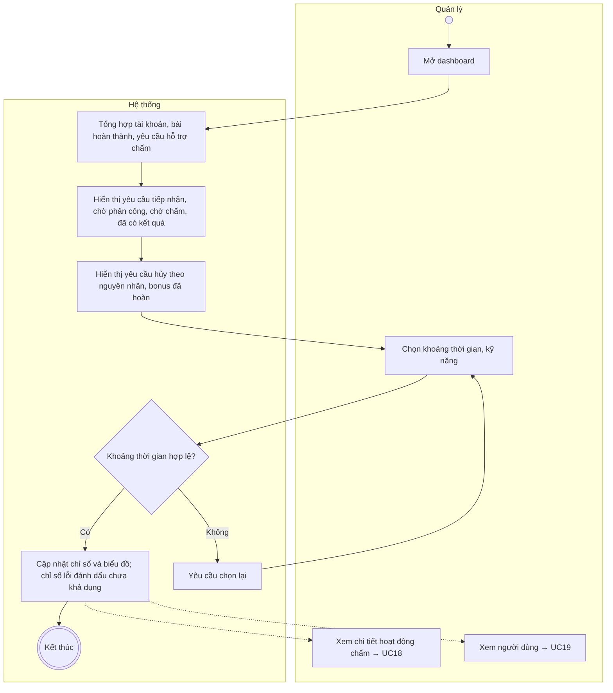
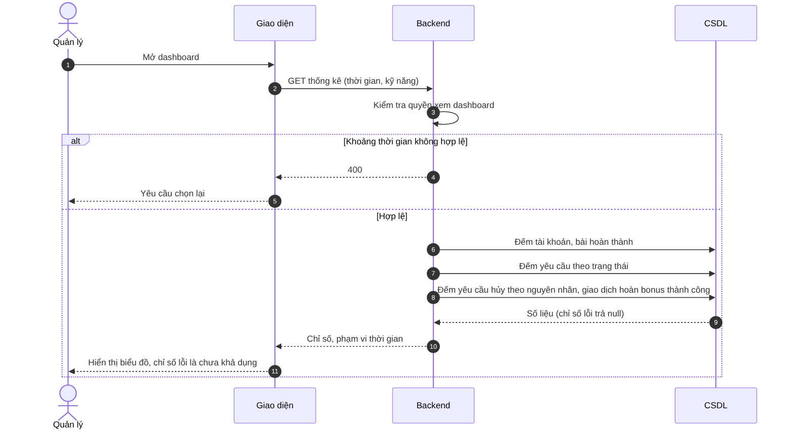

# UC25 – Xem thống kê hệ thống

> Nguồn: Chương 3 §3.6.2 (Chương 3 - bản team 10-11 (đã đồng bộ).docx). [← Danh sách use case](README.md)

| Mục | Nội dung |
|---|---|
| Mã use case | UC25 |
| Tên use case | Xem thống kê hệ thống |
| Mô tả | Cho phép Quản lý theo dõi tình hình sử dụng nền tảng, hoạt động hỗ trợ chấm, các nguyên nhân hủy và số lượt bonus được hoàn. |
| Actors | Quản lý. |
| Pre-Conditions | Quản lý đã đăng nhập và có quyền xem dashboard. |
| Post-Conditions | Các chỉ số tổng hợp được hiển thị theo phạm vi và thời điểm dữ liệu tương ứng; không thay đổi dữ liệu nghiệp vụ. |

## Main flow

1. Quản lý mở dashboard.
2. Hệ thống tổng hợp số tài khoản, bài hoàn thành và yêu cầu hỗ trợ chấm.
3. Hiển thị số yêu cầu tiếp nhận, chờ phân công, chờ chấm và đã có kết quả.
4. Hiển thị số yêu cầu bị hủy, phân tách theo nguyên nhân: quá hạn chưa phân công hoặc Giáo viên không thể hoàn thành.
5. Hiển thị số lượt bonus đã được hoàn.
6. Quản lý chọn khoảng thời gian hoặc kỹ năng.
7. Hệ thống cập nhật các chỉ số và biểu đồ.

## Alternative Flow

- A1. Không có hoạt động trong khoảng thời gian chọn: hiển thị giá trị 0 và biểu đồ rỗng phù hợp.
- A2. Chọn xem chi tiết hoạt động chấm: chuyển sang [UC18](UC18-theo-doi-hoat-dong-ho-tro-cham-bai.md).
- A3. Chọn xem người dùng: chuyển sang [UC19](UC19-quan-ly-nguoi-dung.md).

## Exception

- E1. Khoảng thời gian không hợp lệ: yêu cầu chọn lại.
- E2. Một chỉ số không tải được: đánh dấu chưa khả dụng, không thay bằng 0 gây hiểu nhầm.

## Business Rules

- BR1. Phân biệt số bài đã hoàn thành với số yêu cầu hỗ trợ chấm; một bài có thể có nhiều yêu cầu kế tiếp sau các lần hủy.
- BR2. Chờ phân công và đã phân công – chờ chấm là hai nhóm riêng.
- BR3. Số yêu cầu hủy được phân tách theo lý do, không tính lặp cùng một yêu cầu.
- BR4. Số bonus đã hoàn chỉ tính giao dịch hoàn thành công; giao dịch đang chờ xử lý được thống kê riêng nếu hiển thị.
- BR5. Mỗi chỉ số phải nêu rõ phạm vi thời gian và ý nghĩa.
- BR6. Xóa nội dung hết hạn không làm mất lịch sử tối thiểu và kết quả dùng cho thống kê.
- BR7. Thống kê tổng hợp không mặc định cấp quyền đọc nội dung bài làm cá nhân.

## Sơ đồ

*Hình 3.51. Sơ đồ hoạt động của UC25 – Xem thống kê hệ thống*

*Hình 3.52. Sơ đồ tuần tự của UC25 – Xem thống kê hệ thống*
