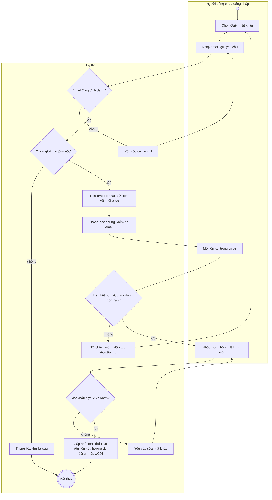
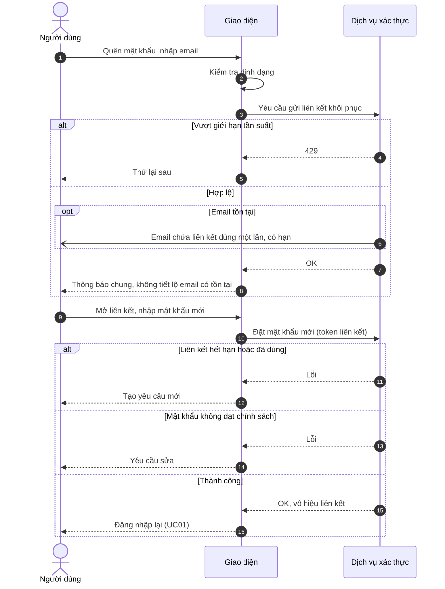

# UC26 – Khôi phục mật khẩu

> Nguồn: Chương 3 §3.6.2 (Chương 3 - bản team 10-11 (đã đồng bộ).docx). [← Danh sách use case](README.md)

| Mục | Nội dung |
|---|---|
| Mã use case | UC26 |
| Tên use case | Khôi phục mật khẩu |
| Mô tả | Cho phép người có tài khoản đặt lại mật khẩu bằng liên kết xác minh gửi qua email. |
| Actors | Người có tài khoản chưa đăng nhập, gồm Người học, Giáo viên và Quản lý. |
| Pre-Conditions | Người dùng truy cập chức năng quên mật khẩu; để hoàn tất phải kiểm soát được email của tài khoản. |
| Post-Conditions | **Thành công:** mật khẩu mới được thiết lập; liên kết đã sử dụng không còn hiệu lực. **Không thành công:** mật khẩu hiện tại không thay đổi. |

## Main flow

1. Người dùng chọn “Quên mật khẩu”.
2. Nhập email và gửi yêu cầu.
3. Hệ thống kiểm tra định dạng và giới hạn tần suất.
4. Nếu email đáp ứng điều kiện, gửi liên kết khôi phục.
5. Hiển thị thông báo chung về việc kiểm tra email.
6. Người dùng mở liên kết, nhập và xác nhận mật khẩu mới.
7. Hệ thống kiểm tra liên kết và chính sách mật khẩu.
8. Cập nhật mật khẩu và hướng dẫn đăng nhập lại.

## Alternative Flow

- A1. Chưa nhận được email: yêu cầu gửi lại trong giới hạn cho phép.
- A2. Người dùng nhớ mật khẩu: quay lại [UC01](UC01-dang-nhap.md).

## Exception

- E1. Email sai định dạng: yêu cầu sửa.
- E2. Liên kết không hợp lệ, hết hạn hoặc đã sử dụng: từ chối và hướng dẫn tạo yêu cầu mới.
- E3. Mật khẩu không hợp lệ hoặc xác nhận không khớp: yêu cầu sửa.
- E4. Vượt giới hạn yêu cầu: thông báo thử lại sau.
- E5. Dịch vụ xác thực không khả dụng: thông báo lỗi phù hợp.

## Business Rules

- BR1. Thông báo công khai không tiết lộ email có tồn tại trong hệ thống hay không.
- BR2. Liên kết khôi phục có thời hạn và chỉ dùng một lần.
- BR3. Đặt lại mật khẩu không tự mở khóa tài khoản.
- BR4. Không gửi mật khẩu mới qua email hoặc ghi vào nhật ký.
- BR5. Việc xử lý các phiên cũ tuân thủ chính sách bảo mật của dịch vụ xác thực.

## Sơ đồ

*Hình 3.53. Sơ đồ hoạt động của UC26 – Khôi phục mật khẩu*

*Hình 3.54. Sơ đồ tuần tự của UC26 – Khôi phục mật khẩu*
