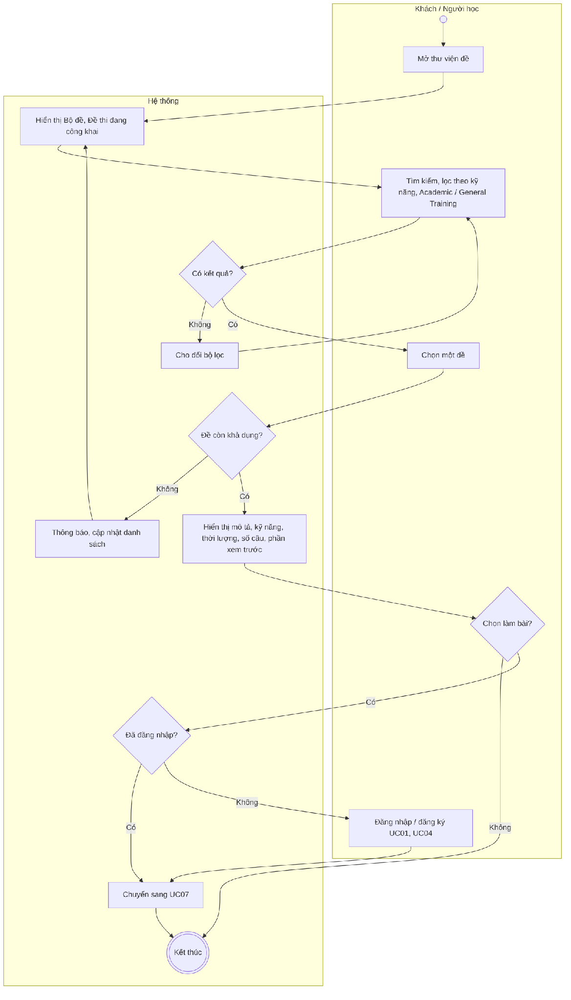
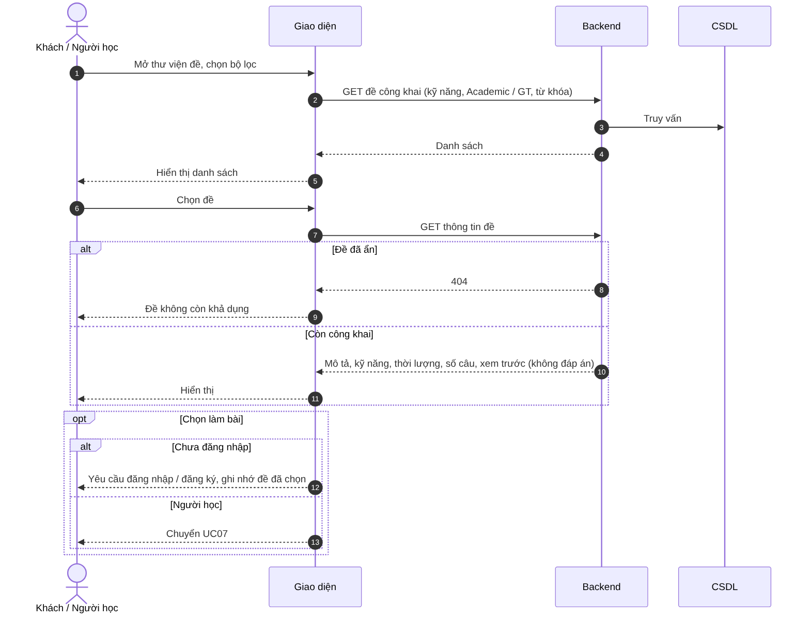

# UC27 – Xem thư viện đề

> Nguồn: Chương 3 §3.6.2 (Chương 3 - bản team 10-11 (đã đồng bộ).docx). [← Danh sách use case](README.md)

| Mục | Nội dung |
|---|---|
| Mã use case | UC27 |
| Tên use case | Xem thư viện đề |
| Mô tả | Cho phép Khách và Người học khám phá, tìm kiếm và xem thông tin đề trước khi làm bài. |
| Actors | Khách, Người học. |
| Pre-Conditions | Người truy cập mở thư viện đề; không bắt buộc đăng nhập. |
| Post-Conditions | Danh sách hoặc thông tin đề được hiển thị; chưa tạo lượt làm bài nếu chưa bắt đầu làm. |

## Main flow

1. Người truy cập mở thư viện đề.
2. Hệ thống hiển thị các Bộ đề và Đề thi đang công khai.
3. Người truy cập tìm kiếm hoặc lọc theo kỹ năng, Academic/General Training.
4. Chọn một đề.
5. Hệ thống hiển thị mô tả, kỹ năng, thời lượng, số câu và phần xem trước được phép.

## Alternative Flow

- A1. Người học chọn làm bài: chuyển sang [UC07](UC07-lam-bai-kiem-tra.md).
- A2. Khách chọn làm bài: yêu cầu đăng nhập hoặc đăng ký, sau đó quay lại đề đã chọn.
- A3. Không có kết quả phù hợp: cho phép đổi bộ lọc.

## Exception

- E1. Đề đã bị ẩn hoặc không còn khả dụng: thông báo và cập nhật danh sách.
- E2. Không tải được dữ liệu: cho phép thử lại.

## Business Rules

- BR1. Chỉ hiển thị đề đang công khai.
- BR2. Xem trước không mặc định cấp quyền xem toàn bộ đề, đáp án hoặc lời giải.
- BR3. Khách không được tạo lượt làm có lưu kết quả.
- BR4. Nội dung dùng chung có thể phù hợp với cả Academic và General Training.
- BR5. Xem thư viện không được tính là hoàn thành phiên học.

## Sơ đồ

*Hình 3.55. Sơ đồ hoạt động của UC27 – Xem thư viện đề*

*Hình 3.56. Sơ đồ tuần tự của UC27 – Xem thư viện đề*
