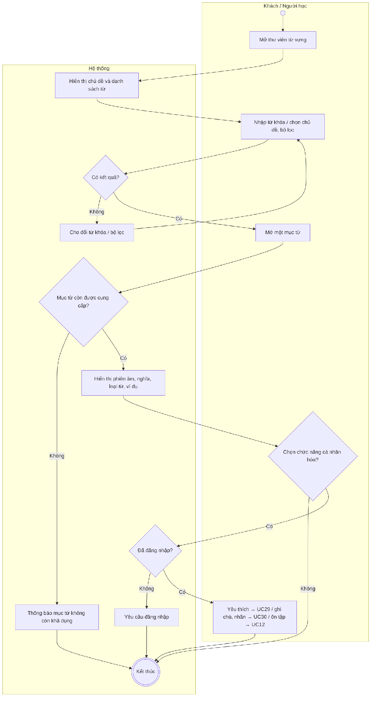
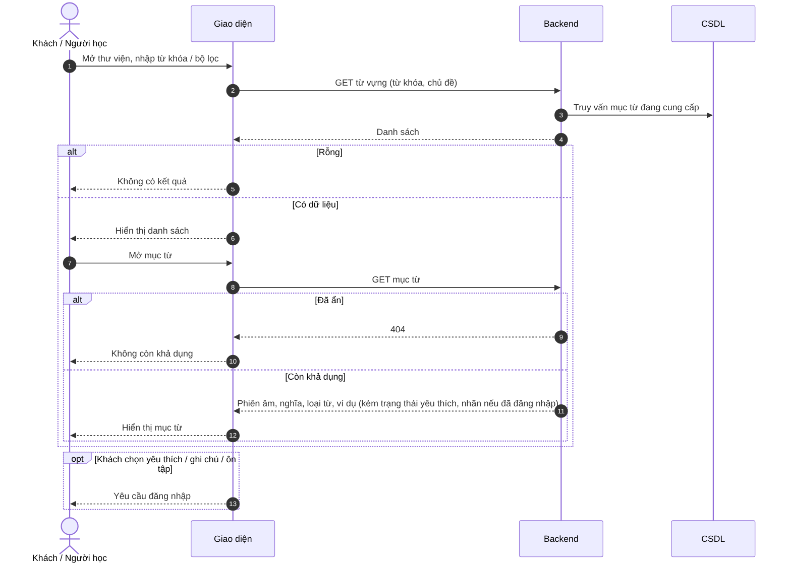

# UC28 – Tra cứu thư viện từ vựng

> Nguồn: Chương 3 §3.6.2 (Chương 3 - bản team 10-11 (đã đồng bộ).docx). [← Danh sách use case](README.md)

| Mục | Nội dung |
|---|---|
| Mã use case | UC28 |
| Tên use case | Tra cứu thư viện từ vựng |
| Mô tả | Cho phép tra cứu nội dung từ vựng công khai mà không bắt buộc đăng nhập. |
| Actors | Khách, Người học. |
| Pre-Conditions | Người truy cập mở thư viện từ vựng. |
| Post-Conditions | Danh sách hoặc nội dung từ được hiển thị; không tự tạo dữ liệu cá nhân hóa. |

## Main flow

1. Người truy cập mở thư viện từ vựng.
2. Hệ thống hiển thị chủ đề và danh sách từ.
3. Người truy cập nhập từ khóa hoặc chọn bộ lọc.
4. Hệ thống trả kết quả phù hợp.
5. Người truy cập mở một mục từ.
6. Hiển thị phiên âm, nghĩa, loại từ và ví dụ.

## Alternative Flow

- A1. Người học lưu yêu thích: chuyển sang [UC29](UC29-quan-ly-tu-yeu-thich.md).
- A2. Người học thêm ghi chú hoặc nhãn: chuyển sang [UC30](UC30-quan-ly-ghi-chu-va-nhan-tu-vung.md).
- A3. Người học chọn ôn tập: chuyển sang [UC12](UC12-on-tap-tu-vung-bang-flashcard.md).
- A4. Khách chọn chức năng cá nhân hóa: yêu cầu đăng nhập.
- A5. Không có kết quả: cho phép đổi từ khóa hoặc bộ lọc.

## Exception

- E1. Mục từ đã bị ẩn: thông báo không còn khả dụng trong thư viện công khai.
- E2. Không tải được dữ liệu: cho phép thử lại.

## Business Rules

- BR1. Chỉ nội dung đang được cung cấp mới xuất hiện trong thư viện.
- BR2. Khách không được lưu yêu thích, ghi chú hoặc kết quả ôn.
- BR3. Nội dung từ vựng gốc chỉ được sửa bởi người có quyền quản trị.
- BR4. Chỉ tra cứu không mặc định được tính là hoàn thành phiên học.

## Sơ đồ

*Hình 3.57. Sơ đồ hoạt động của UC28 – Tra cứu thư viện từ vựng*

*Hình 3.58. Sơ đồ tuần tự của UC28 – Tra cứu thư viện từ vựng*
