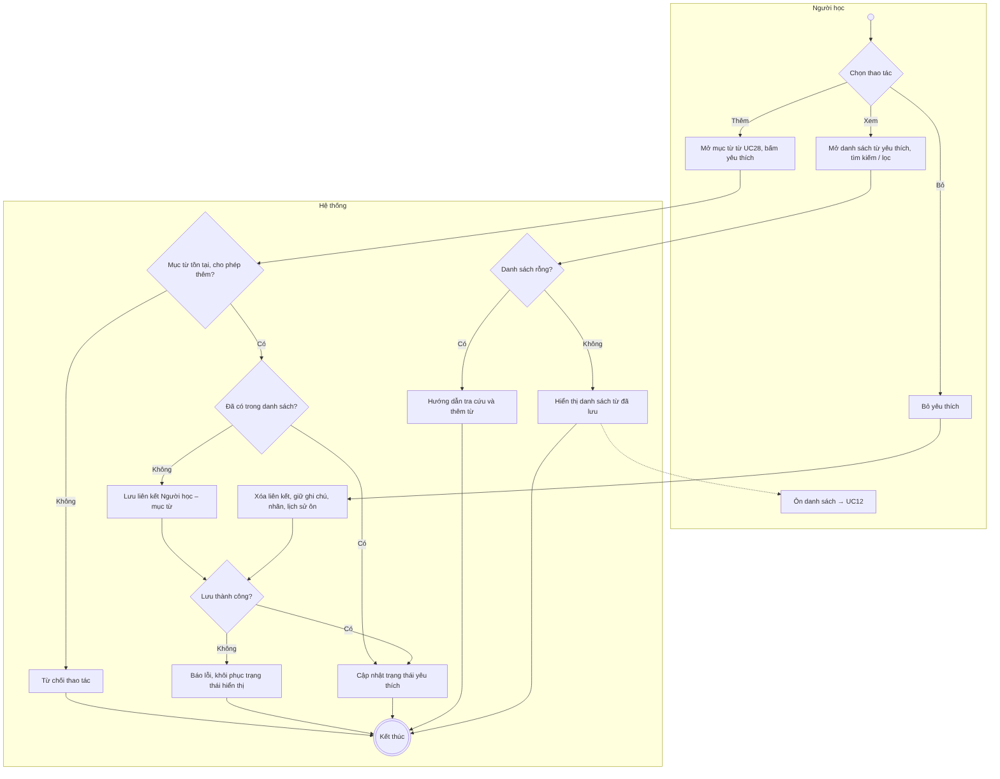
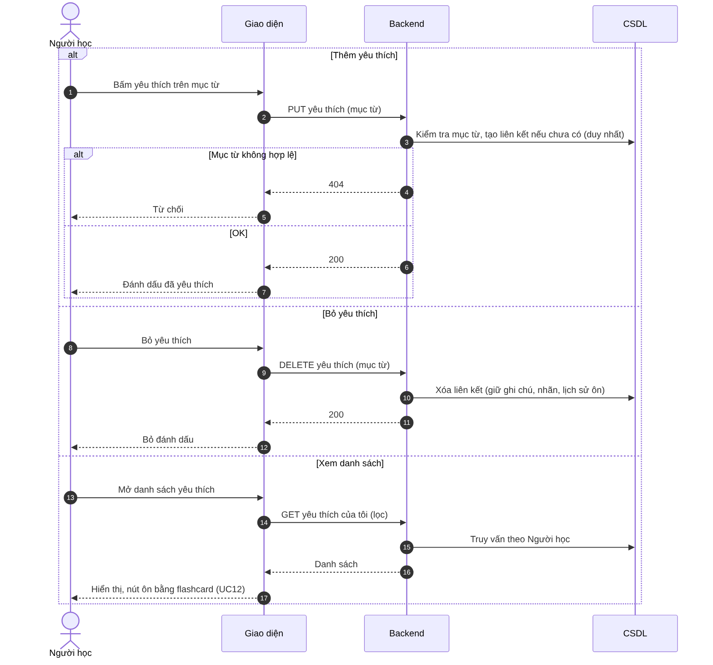

# UC29 – Quản lý từ yêu thích

> Nguồn: Chương 3 §3.6.2 (Chương 3 - bản team 10-11 (đã đồng bộ).docx). [← Danh sách use case](README.md)

| Mục | Nội dung |
|---|---|
| Mã use case | UC29 |
| Tên use case | Quản lý từ yêu thích |
| Mô tả | Cho phép Người học lưu và quản lý danh sách từ muốn học hoặc xem lại. |
| Actors | Người học. |
| Pre-Conditions | Người học đã đăng nhập. |
| Post-Conditions | Danh sách từ yêu thích được hiển thị hoặc cập nhật theo thao tác hợp lệ. |

## Main flow

1. Người học mở một mục từ từ [UC28](UC28-tra-cuu-thu-vien-tu-vung.md).
2. Chọn đánh dấu yêu thích.
3. Backend kiểm tra tài khoản và mục từ.
4. Lưu liên kết giữa Người học và mục từ.
5. Cập nhật trạng thái yêu thích.
6. Người học mở danh sách từ yêu thích để xem các từ đã lưu.

## Alternative Flow

- A1. Bỏ yêu thích: xóa liên kết tương ứng.
- A2. Tìm kiếm hoặc lọc trong danh sách đã lưu.
- A3. Chọn ôn danh sách: chuyển sang [UC12](UC12-on-tap-tu-vung-bang-flashcard.md).
- A4. Danh sách rỗng: hướng dẫn tra cứu và thêm từ.

## Exception

- E1. Mục từ không tồn tại hoặc không được phép thêm mới: từ chối thao tác.
- E2. Không lưu được thay đổi: thông báo và khôi phục trạng thái hiển thị phù hợp.

## Business Rules

- BR1. Một Người học không có nhiều bản ghi yêu thích trùng cho cùng mục từ.
- BR2. Chỉ được thay đổi danh sách của mình.
- BR3. Bỏ yêu thích không xóa ghi chú, nhãn hoặc lịch sử ôn.
- BR4. Từ yêu thích không được mặc định là từ đã học hoặc đã thành thạo.
- BR5. Mục từ bị ẩn không làm mất liên kết cá nhân đã lưu; khả năng học tiếp tuân thủ trạng thái cung cấp nội dung.

## Sơ đồ

*Hình 3.59. Sơ đồ hoạt động của UC29 – Quản lý từ yêu thích*

*Hình 3.60. Sơ đồ tuần tự của UC29 – Quản lý từ yêu thích*
