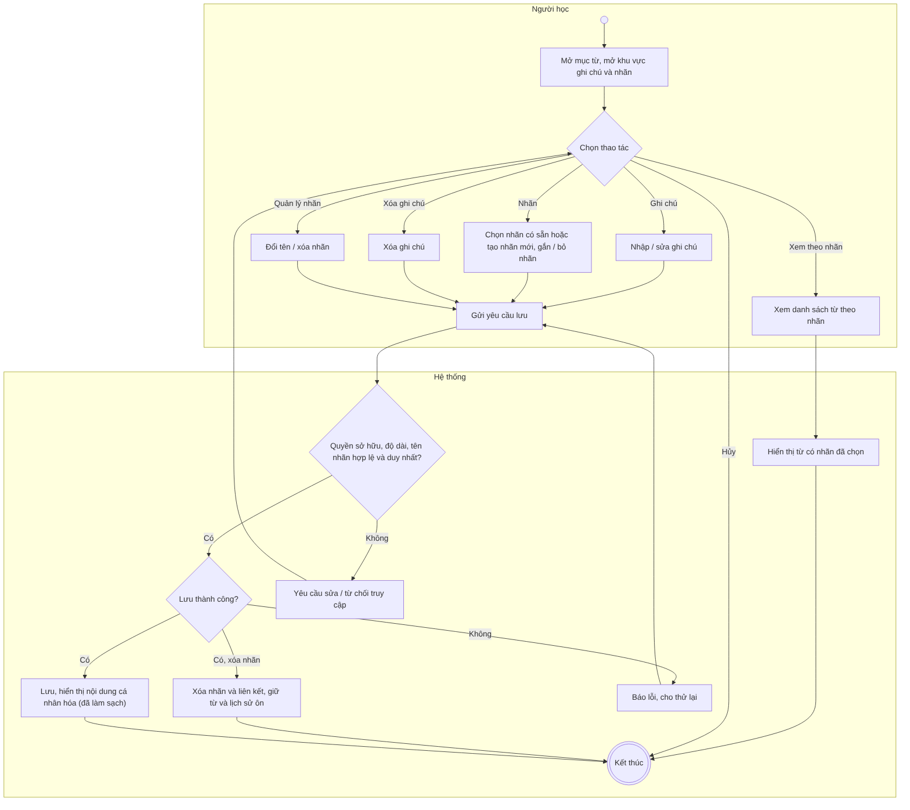
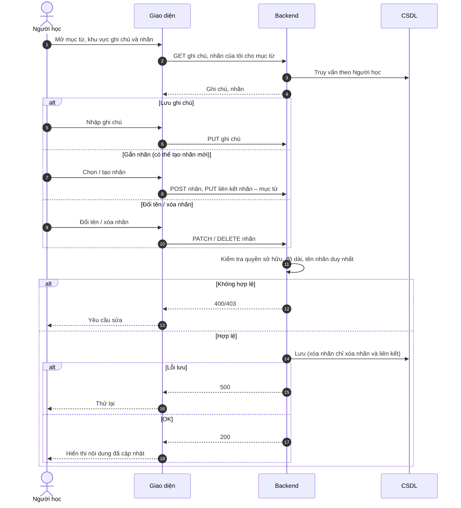

# UC30 – Quản lý ghi chú và nhãn từ vựng

> Nguồn: Chương 3 §3.6.2 (Chương 3 - bản team 10-11 (đã đồng bộ).docx). [← Danh sách use case](README.md)

| Mục | Nội dung |
|---|---|
| Mã use case | UC30 |
| Tên use case | Quản lý ghi chú và nhãn từ vựng |
| Mô tả | Cho phép Người học bổ sung ghi chú và tổ chức từ vựng bằng nhãn cá nhân. |
| Actors | Người học. |
| Pre-Conditions | Người học đã đăng nhập; mục từ liên quan có thể truy cập trong phạm vi cho phép. |
| Post-Conditions | Ghi chú, nhãn hoặc liên kết nhãn được cập nhật; nội dung từ vựng gốc không thay đổi. |

## Main flow

1. Người học mở một mục từ.
2. Mở khu vực ghi chú và nhãn cá nhân.
3. Nhập hoặc sửa ghi chú.
4. Chọn nhãn có sẵn hoặc tạo nhãn mới.
5. Gửi yêu cầu lưu.
6. Backend kiểm tra quyền sở hữu và dữ liệu.
7. Lưu và hiển thị nội dung cá nhân hóa.

## Alternative Flow

- A1. Xóa ghi chú của mục từ.
- A2. Đổi tên hoặc xóa nhãn cá nhân.
- A3. Bỏ nhãn khỏi một từ nhưng giữ nhãn để dùng cho từ khác.
- A4. Xem danh sách từ theo nhãn.
- A5. Hủy chỉnh sửa: không lưu thay đổi.

## Exception

- E1. Nội dung vượt giới hạn hoặc tên nhãn không hợp lệ: yêu cầu sửa.
- E2. Truy cập ghi chú hoặc nhãn của người khác: từ chối.
- E3. Lưu thất bại: thông báo và cho phép thử lại.

## Business Rules

- BR1. Ghi chú và nhãn là dữ liệu riêng của từng Người học.
- BR2. Tên nhãn phải duy nhất trong phạm vi một Người học theo quy tắc chuẩn hóa.
- BR3. Xóa nhãn chỉ xóa nhãn và các liên kết của nó, không xóa từ hoặc lịch sử ôn.
- BR4. Nội dung ghi chú phải được xử lý an toàn khi hiển thị.
- BR5. Không bắt buộc đánh dấu yêu thích trước khi thêm ghi chú hoặc nhãn.

## Sơ đồ

*Hình 3.61. Sơ đồ hoạt động của UC30 – Quản lý ghi chú và nhãn từ vựng*

*Hình 3.62. Sơ đồ tuần tự của UC30 – Quản lý ghi chú và nhãn từ vựng*
