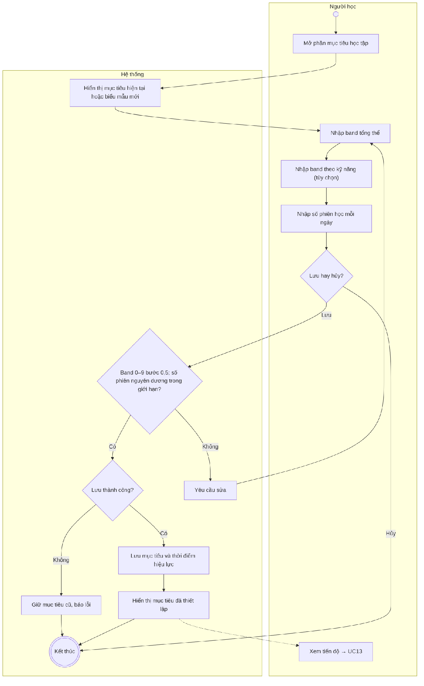
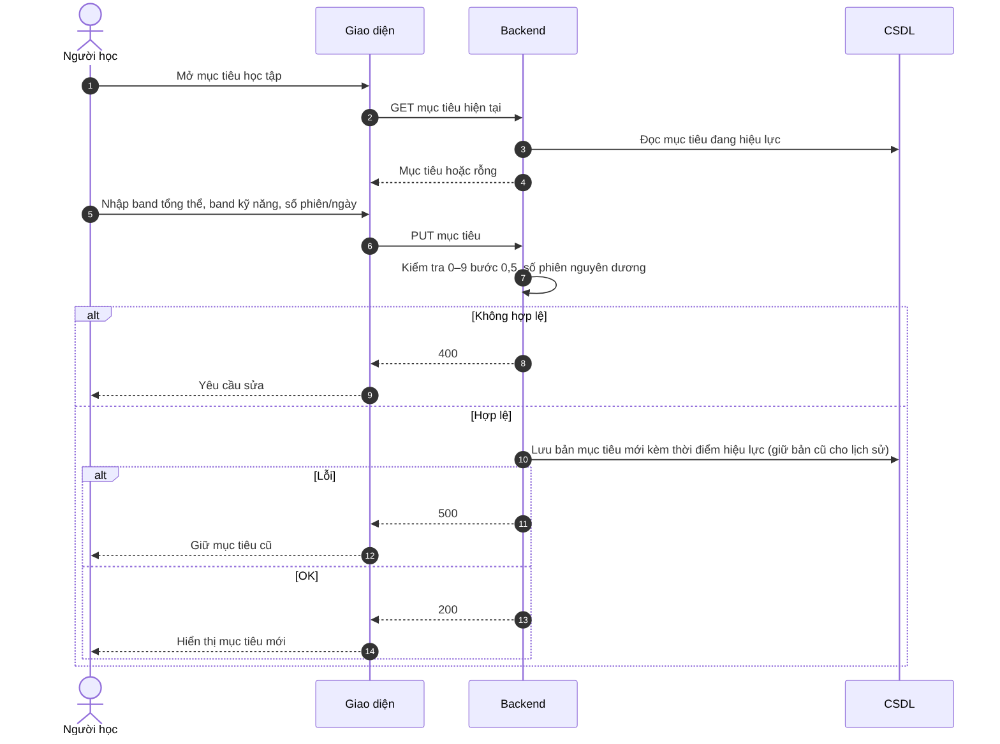

# UC31 – Thiết lập mục tiêu học tập

> Nguồn: Chương 3 §3.6.2 (Chương 3 - bản team 10-11 (đã đồng bộ).docx). [← Danh sách use case](README.md)

| Mục | Nội dung |
|---|---|
| Mã use case | UC31 |
| Tên use case | Thiết lập mục tiêu học tập |
| Mô tả | Cho phép Người học xác định band mong muốn và số phiên học mỗi ngày. |
| Actors | Người học. |
| Pre-Conditions | Người học đã đăng nhập. |
| Post-Conditions | Mục tiêu hợp lệ được lưu và sử dụng để hiển thị tiến độ; lịch sử hoạt động không bị thay đổi. |

## Main flow

1. Người học mở phần mục tiêu học tập.
2. Hệ thống hiển thị mục tiêu hiện tại hoặc biểu mẫu thiết lập mới.
3. Nhập band mục tiêu tổng thể.
4. Nhập band mục tiêu theo kỹ năng nếu có nhu cầu.
5. Nhập số phiên học mỗi ngày.
6. Hệ thống kiểm tra giá trị.
7. Lưu mục tiêu và thời điểm hiệu lực.
8. Hiển thị mục tiêu đã thiết lập.

## Alternative Flow

- A1. Chỉ thiết lập mục tiêu tổng thể và số phiên, bỏ qua mục tiêu từng kỹ năng.
- A2. Cập nhật mục tiêu đã có.
- A3. Hủy thao tác: giữ nguyên mục tiêu hiện tại.
- A4. Xem tiến độ: chuyển sang [UC13](UC13-xem-lich-su-va-thong-ke.md).

## Exception

- E1. Band ngoài thang điểm hoặc không đúng bước điểm: yêu cầu sửa.
- E2. Số phiên không phải số nguyên dương hoặc vượt giới hạn: từ chối lưu.
- E3. Lưu thất bại: giữ mục tiêu cũ và thông báo lỗi.

## Business Rules

- BR1. Chỉ Người học được quản lý mục tiêu của mình.
- BR2. Band mục tiêu nằm trong khoảng 0–9, theo bước 0,5.
- BR3. Mục tiêu tổng thể được nhập độc lập, không mặc định bằng trung bình các mục tiêu kỹ năng.
- BR4. Thay đổi mục tiêu không sửa dữ liệu hoạt động; việc đánh giá lịch sử phải dựa trên mục tiêu có hiệu lực tại thời điểm tương ứng.
- BR5. Đạt số phiên không đồng nghĩa đạt band mục tiêu.
- BR6. Chỉ phiên học hợp lệ được tính vào tiến độ; gửi lại yêu cầu chấm không tạo thêm phiên học hoàn thành.

## Sơ đồ

*Hình 3.63. Sơ đồ hoạt động của UC31 – Thiết lập mục tiêu học tập*

*Hình 3.64. Sơ đồ tuần tự của UC31 – Thiết lập mục tiêu học tập*
