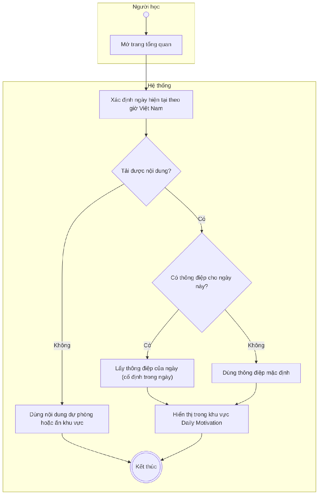
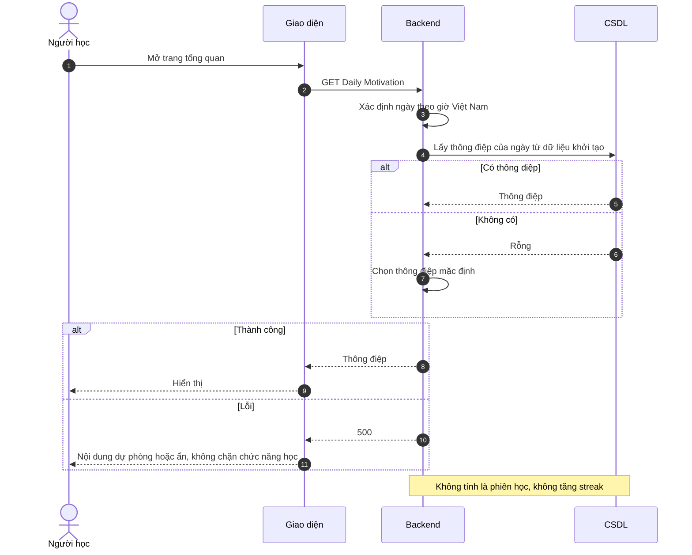

# UC32 – Xem thông điệp động lực hằng ngày

> Nguồn: Chương 3 §3.6.2 (Chương 3 - bản team 10-11 (đã đồng bộ).docx). [← Danh sách use case](README.md)

| Mục | Nội dung |
|---|---|
| Mã use case | UC32 |
| Tên use case | Xem thông điệp động lực hằng ngày |
| Mô tả | Hiển thị thông điệp Daily Motivation để hỗ trợ Người học duy trì động lực. |
| Actors | Người học. |
| Pre-Conditions | Người học đã đăng nhập và mở trang có khu vực Daily Motivation. |
| Post-Conditions | Thông điệp của ngày được hiển thị; không thay đổi điểm hoặc kết quả học tập. |

## Main flow

1. Người học mở trang tổng quan.
2. Hệ thống xác định ngày hiện tại theo múi giờ cấu hình.
3. Lấy thông điệp phù hợp từ nội dung đang hoạt động.
4. Hiển thị thông điệp trong khu vực Daily Motivation.

## Alternative Flow

- A1. Không có nội dung riêng cho ngày hiện tại: sử dụng thông điệp mặc định.
- A2. Truy cập lại trong cùng ngày: hiển thị nhất quán theo quy tắc lựa chọn của hệ thống.

## Exception

- E1. Không tải được dữ liệu: sử dụng nội dung dự phòng hoặc tạm ẩn khu vực này, không ngăn truy cập chức năng học.

## Business Rules

- BR1. Sử dụng múi giờ thống nhất với thống kê ngày và streak.
- BR2. Nội dung phải phù hợp với mục đích học tập và có quyền sử dụng.
- BR3. Xem thông điệp không được tính là phiên học hoặc làm tăng streak.
- BR4. MVP không bắt buộc có trang quản trị riêng nếu thông điệp được chuẩn bị trong dữ liệu khởi tạo.

## Sơ đồ

*Hình 3.65. Sơ đồ hoạt động của UC32 – Xem thông điệp động lực hằng ngày*

*Hình 3.66. Sơ đồ tuần tự của UC32 – Xem thông điệp động lực hằng ngày*
