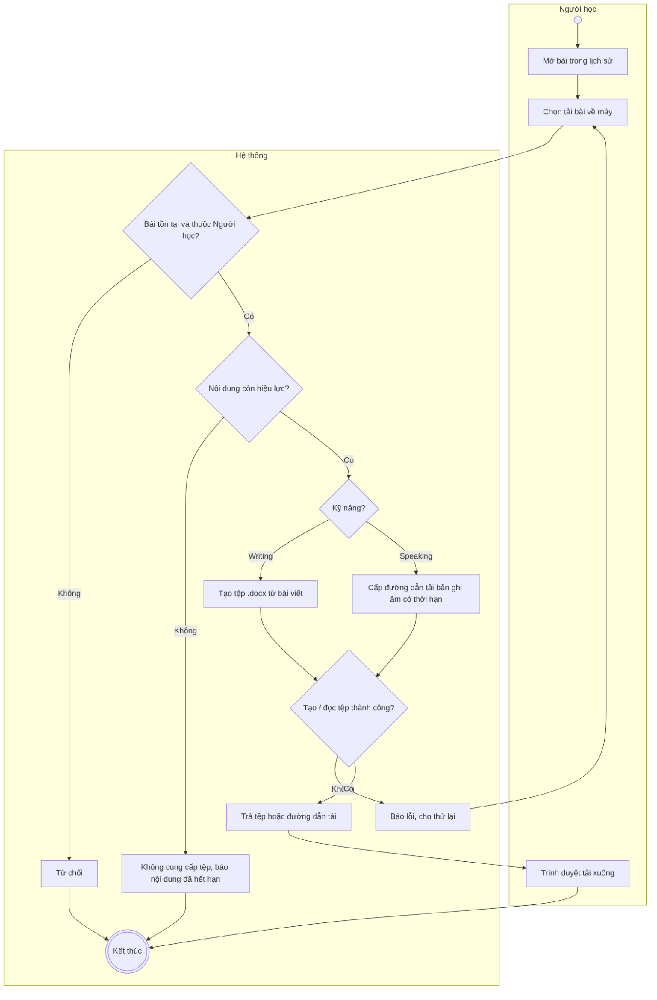
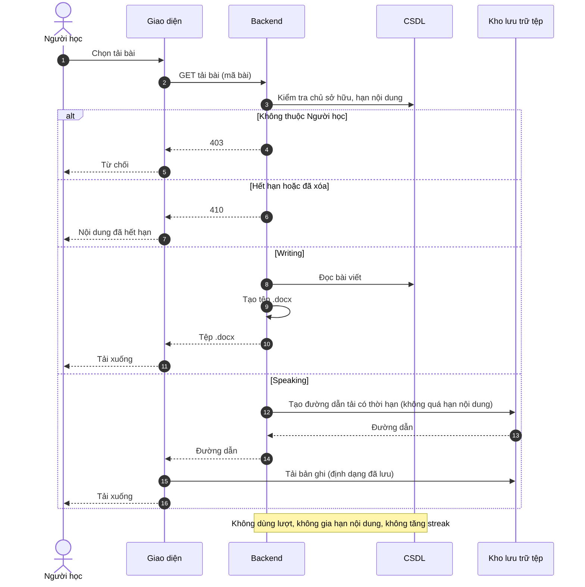

# UC33 – Tải bài làm Writing/Speaking

> Nguồn: Chương 3 §3.6.2 (Chương 3 - bản team 10-11 (đã đồng bộ).docx). [← Danh sách use case](README.md)

| Mục | Nội dung |
|---|---|
| Mã use case | UC33 |
| Tên use case | Tải bài làm Writing/Speaking |
| Mô tả | Cho phép Người học tải nội dung bài còn hiệu lực về máy để tự ôn tập hoặc tự chia sẻ bên ngoài nền tảng. |
| Actors | Người học. |
| Pre-Conditions | Người học đã đăng nhập; bài đã hoàn thành, thuộc về Người học và nội dung còn hiệu lực. |
| Post-Conditions | **Thành công:** tệp được cung cấp cho trình duyệt để tải xuống. **Không thành công:** bài gốc, yêu cầu chấm và lượt hỗ trợ không thay đổi. |

## Main flow

1. Người học mở bài trong lịch sử.
2. Chọn tải bài về máy.
3. Backend kiểm tra quyền sở hữu và thời hạn nội dung.
4. Với Writing, tạo tệp .docx từ nội dung bài đã lưu.
5. Với Speaking, chuẩn bị quyền tải bản ghi âm.
6. Trả tệp hoặc đường dẫn tải có kiểm soát.
7. Trình duyệt thực hiện tải xuống.

## Alternative Flow

- A1. Bài chưa gửi chấm, đang chờ hoặc đã có kết quả: vẫn được tải nếu nội dung còn hiệu lực.
- A2. Người học tải lại: cung cấp tệp mà không tạo bài hoặc yêu cầu chấm mới.
- A3. Người học hủy tải trên trình duyệt: kết thúc thao tác, không thay đổi dữ liệu.

## Exception

- E1. Bài không tồn tại hoặc không thuộc Người học: từ chối.
- E2. Nội dung đã hết hạn hoặc đã bị xóa: không cung cấp tệp.
- E3. Tạo .docx hoặc đọc tệp âm thanh thất bại: thông báo và cho phép thử lại khi nội dung còn hạn.
- E4. Đường dẫn tải hết hạn: kiểm tra quyền và thời hạn nội dung trước khi cấp đường dẫn mới.
- E5. Mất kết nối: cho phép yêu cầu tải lại.

## Business Rules

- BR1. Tải bài không sử dụng lượt hỗ trợ, không tăng streak và không tạo phiên học hoàn thành.
- BR2. Tải bài không gia hạn nội dung.
- BR3. Tệp Writing chứa bài viết và thông tin nhận diện cần thiết; chỉ kèm đề bài nếu quyền sử dụng cho phép.
- BR4. Speaking được tải theo định dạng đã lưu, không mặc định chuyển sang MP3.
- BR5. Không cung cấp đường dẫn công khai cố định; quyền tải tạm thời không được vượt quá hạn nội dung áp dụng.
- BR6. Chia sẻ và nhận phản hồi bên ngoài hệ thống nằm ngoài phạm vi nền tảng.
- BR7. Hệ thống xác nhận đã cung cấp tệp, không mặc định xác nhận tệp đã được lưu thành công trên thiết bị.

## Sơ đồ

*Hình 3.67. Sơ đồ hoạt động của UC33 – Tải bài làm Writing/Speaking*

*Hình 3.68. Sơ đồ tuần tự của UC33 – Tải bài làm Writing/Speaking*
