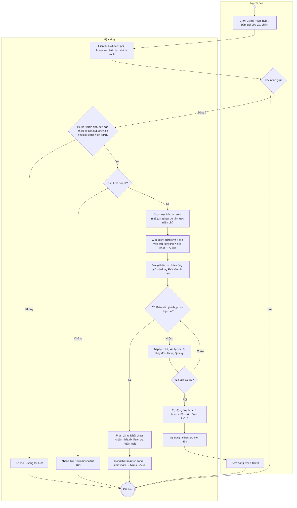
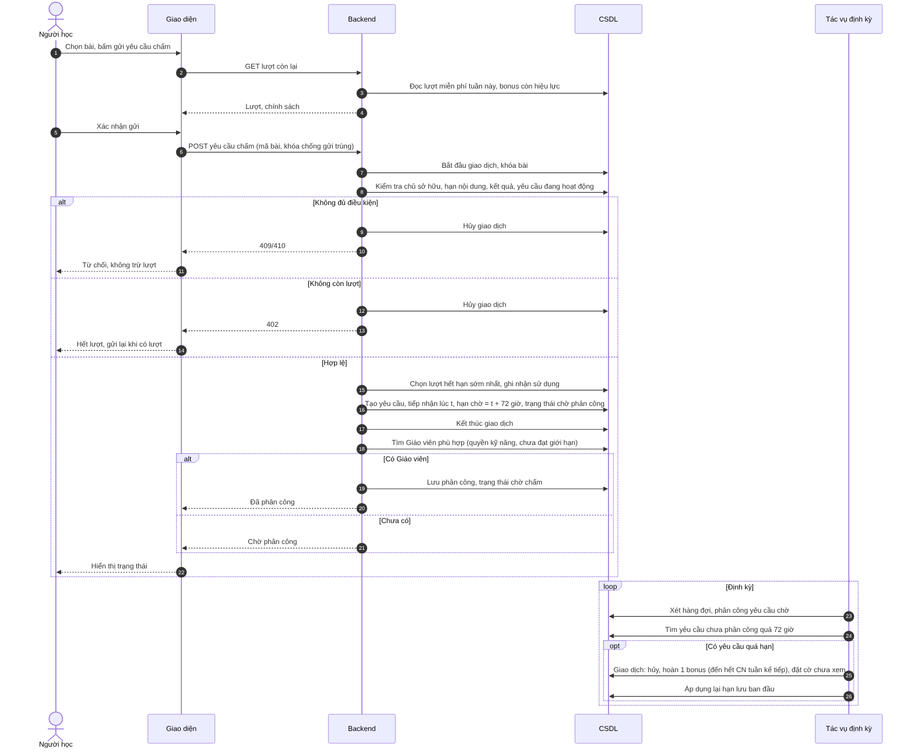

# UC34 – Gửi yêu cầu hỗ trợ chấm Writing/Speaking

> Nguồn: Chương 3 §3.6.2 (Chương 3 - bản team 10-11 (đã đồng bộ).docx). [← Danh sách use case](README.md)

| Mục | Nội dung |
|---|---|
| Mã use case | UC34 |
| Tên use case | Gửi yêu cầu hỗ trợ chấm Writing/Speaking |
| Mô tả | Cho phép Người học chủ động gửi bài đã hoàn thành để được hỗ trợ chấm. Hệ thống kiểm tra lượt, tiếp nhận, tự động phân công và xử lý hủy, hoàn bonus theo quy định. |
| Actors | Người học. |
| Pre-Conditions | Người học đã đăng nhập, tài khoản đang hoạt động; bài Writing/Speaking đã hoàn thành và thuộc về Người học. Lượt hỗ trợ, thời hạn nội dung và trạng thái yêu cầu được kiểm tra khi gửi. |
| Post-Conditions | **Được tiếp nhận:** tạo một yêu cầu, sử dụng một lượt hợp lệ, giữ nội dung và đưa vào hàng đợi hoặc phân công ngay. **Không được tiếp nhận:** không sử dụng lượt, không tạo yêu cầu đang hoạt động; bài tiếp tục tuân theo thời hạn hiện có. **Bị hủy theo chính sách:** yêu cầu kết thúc, Người học được hoàn một bonus; nội dung bài quay về hạn lưu ban đầu. |

## Main flow

1. Người học chọn bài đã hoàn thành và bấm gửi yêu cầu hỗ trợ chấm.
2. Hệ thống hiển thị lượt miễn phí, bonus còn hiệu lực và chính sách hỗ trợ.
3. Người học xác nhận gửi.
4. Backend kiểm tra quyền sở hữu, nội dung còn hiệu lực, bài chưa có kết quả và chưa có yêu cầu đang hoạt động.
5. Kiểm tra và lựa chọn lượt hợp lệ hết hạn sớm nhất.
6. Ghi nhận sử dụng lượt và tạo yêu cầu trong cùng giao dịch; lưu thời điểm tiếp nhận và hạn chờ phân công bằng thời điểm tiếp nhận cộng 72 giờ.
7. Đặt trạng thái chờ phân công và giữ nội dung khỏi quy trình xóa hết hạn.
8. Hệ thống xét hàng đợi để phân công cho Giáo viên phù hợp còn khả năng nhận bài mới.
9. Trả trạng thái chờ phân công hoặc đã phân công cho Người học.

## Alternative Flow

- A1. Không còn lượt: thông báo không tiếp nhận; Người học có thể gửi lại khi có lượt nếu bài chưa hết hạn.
- A2. Chưa có Giáo viên phù hợp còn khả năng nhận bài: tiếp tục chờ và thử phân công lại khi có thay đổi hoặc đến lần xử lý định kỳ.
- A3. Tìm được Giáo viên trước hạn: lưu phân công và chuyển sang đã phân công – chờ chấm.
- A4. Đến hạn 72 giờ vẫn chưa được phân công: hệ thống tự động hủy, loại khỏi hàng đợi, hoàn một bonus và thông báo cho Người học.
- A5. Giáo viên không thể hoàn thành bài đã nhận: sau khi Quản lý xác nhận tại [UC19](UC19-quan-ly-nguoi-dung.md), hệ thống hủy yêu cầu, hoàn một bonus và thông báo lý do.
- A6. Sau khi hủy, bài còn hạn lưu ban đầu: Người học có thể chủ động gửi yêu cầu mới bằng lượt hợp lệ.
- A7. Sau khi hủy, bài đã quá hạn lưu ban đầu: nội dung hết hiệu lực và được tự động xóa; bonus vẫn dùng được cho bài khác.
- A8. Người học hủy thao tác trước khi xác nhận gửi: không sử dụng lượt.

## Exception

- E1. Bài hết hạn, nội dung không khả dụng hoặc không thuộc Người học: từ chối tiếp nhận, không trừ lượt.
- E2. Bài đã có yêu cầu đang hoạt động hoặc đã có kết quả: không tạo yêu cầu mới.
- E3. Gửi lặp hoặc gửi đồng thời: kiểm tra trong giao dịch; không tạo yêu cầu hay trừ lượt trùng.
- E4. Không lưu được yêu cầu: hoàn tác sử dụng lượt, không thông báo tiếp nhận thành công.
- E5. Phân công gặp lỗi sau khi đã tiếp nhận: giữ yêu cầu chờ trong hạn, không trừ thêm lượt.
- E6. Hủy hoặc hoàn bonus gặp lỗi: ghi nhận để thử lại; không cho yêu cầu quá hạn được phân công hoặc yêu cầu đã hủy được chấm tiếp.
- E7. Không cập nhật được dấu hiệu chưa xem: trạng thái và lượt đã xử lý vẫn được giữ; Người học kiểm tra qua [UC35](UC35-xem-va-quan-ly-thong-bao.md).
- E8. Công bố kết quả đồng thời với thao tác hủy: hệ thống chỉ cho một chuyển trạng thái hợp lệ thành công.

## Business Rules

- BR1. Mỗi Người học đang hoạt động có một lượt miễn phí mỗi tuần, dùng chung Writing/Speaking; lượt chưa dùng không cộng dồn.
- BR2. Tuần tính từ 00:00 thứ Hai đến trước 00:00 thứ Hai kế tiếp theo giờ Việt Nam.
- BR3. Một yêu cầu tương ứng với một bài của một kỹ năng và sử dụng một lượt.
- BR4. Ưu tiên lượt hết hạn sớm nhất; nếu cùng hạn, ưu tiên lượt miễn phí.
- BR5. Kiểm tra lượt, sử dụng lượt và tạo yêu cầu phải nhất quán; mỗi bài có tối đa một yêu cầu đang hoạt động.
- BR6. Xử lý theo thứ tự tiếp nhận trong nhóm kỹ năng có Giáo viên đủ điều kiện; ưu tiên Giáo viên có ít bài chưa chấm nhất, sau đó là người lâu chưa nhận bài hơn.
- BR7. Giáo viên phải đang hoạt động, có quyền chấm kỹ năng tương ứng, còn nhận bài mới và chưa đạt giới hạn bài chưa chấm.
- BR8. Hết 72 giờ mà chưa được phân công thì hủy; yêu cầu đã quá hạn không được phân công tiếp.
- BR9. Yêu cầu đã phân công chỉ bị hủy theo trường hợp Giáo viên không thể hoàn thành và có xác nhận của Quản lý; không tự hủy do thời gian chấm vượt 72 giờ.
- BR10. Mỗi yêu cầu bị hủy theo hai trường hợp trên được hoàn đúng một bonus, bất kể trước đó sử dụng lượt miễn phí hay bonus.
- BR11. Bonus có hiệu lực từ lúc được hoàn đến hết Chủ nhật của tuần kế tiếp, tính theo tuần được hoàn; không làm mất lượt miễn phí của tuần mới.
- BR12. Yêu cầu gửi lại nếu tiếp tục bị hủy hợp lệ cũng được hoàn một bonus cho lần hủy đó; không hoàn trùng cùng một yêu cầu.
- BR13. Không chuyển bài bị hủy do Giáo viên không thể hoàn thành sang phân công lại. Muốn tiếp tục, Người học phải chủ động tạo yêu cầu mới khi bài còn hạn và có lượt.
- BR14. Nội dung được giữ khi yêu cầu đang hoạt động; khi hủy áp dụng lại hạn lưu ban đầu; khi có kết quả áp dụng hạn 14 ngày từ lúc công bố.
- BR15. Không tự gửi lại bài khi sang tuần mới hoặc sau khi hoàn bonus.
- BR16. Bài đã có kết quả không được gửi chấm lại trong MVP.
- BR17. Tác vụ chạy lại không được tạo yêu cầu, phân công hoặc bonus trùng; không cho một yêu cầu vừa có kết quả vừa bị hủy và hoàn lượt.

## Sơ đồ

*Hình 3.69. Sơ đồ hoạt động của UC34 – Gửi yêu cầu hỗ trợ chấm Writing/Speaking*

*Hình 3.70. Sơ đồ tuần tự của UC34 – Gửi yêu cầu hỗ trợ chấm Writing/Speaking*
