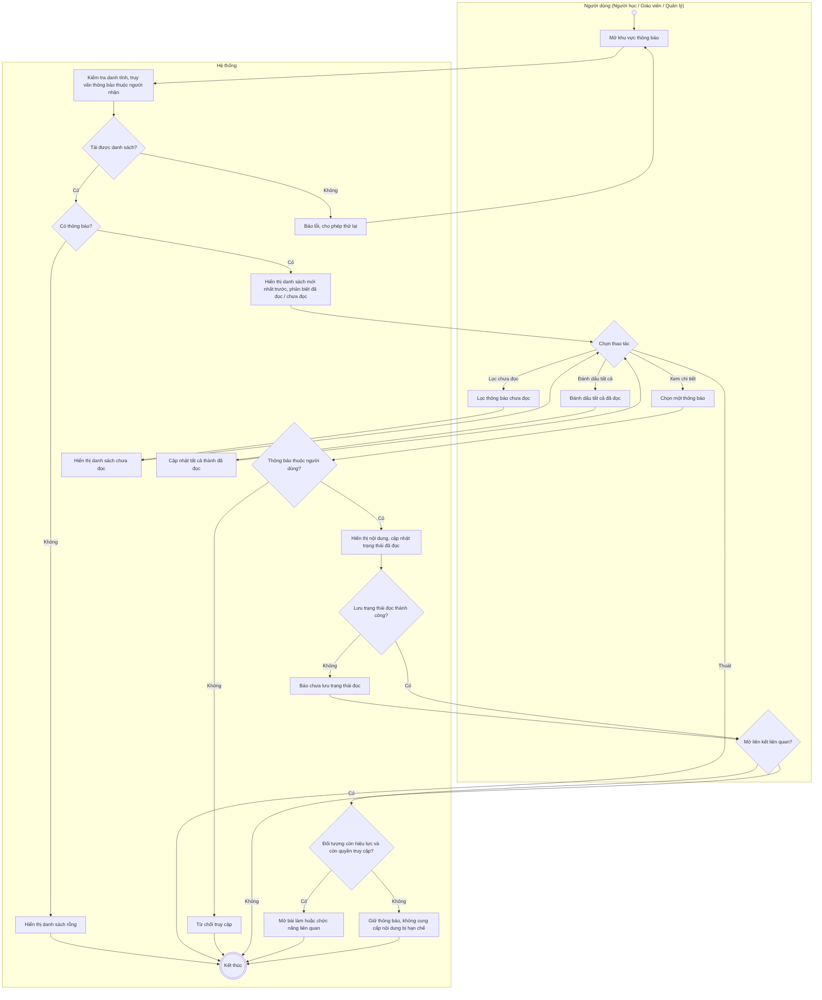
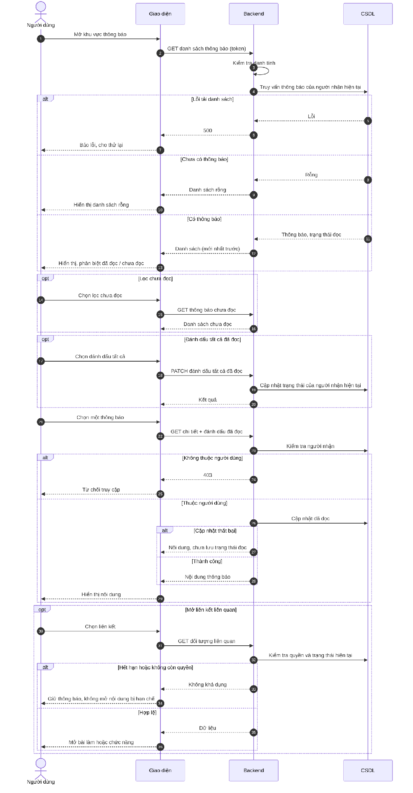

# UC35 – Xem và quản lý thông báo

> Nguồn: Chương 3 §3.6.2 (Chương 3 - bản team 10-11 (đã đồng bộ).docx). [← Danh sách use case](README.md)

| Mục | Nội dung |
|---|---|
| Mã use case | UC35 |
| Tên use case | Xem và quản lý thông báo |
| Mô tả | Cho phép người dùng xem thông báo liên quan đến tài khoản và hoạt động của mình, đánh dấu đã đọc và mở chức năng liên quan. |
| Actors | Người học, Giáo viên, Quản lý. |
| Pre-Conditions | Người dùng đã đăng nhập và tài khoản đang hoạt động. |
| Post-Conditions | Danh sách hoặc chi tiết thông báo được hiển thị; trạng thái đã đọc được cập nhật khi thao tác thành công. |

## Main flow

1. Người dùng mở khu vực thông báo.
2. Backend kiểm tra danh tính và truy vấn thông báo thuộc người nhận.
3. Hiển thị danh sách theo thời gian mới nhất, phân biệt đã đọc và chưa đọc.
4. Người dùng chọn một thông báo.
5. Hệ thống hiển thị nội dung và cập nhật trạng thái đã đọc.
6. Người dùng chọn liên kết để mở bài làm hoặc chức năng liên quan, nếu có.

## Alternative Flow

- A1. Chưa có thông báo: hiển thị danh sách rỗng.
- A2. Người dùng lọc thông báo chưa đọc.
- A3. Người dùng chọn đánh dấu tất cả đã đọc.
- A4. Nội dung liên quan đã hết hạn hoặc không còn được phép truy cập: vẫn hiển thị thông báo, nhưng không cung cấp nội dung bị hạn chế.

## Exception

- E1. Không tải được danh sách: thông báo lỗi và cho phép thử lại.
- E2. Cập nhật trạng thái đọc thất bại: không xác nhận đã lưu thành công.
- E3. Truy cập thông báo của người khác: từ chối.

## Business Rules

- BR1. Người dùng chỉ được truy cập thông báo gửi cho mình.
- BR2. Mở liên kết từ thông báo vẫn phải kiểm tra quyền và trạng thái hiện tại của đối tượng liên quan.
- BR3. Đọc thông báo không làm thay đổi lượt hỗ trợ, hạn nội dung hoặc trạng thái chấm.
- BR4. Thông báo là bản ghi sự kiện tại thời điểm phát sinh; màn hình chi tiết nghiệp vụ hiển thị trạng thái hiện tại.
- BR5. Không đưa toàn bộ bài viết hoặc bản ghi âm vào thông báo.
- BR6. Tác vụ thử lại không được tạo thông báo trùng cho cùng sự kiện và người nhận.
- BR7. Thông báo chỉ hiển thị trong hệ thống, không gửi email hoặc thông báo đẩy. Sự kiện tạo thông báo: Người học – yêu cầu hỗ trợ chấm có kết quả hoặc bị hủy và được hoàn bonus; Giáo viên – được phân công bài mới, bị thu hồi quyền chấm; Quản lý – Giáo viên không thể hoàn thành bài đã nhận cần xác nhận.

## Sơ đồ

*Hình 3.71. Sơ đồ hoạt động của UC35 – Xem và quản lý thông báo*

*Hình 3.72. Sơ đồ tuần tự của UC35 – Xem và quản lý thông báo*
